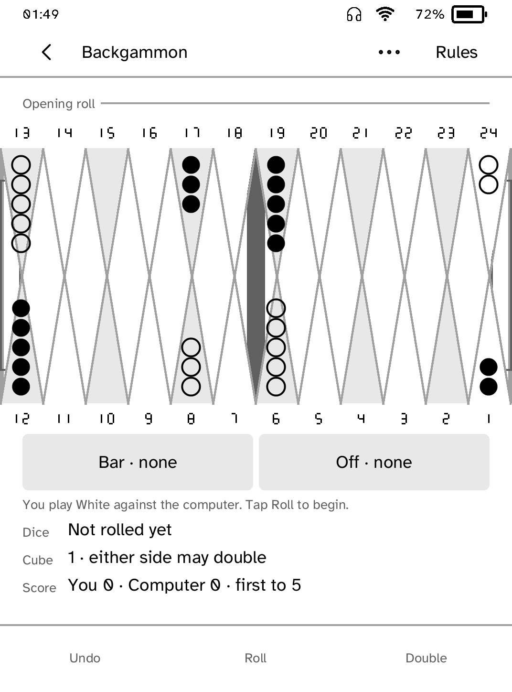
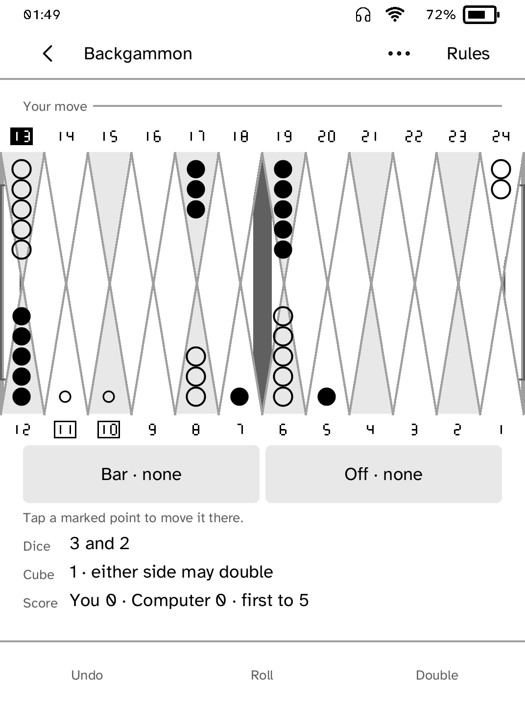
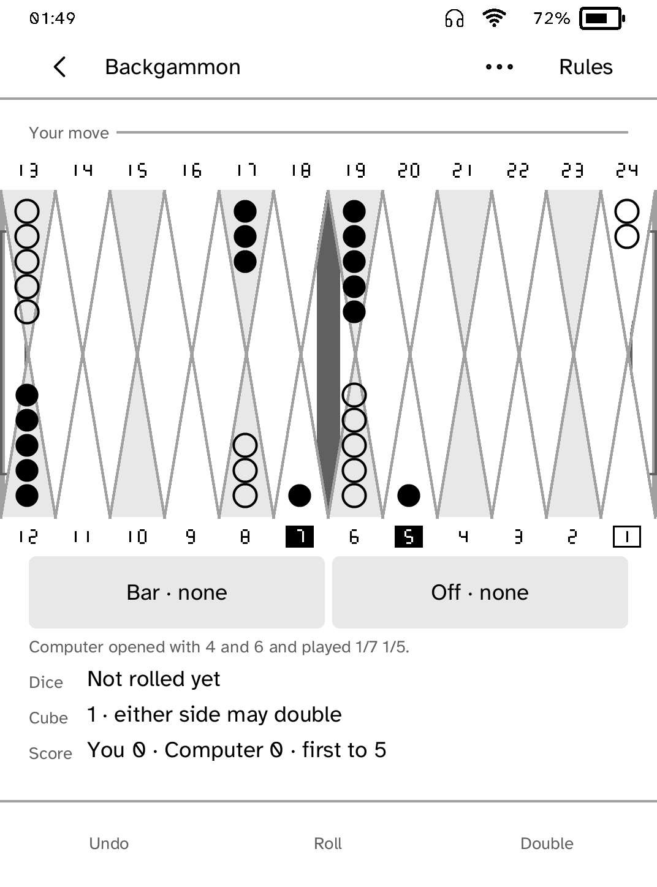

# Backgammon

Solo or pass-and-play backgammon on one Kobo, with full match rules.

<table>
<tr>
<td width="50%" valign="top"><br>The opening board</td>
<td width="50%" valign="top"><br>A checker in hand, with the points it can reach marked</td>
</tr>
<tr>
<td width="50%" valign="top"><br>The computer's opening move, marked on the board and said in words</td>
</tr>
</table>

## Features

- A portrait 24-point board with the bar, dice and doubling cube.
- Full move rules: forced moves, maximum dice use, the higher-die rule, bar
  entry, blocks, hits, doubles, exact and oversize bear-offs, and automatic
  passes when no move is possible.
- Matches of 1, 3, 5 or 7 points, with gammons and backgammons. The doubling
  cube supports offer, take and drop, cube ownership and the Crawford rule.
  Beavers are not used.
- Play against a modest one-ply computer player, which rolls and moves as soon
  as your turn ends, or pass the reader between two players with the board
  turned towards whoever is moving.
- Match settings choose the players and the match length. Turn history keeps
  the last eight turns in board notation, such as "You 8/5 6/5" or "bar/20".
- Every action is saved. A move can be undone until the turn ends.

## Playing

Tap **Roll**, then tap one of your checkers on the board to pick it up, and
tap a marked point (or **Off**) to move it there. Tap the checker again to put
it back. A checker on the bar comes in first: tap **Bar**, then a marked point.

The numbers beside the points carry the marks: a boxed number is a point you
can tap now, and a solid one is the checker in hand. Between turns they show
the last turn, boxed where its checkers left and solid where they landed, and
the line under the board says it in words, such as "Computer rolled 6 and 4
and played 1/7 1/5." The board keeps its size and place for the whole game.

**Rules** is in the top bar. The menu beside it starts with **New game**, which
asks first when a match is under way, then Match settings and Turn history.
**Undo**, **Roll** and **Double** sit at the foot of the board.

## Dice

Dice come from the operating system's entropy source. If that source cannot
be opened, the board says so and does not roll. For tests and screenshots,
`KOBO_BACKGAMMON_SEED` fixes the sequence, and Match settings show that a seed
is in use.

## Permissions

None. Backgammon runs offline.

## Development

```sh
cargo test -p kobo-backgammon
python3 scripts/check-apps-sim.py backgammon
```

The simulator check builds the app, opens it in a fresh simulator and plays
`drive.kobo`: the rules, the computer's opening, picking up and moving a
checker, a wrong tap, Undo, a refused save, the menu and New game.
`scripts/quality/check-backgammon-sim.py --output DIR` plays seeded turns
against the computer and checks the match survives a restart.
