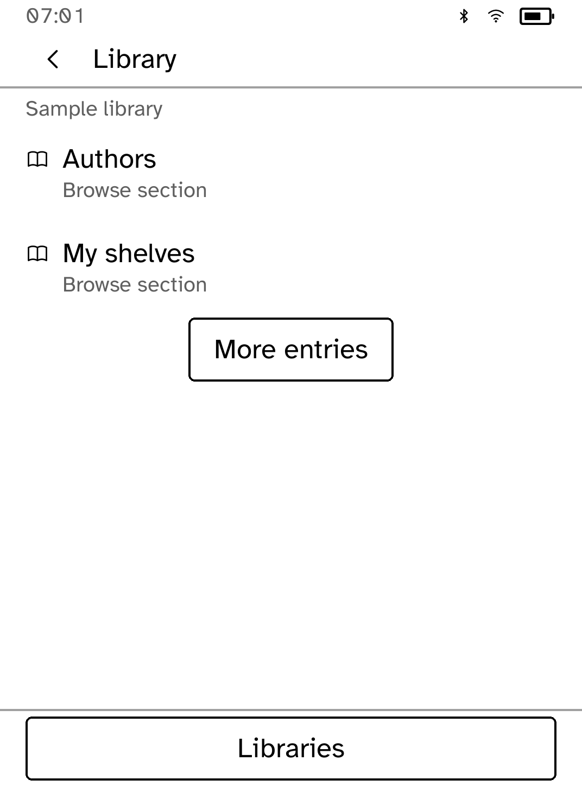
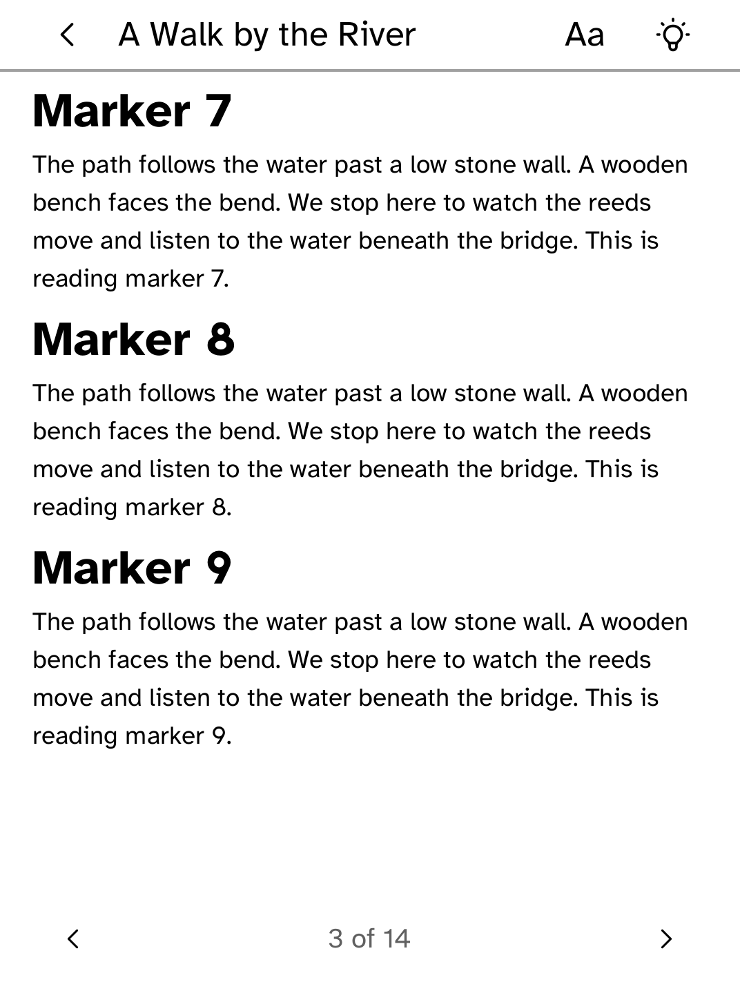
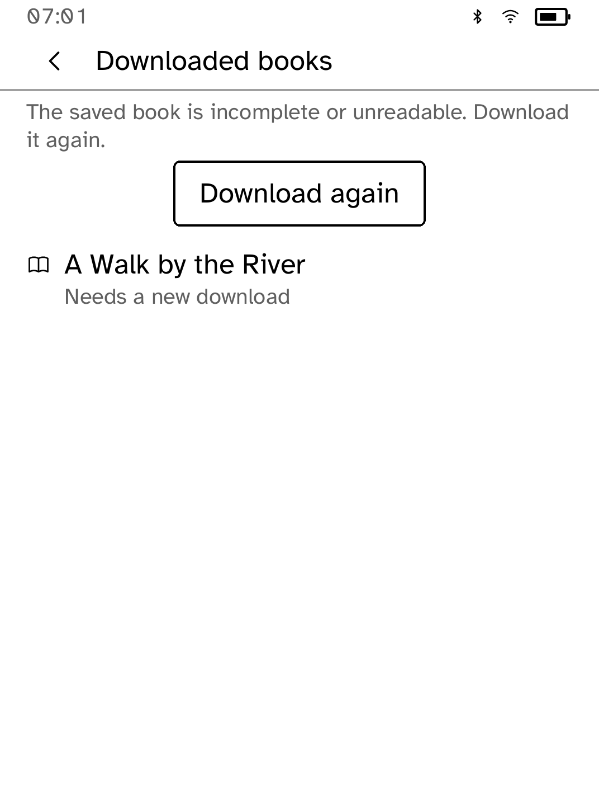

# Library

Browse an OPDS book catalog, such as calibre-web, and read downloaded books
offline.

<table>
<tr>
<td width="50%" valign="top"><br>Catalog sections</td>
<td width="50%" valign="top"><br>A private library</td>
</tr>
<tr>
<td width="50%" valign="top"><br>Reading a downloaded book</td>
<td width="50%" valign="top"><br>Replacing a damaged download</td>
</tr>
</table>

## Features

- Works with any OPDS server, including calibre-web and `calibre serve`.
- Browse the server's sections, authors and shelves. **Back** returns to the
  previous page at the same position.
- Download EPUB and plain-text books and read them offline, with page
  navigation, text size, bookmarks and saved position.
- **Downloaded books** opens without contacting the server.
- Downloads can be cancelled and restarted. Every file is checked before it
  opens, and a damaged file offers **Download again**.
- Up to 64 books of up to 16 MB each.

## Setup

1. Set up the reader once over USB, if you have not already: `kobo setup`.
2. Connect from your computer:

   ```sh
   kobo connect calibre-web
   ```

   It asks for the OPDS address, your username and password, checks them with
   the library, and sets Library up. Open Library, or tap **Check again**.

Or, on the reader, choose **Add library**, enter the HTTPS OPDS address (a
bare server address opens `/opds`), then **Sign in** or **Use public
library**. The password form counts the characters typed and has **Show**.

Your username and password are stored by the runtime for that server only,
used only to read from it, and never shown to the app.

For a private certificate authority, install its root with
`kobo trust set calibre --from ROOT.pem`, and pass the same file to
`kobo connect calibre-web --ca ROOT.pem`. For `calibre serve`, use Basic
authentication.

A failed request keeps the catalog on screen with a banner saying why. A
refused account offers **Sign in again**, and a library on your home network
that does not answer says the reader must be at home on the same Wi-Fi.

## Limits

Digest authentication and calibre-web's Kobo sync endpoint are not supported.

## Permissions

- `network`: reads the catalog and downloads books.

## Development

```sh
cargo test -p kobo-calibre-web
python3 scripts/check-apps-sim.py calibre-web
```

The simulator check builds the app, opens it in a fresh simulator and plays
`drive.kobo`. `scripts/quality/check-calibre-sim.py --output /tmp/calibre-check` runs a longer check against a local HTTPS test server using the catalog in `fixtures/`.

## Credits

Library is unofficial and not affiliated with or endorsed by the calibre-web
or calibre projects.
