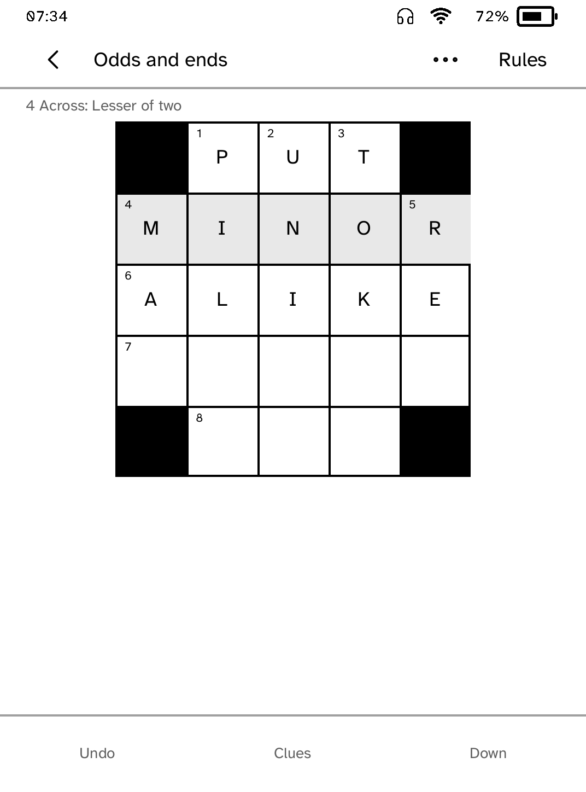
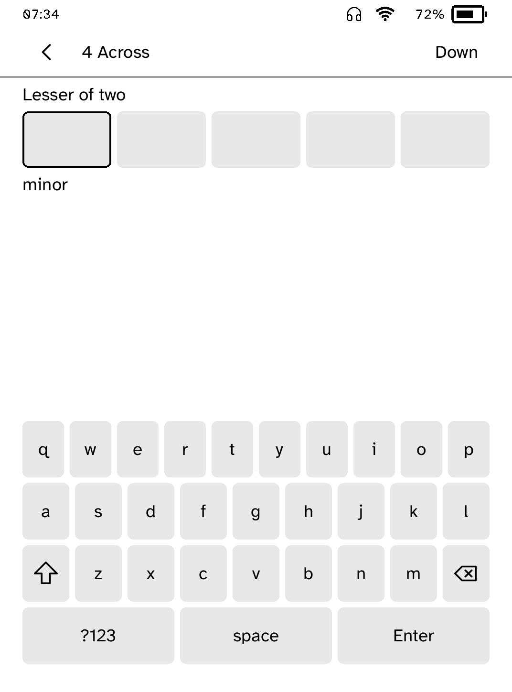
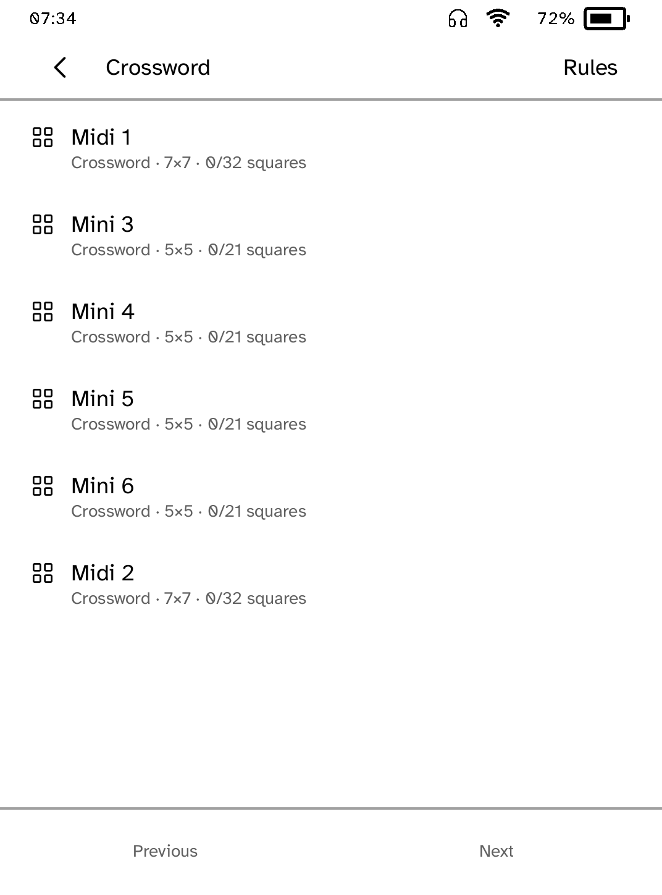
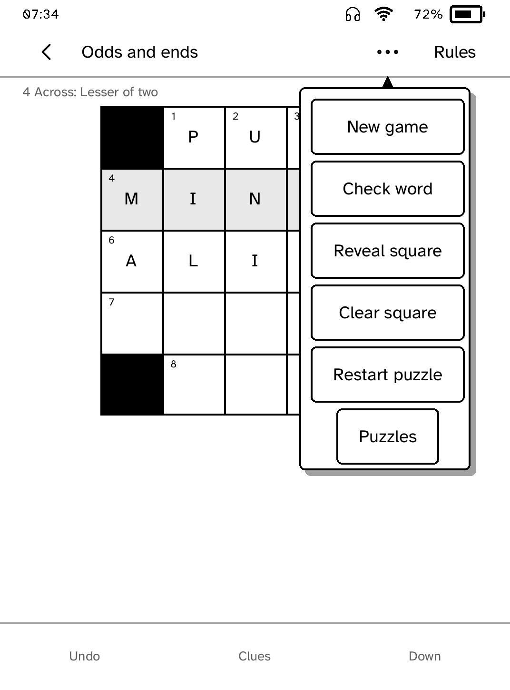
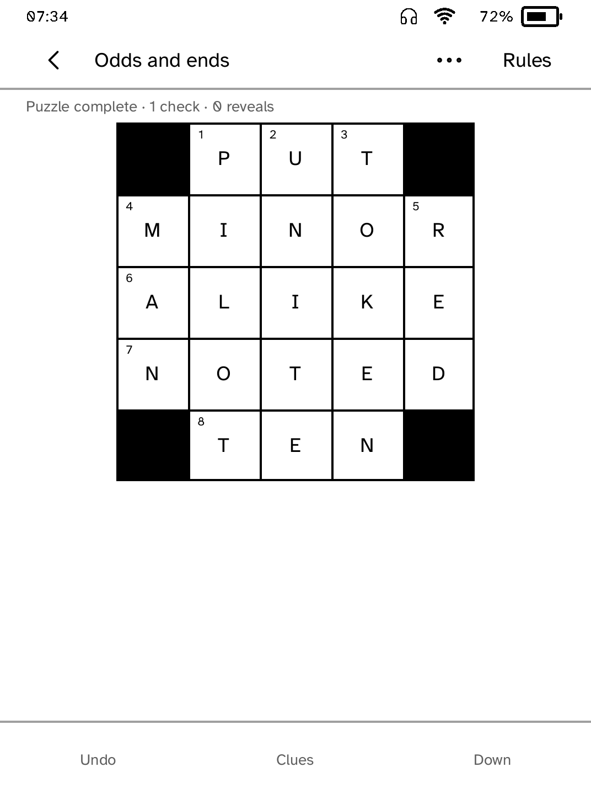
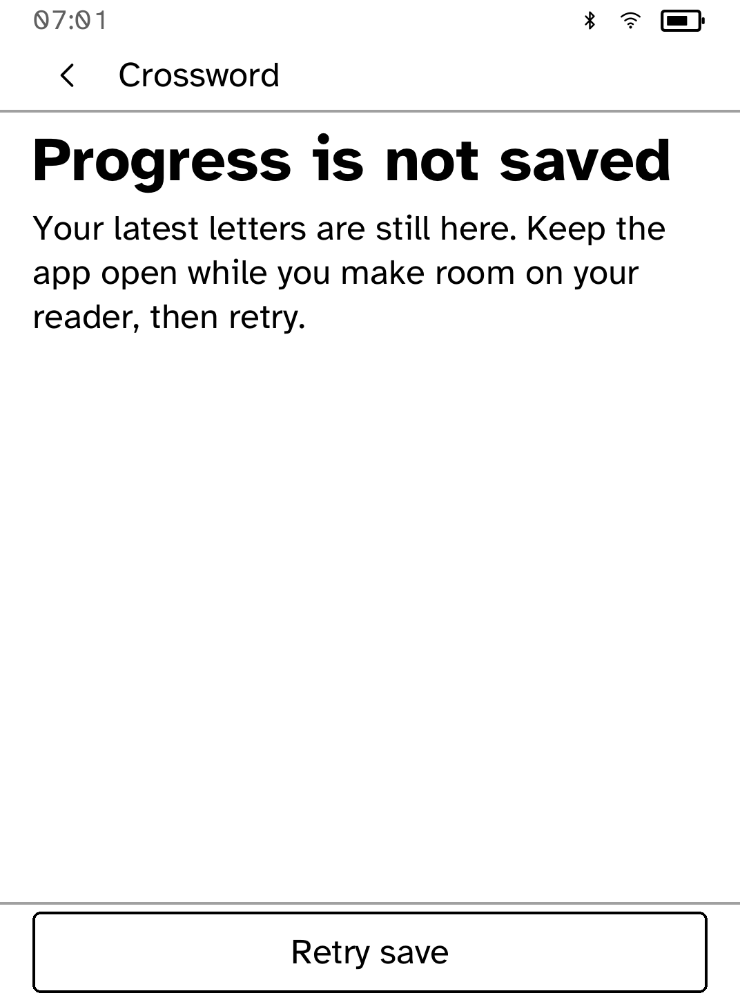

# Crossword

Sixty-one offline crosswords, each with its own saved progress.

<table>
<tr>
<td width="50%" valign="top"><br>A numbered grid with the active word shaded</td>
<td width="50%" valign="top"><br>Entering an answer below its clue</td>
</tr>
<tr>
<td width="50%" valign="top"><br>A 7 by 7 crossword</td>
<td width="50%" valign="top"><br>New game, checking and revealing under More</td>
</tr>
<tr>
<td width="50%" valign="top"><br>A completed puzzle</td>
<td width="50%" valign="top"><br>Retrying a save that failed</td>
</tr>
</table>

## Puzzles

- **Odds and ends**: a 5×5 crossword with black corners.
- Three word squares at Starter, Easy and Medium difficulty. Difficulty is an
  editorial guide, not a measured solving time.
- **Heart of the matter**: the earlier 5×5 word square, with its saved letters
  kept.
- **Mini 1 to 46**: 5×5 crosswords.
- **Midi 1 to 11**: 7×7 crosswords, one after every four minis.

No answer appears twice in a puzzle, and across the collection a five-letter
answer is used at most twice and a three-letter one at most three times. A few
squares at the ends of short rows belong to one word only. All clues were
written for Cobalt.

## Playing

Tap a square, or choose a clue from **Clues**. The active word is shaded and
its clue is above the grid. While you type, the full clue stays above the word
and keyboard. Type one letter to move through the word, or the whole word to
fill it from the first square. **Back** cancels text you have not entered.

The bar under the grid holds **Undo**, **Clues**, and **Across** or **Down**,
which turns the shaded word the other way; the same switch is at the top while
you type. **Rules** is in the top bar. **More** holds:

- **New game** opens the next puzzle you have not started. Every puzzle keeps
  its own letters, so nothing is lost.
- **Check word** marks wrong and empty letters in the active word without
  changing them.
- **Reveal square** fills one square, after confirmation.
- **Clear square** empties the selected square.
- **Restart puzzle** asks first. Reveal and Restart can both be undone.
- **Puzzles** opens the list at the page of the puzzle you were playing.

Each puzzle keeps up to 32 undo steps, its position and direction, and its
check and reveal counts, which show above the grid once it is solved. A puzzle
stays marked Completed once solved, even after a restart.

## Saving

Progress is marked saved only once storage confirms it. If storage is full,
keep the app open, free some space and choose **Retry saving**. Your latest
letters stay in memory, and the reader will not suspend until they are saved.
Saves that cannot be read are left untouched.

## Limits

`.puz` and `.ipuz` imports, rebuses and large Sunday grids are not supported.

## Permissions

None. Crossword runs offline.

## Development

```sh
cargo test -p kobo-crossword
python3 scripts/check-apps-sim.py crossword
```

The puzzles after the first four are generated. To change a clue or add
answers, edit `tools/crossword/words.tsv` and run
`python3 tools/crossword/generate.py`; it rewrites `src/puzzles.rs`, keeping
every existing grid and adding new ones after them. `--check` fails if the
file is out of date.

The simulator check builds the app, opens it in a fresh simulator and plays
`drive.kobo`. `scripts/quality/check-crossword-sim.py --output /tmp/crossword-check` also covers completion, reopening, undo, failed saves and both clue directions.
