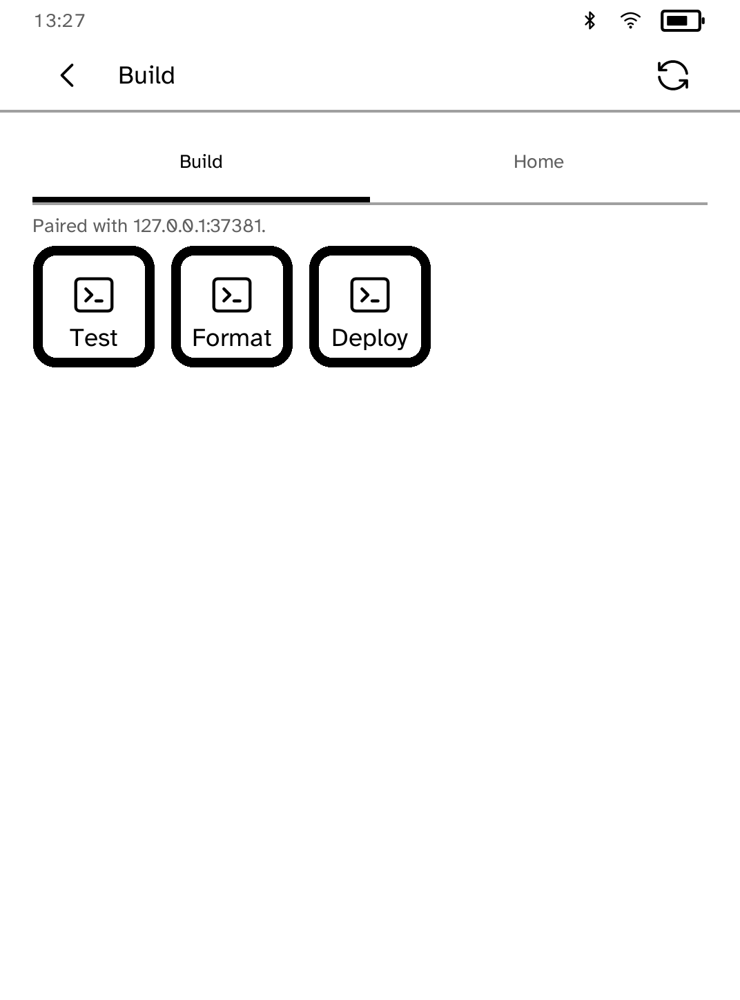
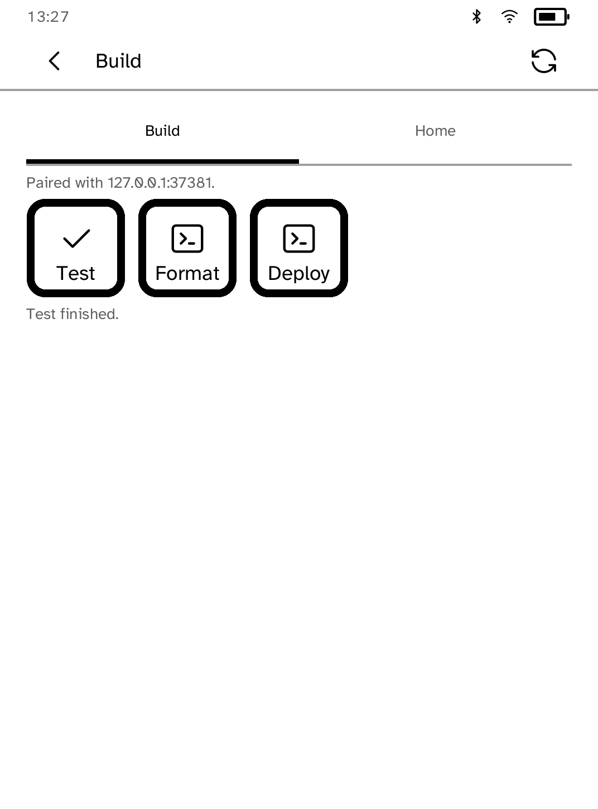
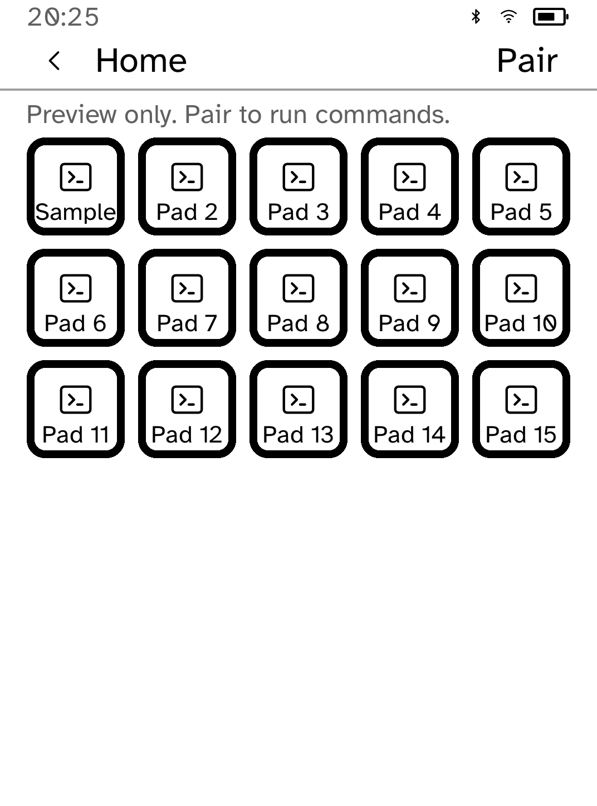

# Deck

Run commands, open apps and open links on your computer from your Kobo.

<table>
<tr>
<td width="50%" valign="top"><br>A Build page with Test, Format and Deploy</td>
<td width="50%" valign="top"><br>A command's result after it runs</td>
</tr>
<tr>
<td width="50%" valign="top"><br>A full page of fifteen pads</td>
</tr>
</table>

## Features

- Up to six pages of up to fifteen pads each.
- A pad can run a shell command, open an app or open a link on the paired
  computer.
- The top bar names the current page. A status line says which computer the
  deck is talking to and whether it answered.
- Unassigned pads are drawn faintly so they do not look like controls.
- After a command runs, Deck shows its result, whether it succeeded or not.
- If the computer stops answering, the last working layout stays on screen.

## Setup

Deck needs your computer. It uses the same helper and pairing as
[Sidekick](../../examples/sidekick/). On the computer:

1. Set up the reader once over USB, if you have not already:

   ```sh
   kobo setup
   ```

2. In your project folder, lay out your first pads:

   ```sh
   kobo deck init --preset build   # test, format, lint, build, status, pull, deploy
   ```

   The build pads run in the folder you ran this from. `--preset home` gives
   play, pause, next, volume, mute, a five-minute timer and a screen lock,
   using the Music app and `pmset` on macOS, or `playerctl`, `pactl`,
   `notify-send` and `loginctl` on Linux.

3. Pair this computer with the reader. There is nothing to type on the
   reader. The first time, close Cobalt and open it again afterwards so it
   trusts the computer.

   ```sh
   kobo sidekick init
   ```

4. Start the helper and leave it running, then open Deck.

   ```sh
   kobo sidekick run
   ```

Change pads at any time; a paired deck picks up each change by itself:

```sh
kobo deck set 1 --launch todo
kobo deck set 2 --url https://example.com
kobo deck set 3 --label Test --detail "cargo test" --run "cd ~/src/project && cargo test"
kobo deck ls
```

`--launch` opens an app with `open -a` on macOS or `gtk-launch` elsewhere.
`--url` uses `open` or `xdg-open`. `--run` runs a shell command from your home
directory, so start it with `cd` when it belongs to a project. Add
`--confirm` to ask before a pad runs, or `--no-confirm` to stop asking. New
pads do not ask.

If `kobo sidekick init` cannot reach the reader, it prints an address and a
six-character code. Enter them in Deck; the port is filled in if you leave it
off. **Pairing** in the top bar changes the pairing later, and Back returns to
the deck you had.

The layout lives in `~/.config/kobo/sidekick/deck.toml` and can be edited by
hand:

```toml
[[page]]
name = "Build"

[[page.key]]
label = "Test"
detail = "cargo test"
run = "cd ~/src/project && cargo test"
confirm = false

[[page.key]]
label = "Deploy"
run = "~/bin/deploy-staging.sh"
confirm = true
```

Saving the file refreshes a paired deck. If the file has an error, the deck
keeps the last working layout and shows the problem.

`kobo deck push --sim` shows a layout in an unpaired simulator as a preview
whose pads do not run anything. Choose **Pair** to connect it.

When something goes wrong, Deck says which thing: the reader is off Wi-Fi,
the computer is not answering, the computer refused the pairing code, or the
computer has no deck yet, each with its fix. A pad that has just run opens
its output, with **Run again** under it.

## Security

Deck lets the reader run commands on the paired computer, so:

- Every request uses Sidekick's TLS connection and pairing code.
- Commands come only from `deck.toml`, which the reader cannot change.
- Commands run as your user, from your home directory. Use `confirm = true`
  for anything destructive or visible to others.
- At most four commands run at once. Each is stopped after ten minutes, and
  only the last 2 KB of output is kept.

## Permissions

- `network`: talks to the paired computer.

## Development

```sh
cargo test -p kobo-deck
python3 scripts/check-apps-sim.py deck
```

The simulator check builds the app, opens it in a fresh simulator and plays
`drive.kobo`.
