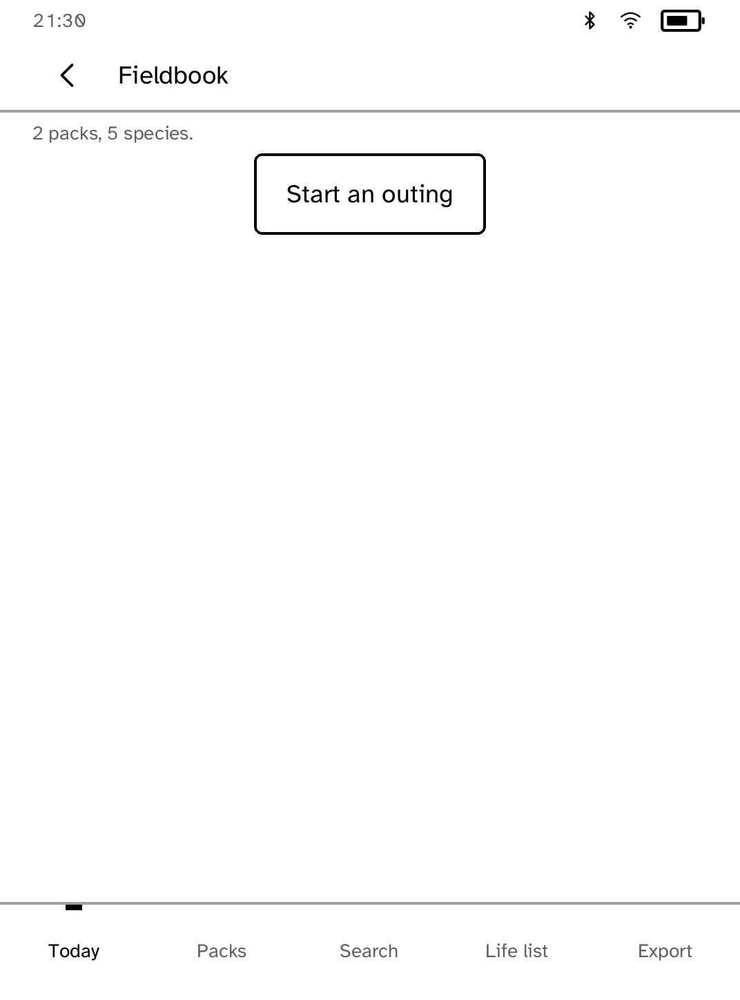
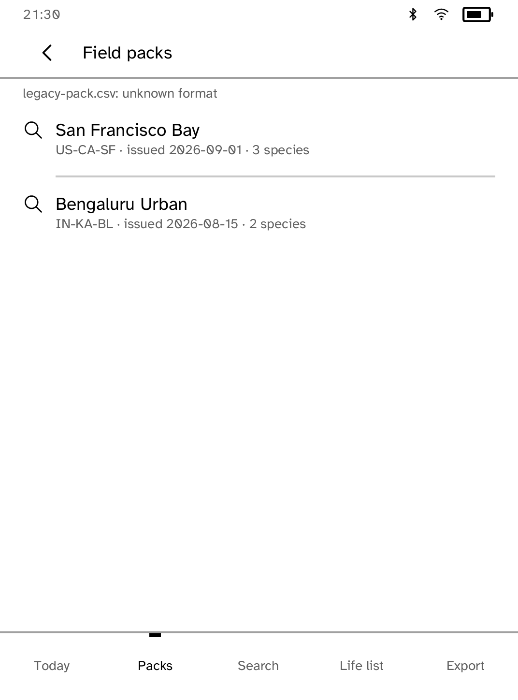
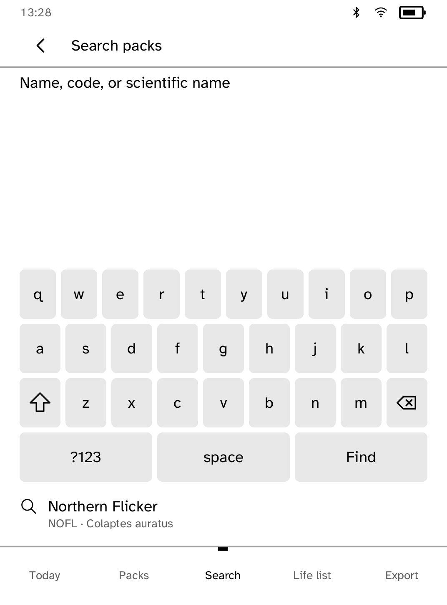
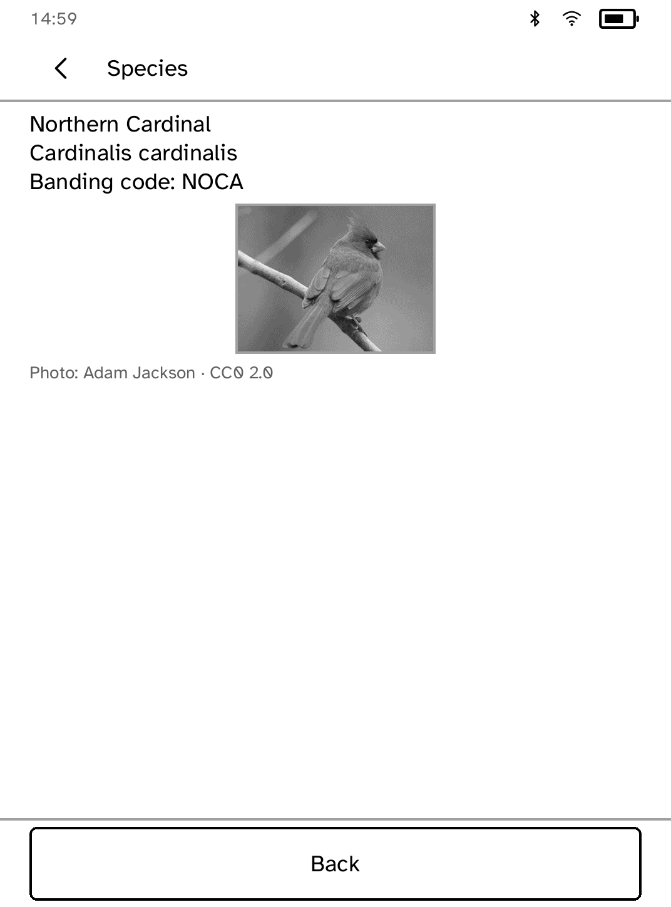
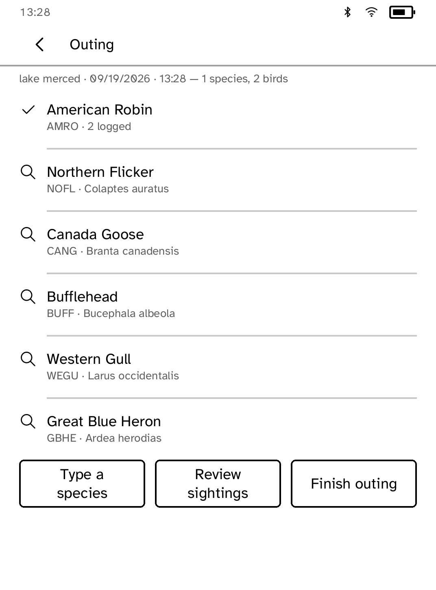
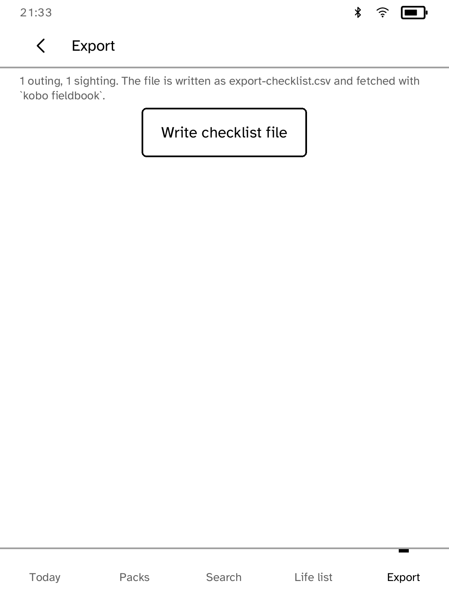

# Fieldbook

Log bird sightings offline and keep a life list on your Kobo.

<table>
<tr>
<td width="50%" valign="top"><br>Today, with recent outings</td>
<td width="50%" valign="top"><br>Field packs on the reader</td>
</tr>
<tr>
<td width="50%" valign="top"><br>Searching a pack</td>
<td width="50%" valign="top"><br>A species with its licensed photo</td>
</tr>
<tr>
<td width="50%" valign="top"><br>Tallying during an outing</td>
<td width="50%" valign="top"><br>Exporting a checklist</td>
</tr>
</table>

## Features

- Look up species by common name, scientific name or banding code from a field
  pack.
- Log a sighting with one tap during an outing, for every species in your
  packs, page by page. Species not in a pack can be typed by name.
- An outing stays open when the app closes or the reader restarts.
- Review an outing's log, remove entries and undo a removal.
- A life list of every species logged on the reader.
- Export finished outings as a CSV in eBird's Checklist Format.

## Setup

Set up the reader once over USB with `kobo setup`, if you have not already.

Field packs are regional species lists made on a computer and sent to the
reader. Make one from a CSV list of birds with Common Name and Scientific Name
columns:

- your own sightings: on ebird.org, My eBird, Download My Data;
- a region's species list saved as CSV, or a sheet you type yourself;
- the eBird/Clements taxonomy CSV, which keeps its own species codes.

Birds without a code get a four-letter one made from the name.

```sh
kobo fieldbook new MyEBirdData.csv --title "Local birds" --out pack.json
kobo fieldbook inspect pack.json                     # check a pack
kobo fieldbook photos pack.json --out PACK_DIR       # add licensed species photos
kobo fieldbook push pack.json                        # send it to the reader
kobo fieldbook ls                                    # list packs on the reader
kobo fieldbook export --out FILE.csv                 # fetch the checklist CSV
```

Each push adds its packs to the ones on the reader and prints what is there; a
pack with the same id replaces the old one. `--replace` leaves only the packs
you send. Fieldbook shows them the next time it opens or the reader wakes. Use
`--sim` to work with the simulator. Pack files are limited to 512 KiB.

Packs are stored on the reader, so logging works without a connection. A pack
that fails to import is listed with the reason.

## Logging an outing

1. **Start an outing** and enter a place name. The date and start time come
   from the reader's clock.
2. Tap a species to add it to the tally. Turn the page for more species, or
   tap **Type a species** to search.
3. **Review sightings** lists the log. Tap an entry to remove it, or
   **Undo delete** to restore it.
4. **Finish outing** files it under Today.

**Write checklist file** prepares the CSV, with one column per outing. The
file follows eBird's published format. Importing it into eBird has not been
tested.

## Permissions

None. Fieldbook runs offline.

## Development

```sh
cargo test -p kobo-fieldbook
python3 scripts/check-apps-sim.py fieldbook
```

The simulator check builds the app, opens it in a fresh simulator and plays
`drive.kobo`.

## Credits

Species photos come from Avicommons and are included only when their licence
allows redistribution. Each pack carries attribution for its photos, and the
detail screen shows the credit. The photo above is a Northern Cardinal by Adam
Jackson (CC0), via Avicommons.

eBird and the Cornell Lab of Ornithology are trademarks of their owners.
Fieldbook is an unofficial companion.
