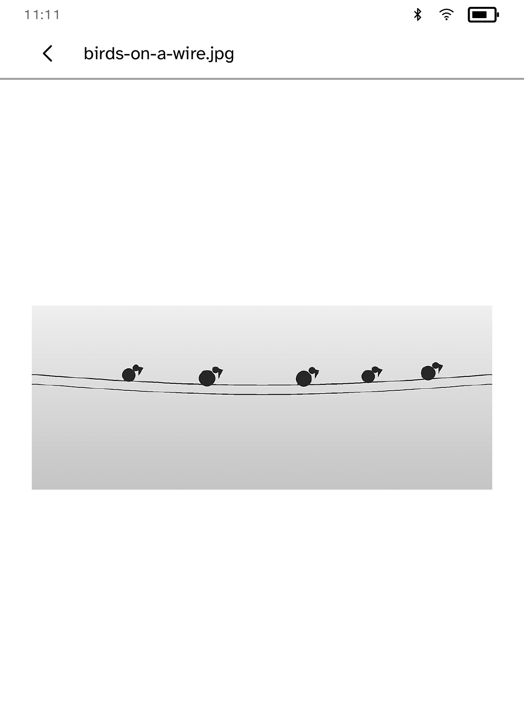
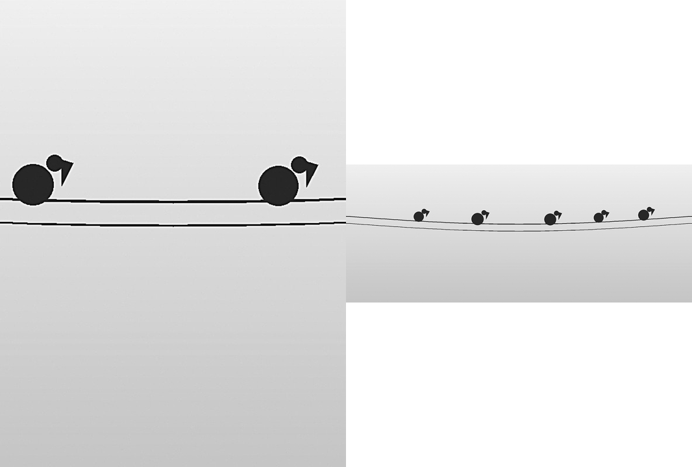

# Frame

Turn a Kobo into a low-power black-and-white photo frame.

<table>
<tr>
<td width="50%" valign="top"><br>A photo filling the screen</td>
<td width="50%" valign="top"><br>Comparing crop and pad on the computer</td>
</tr>
</table>

## Features

- Two modes:
  - **Frame mode** changes photo every 5, 15 or 60 minutes while Frame is
    open.
  - **Slow slideshow** wakes the reader every 1, 6 or 24 hours to change the
    photo, and lets it sleep in between.
- Shuffle or date order. Choose the mode, the interval and the order from
  **Settings** in the top bar. Settings and the current position are
  remembered.
- Tap either side to move between photos. Tap the centre for the photo's file,
  album, date and transfer state.
- New photos appear on their own: Frame looks at its shelf again whenever it
  changes photo, wakes, or you come back to it.
- Every photo is checked against the digest recorded when it was sent.
  Changed or damaged photos are skipped and listed on the home screen.
- Each photo change uses a full-quality screen refresh.

Frame does not replace the Kobo's own sleep screen.

## Setup

1. Set up the reader once over USB, if you have not already: `kobo setup`.
2. Send photos:

```sh
kobo frame push ~/Pictures/family
kobo frame push portrait.jpg --fit pad
kobo frame ls
kobo frame rm photo-0123456789abcdef
```

Commands use the reader `kobo setup` saved. Add `--device IP` for another
reader, or `--sim` to try a command on the simulator.

- JPEG, PNG, GIF and WebP are accepted, and camera orientation is applied.
- Photos are cropped to fill the screen by default. `--fit pad` keeps the
  whole photo with white borders.
- Each push adds to the frame. `--album NAME` names the album; otherwise the
  folder name is used. Photos already on the reader are not sent again.
- `--replace` makes the frame hold only this push, and removes every other
  photo.
- A push ends by listing what is now on the reader, album by album.

### Preview and plan

```sh
kobo frame preview ~/Pictures/family --out ./frame-preview
kobo frame plan ~/Pictures/family --album "Summer holiday"
```

`preview` writes an `index.html` comparing crop and pad for each photo, for
the Clara BW or another reader with `--profile`. `plan` lists what a push
would add, keep and remove without changing anything. Run it with `--replace`
before a replacement.

### Undo

```sh
kobo frame restore
```

Before any change to a non-empty album, Frame saves a copy of it. `restore`
brings back the album as it was before the last push or removal. It keeps one
step of history, not an archive, and needs up to 300 MB of free space.
Keep your originals on your computer.

A push reports `Frame transfer verified` only after reading the album back
from the reader and checking every photo.

## Limits

- Up to 500 photos and 150 MB of prepared images.
- Source files up to 32 MB and 50 million pixels.
- HEIC and HEIF are not supported. Convert them to JPEG first.
- Photos are shown in greyscale.
- Cobalt cannot yet keep a reader awake for Frame mode or wake it for the
  slow slideshow, and Frame says so in **Settings**. Until it can, keep the
  reader on its charger in Frame mode: a charging reader does not go back to
  the Kobo home screen when left alone.

## Permissions

- `keep-awake`: keeps the screen on in Frame mode.
- `scheduled-wake`: wakes the reader to change photos in Slow slideshow.

## Development

```sh
cargo test -p kobo-frame
python3 scripts/check-apps-sim.py frame
```

The simulator check builds the app, opens it in a fresh simulator and plays
`drive.kobo`.

## Credits

Images are prepared and decoded with the `image` crate (MIT or Apache-2.0).
The sample photograph is [Blue Marble](https://svs.gsfc.nasa.gov/30613) by the
NASA Johnson Space Center Earth Science and Remote Sensing Unit.
