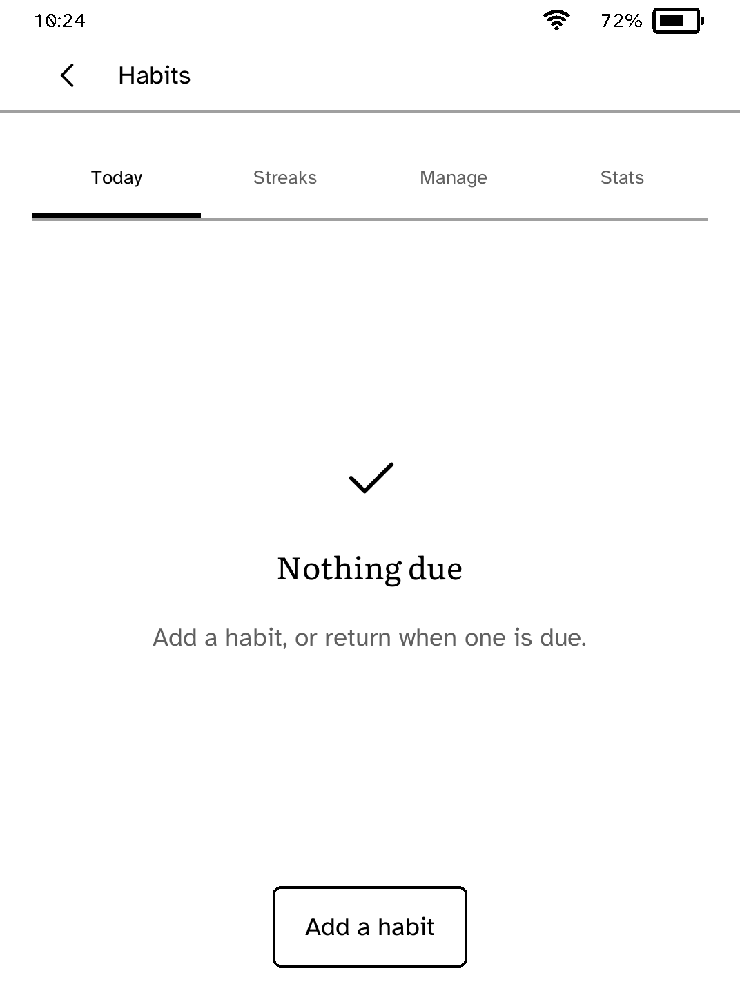
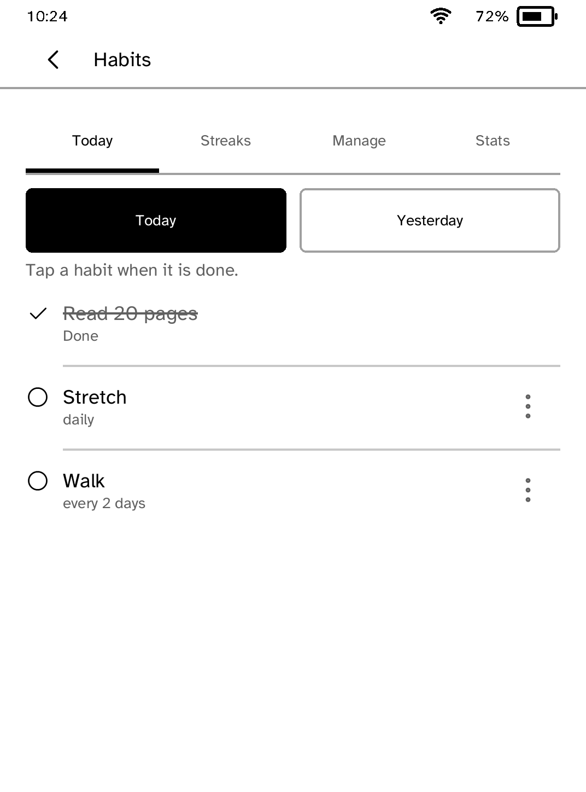
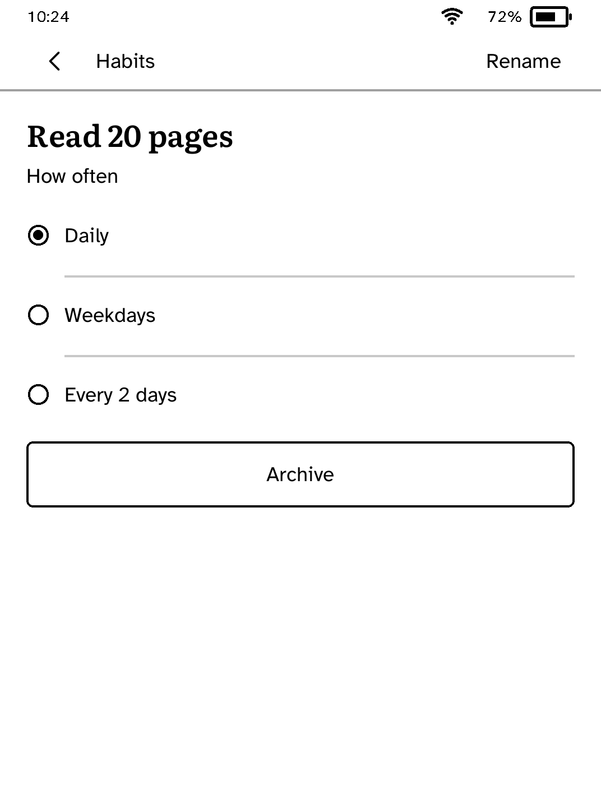
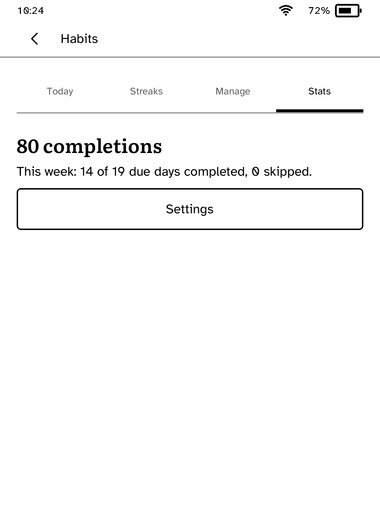
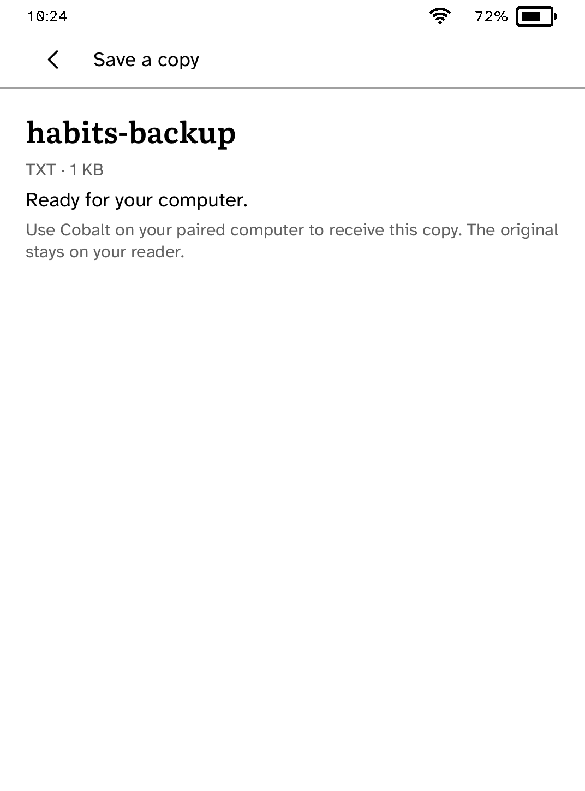

# Habits

An offline habit tracker with daily and weekday schedules and streaks.

<table>
<tr>
<td width="50%" valign="top"><br>Today, before any habits are added</td>
<td width="50%" valign="top"><br>A habit checked off for the day</td>
</tr>
<tr>
<td width="50%" valign="top"><br>Editing a habit's name and schedule</td>
<td width="50%" valign="top"><br>This week's completions on Stats</td>
</tr>
<tr>
<td width="50%" valign="top"><br>A backup ready for a paired computer</td>
</tr>
</table>

## Features

- Daily and weekday habits, with streaks and weekly statistics.
- Days turn over at the reader's own midnight. **Yesterday** on the Today
  tab marks or skips a habit for the day before, so one done late at night
  or forgotten until morning still counts.
- A habit's menu on Today skips it for the day. A missed day breaks a streak;
  a skipped day keeps it.
- Habits and completions stay on the reader. There is no account and nothing
  is uploaded.
- **Settings**, at the foot of the Stats tab, holds the backup. **Export a
  backup** exports a verified text copy for a paired computer.
- **Import a backup** reads a backup from the shelf. **Replace habits on this
  reader** removes the habits here first. **Merge with habits on this reader**
  keeps them and adds days from the backup when a habit's name matches.
  Nothing changes until you confirm.

## Permissions

None. Habits runs offline.

## Development

```sh
cargo test -p kobo-habits
python3 scripts/check-apps-sim.py habits
```

The simulator check builds the app, opens it in a fresh simulator and plays
`drive.kobo`. The screenshots above come from `scripts/quality/check-habits-sim.py`.
