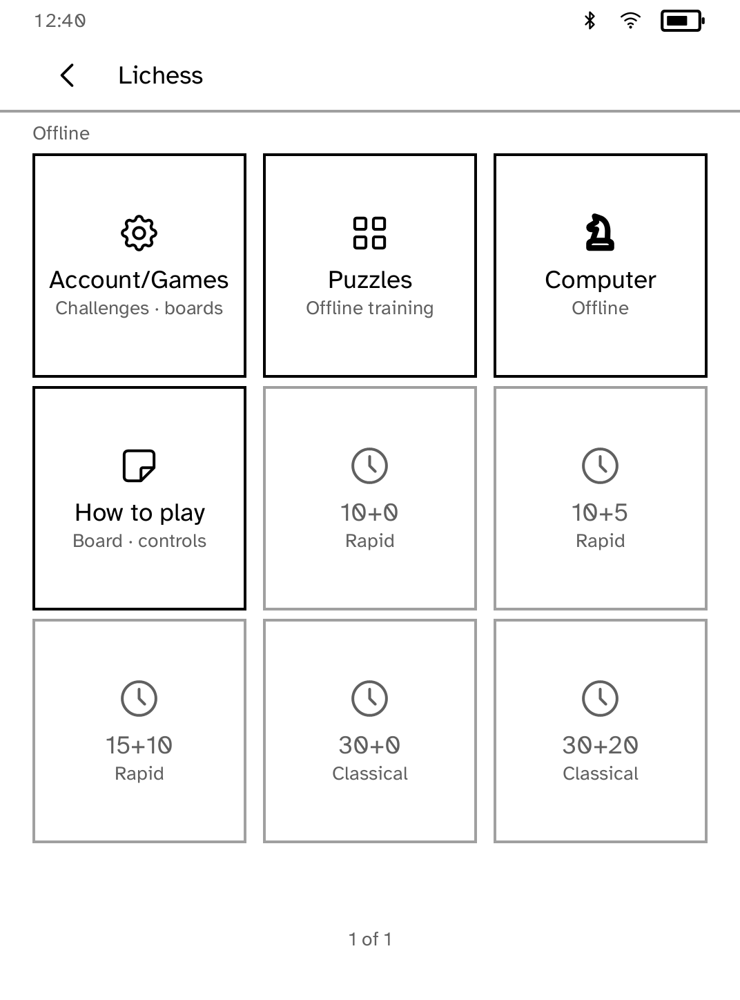
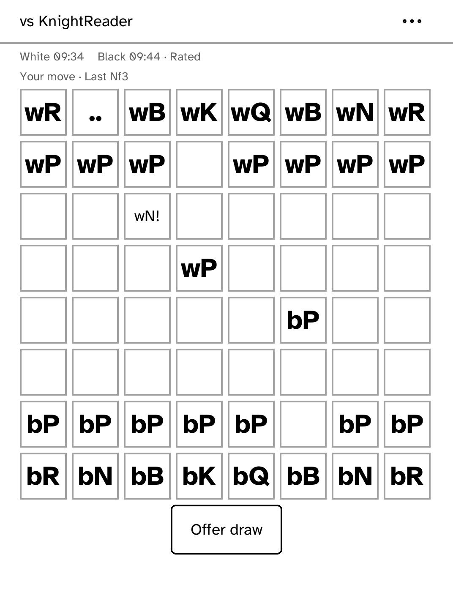
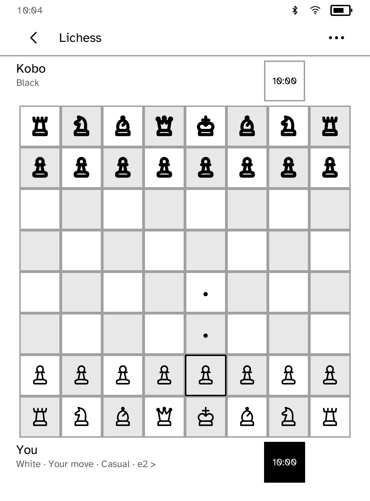
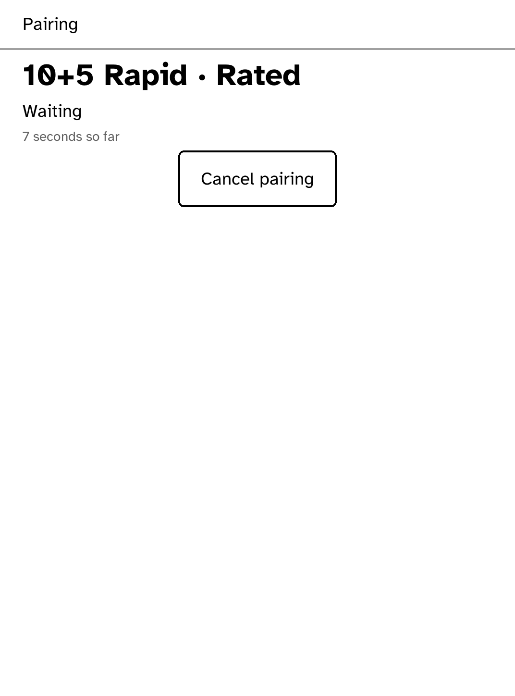
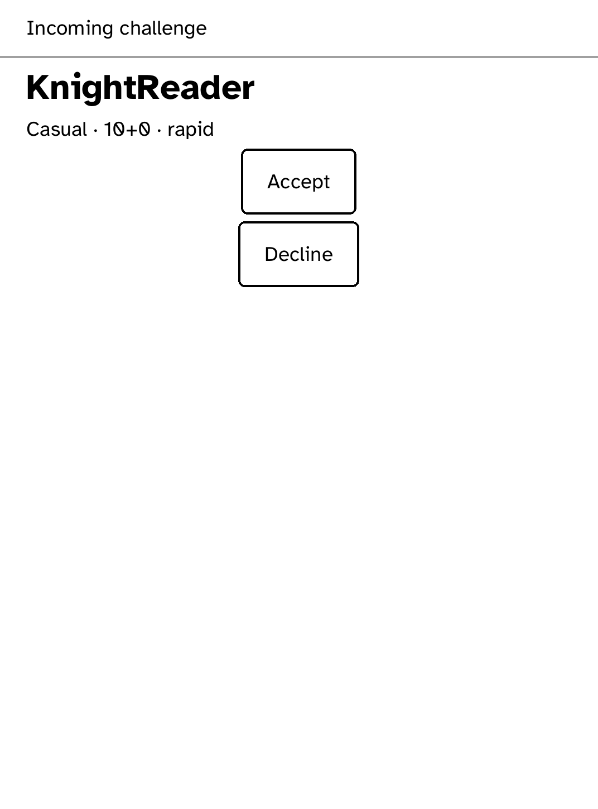
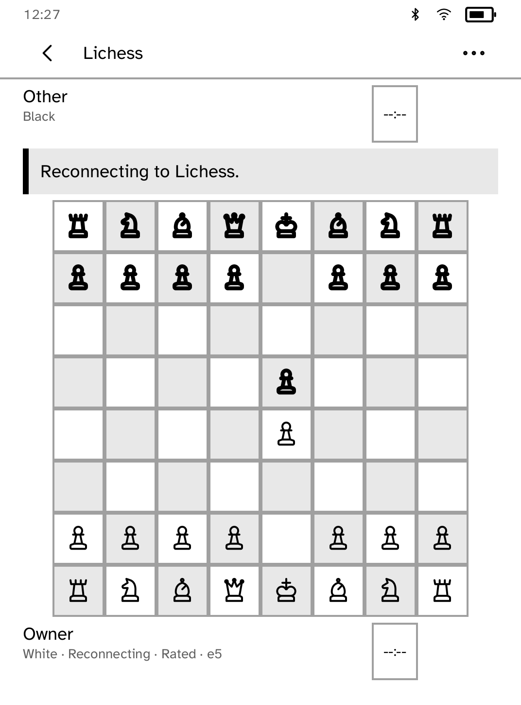

# Lichess

Play [Lichess](https://lichess.org/) on your Kobo, or play the computer
offline.

<table>
<tr>
<td width="50%" valign="top"><br>Time controls and puzzles</td>
<td width="50%" valign="top"><br>A live game</td>
</tr>
<tr>
<td width="50%" valign="top"><br>Offline play, with legal moves marked</td>
<td width="50%" valign="top"><br>Looking for a rated opponent</td>
</tr>
<tr>
<td width="50%" valign="top"><br>An incoming challenge</td>
<td width="50%" valign="top"><br>Reconnecting after the connection drops</td>
</tr>
</table>

## Features

- Rated or casual games with a random colour at 10+0, 10+5, 15+10, 30+0 and
  30+20. Choose rated or casual in **Account/Games**; each time tile says
  which it seeks.
- Casual challenges to a player by username, with time control and side.
- Accept or decline incoming challenges with standard clocks.
- Offline play against the computer, with no account needed. Play White,
  Black or a random side, with no clock or a 10 or 30 minute clock. An
  unfinished game resumes from the home screen.
- Offline puzzles. Solving them does not affect your Lichess rating.
- Two-tap moves, castling, en passant and promotion. The board turns to your
  side.
- The last move is outlined on the board. A move you send is outlined too,
  with "Move sent" in the status line, until Lichess confirms it.
- Clocks above and below the board. The filled clock shows whose turn it is.
- A time tile always answers a tap. If a game cannot start yet, it says why,
  or opens Account/Games when the account needs connecting.
- Offer, accept and decline draws, resign, claim victory when the opponent
  leaves, and abort before both players have moved.
- If a game starts without the reader being told, the app finds it within ten
  seconds. A seek is never sent twice.
- If the connection drops, the last confirmed position stays on screen, clocks
  show `--:--`, and moves are paused until the board reconnects.
- After a restart, **Resume current** reopens the game from Lichess without
  guessing the position.

## Setup

Computer games and puzzles need no account. To play people:

1. Create a Lichess
   [personal access token](https://lichess.org/account/oauth/token/create?scopes[]=board:play&description=Cobalt)
   with only the `board:play` scope.
   A phone works.
2. On the reader, open Lichess, tap **Account/Games**, then
   **Connect Lichess**, and type the token.

Or install it from a computer with the
[`kobo` command](../../docs/INSTALL.md#1-install-the-kobo-command). Set up the
reader once over USB, if you have not already, then save the token in a
private file and install it under the secret name `lichess`:

```sh
kobo setup
kobo secret set lichess --from token.txt
```

The runtime keeps the token and attaches it only to the official Lichess Board
API over HTTPS. A token typed on the reader passes through the app once, on its
way to the runtime. After that the app cannot read it, and it is never shown or
logged.

Cobalt 0.3.18 or newer is required. Typing the token on the reader needs a
newer Cobalt, and the app says so if yours is too old.

## Limits

- No chat.
- No takebacks. A takeback made elsewhere reloads the game from Lichess.
- Outgoing challenges are casual. Only standard clocks are accepted.
- Casual time tiles and challenges to a player need a Cobalt newer than 0.3.30.
  On an older Cobalt the app says so, and Rated still works.
- Only lichess.org is supported, not other servers.
- The offline computer is modest: it searches four moves ahead. Its games
  are not saved when the app closes.

## Permissions

- `network`: talks to the Lichess Board API.
- `hold-wifi`: keeps Wi-Fi connected during a game.
- `keep-awake`: keeps the screen on during a game.

## Development

```sh
cargo test -p kobo-lichess
cargo test -p kobo-net --test lichess_stream_mock -- --test-threads=1
python3 scripts/check-apps-sim.py lichess
```

The stream test uses a local HTTPS mock with a test-only certificate and
never contacts Lichess. Longer simulator checks, each taking `--output DIR`:

| Script | Covers |
| --- | --- |
| `scripts/quality/check-lichess-computer-sim.py` | Offline play, resuming and resigning |
| `scripts/quality/check-lichess-session-sim.py` | Pairing, moves, restart and draws against a local server. Add `--drop-start-event` or `--disconnect-board` for recovery cases, and `--scale 170` for large text |
| `scripts/quality/check-lichess-pairing-sim.py` | Pairing screens. Add `--scenario pairing-error` for failures |

## Credits

This is an unofficial client, not affiliated with Lichess.
