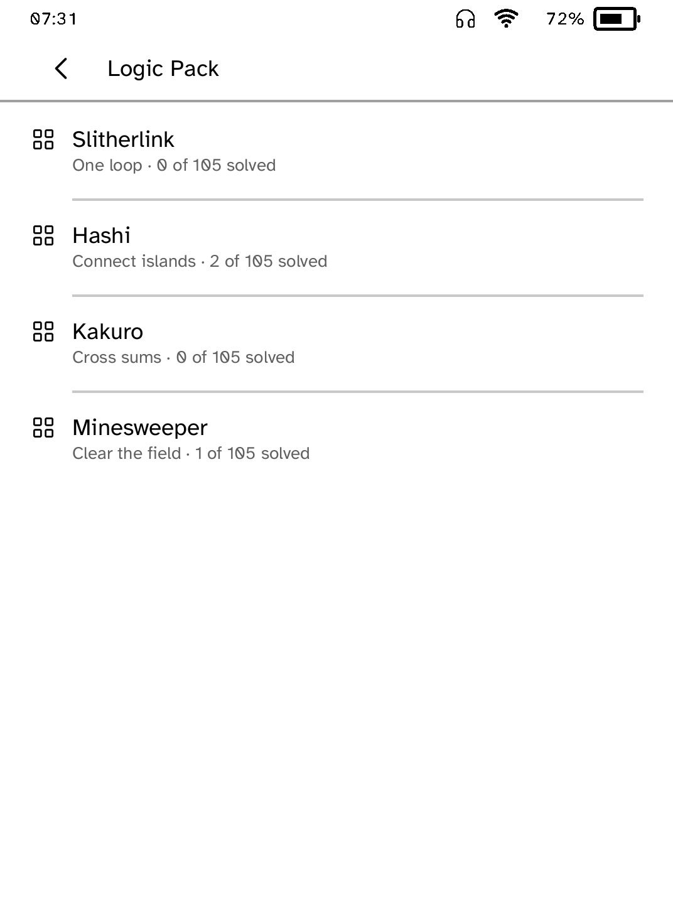
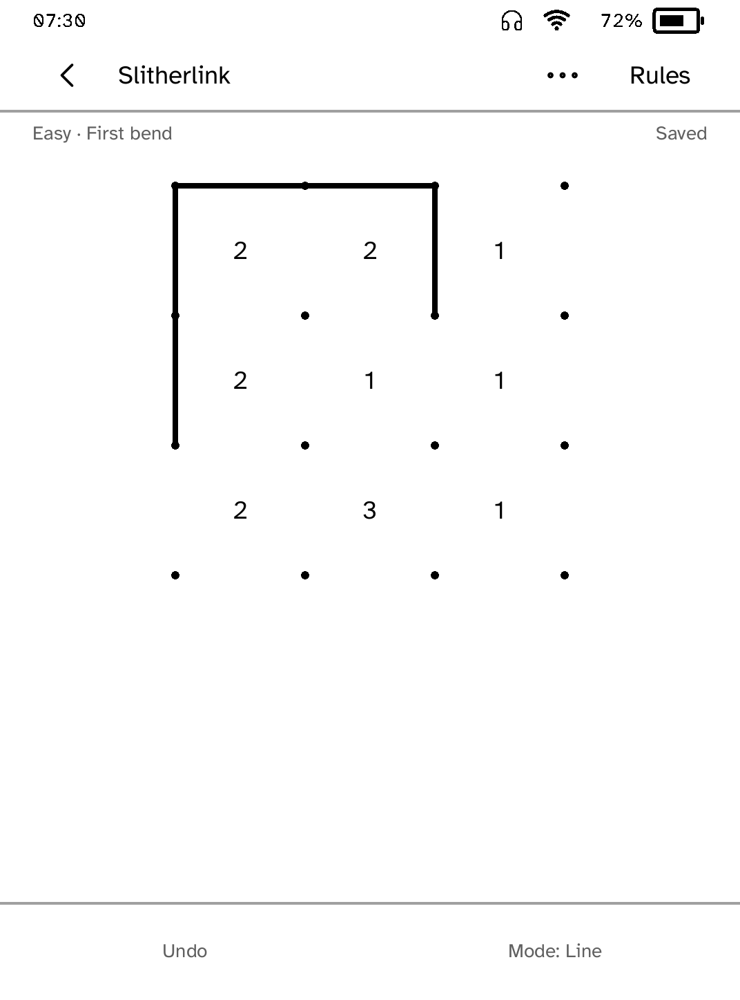
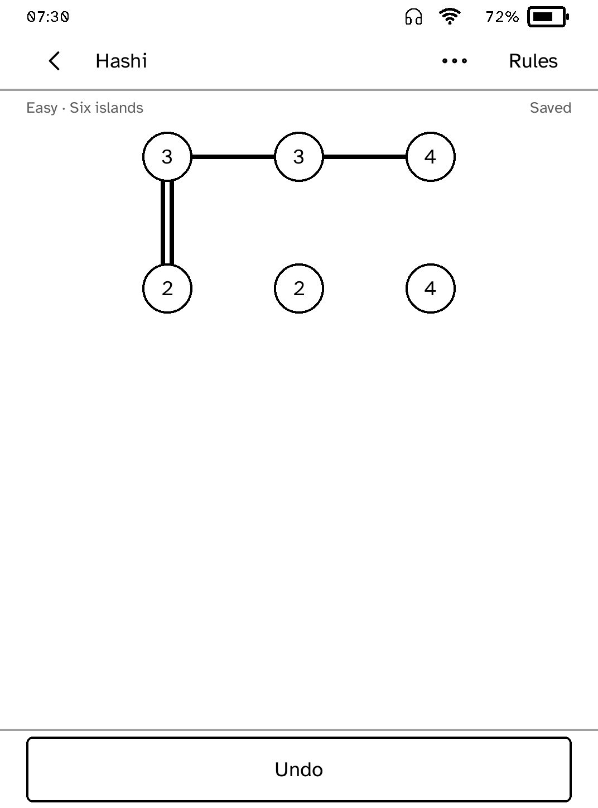
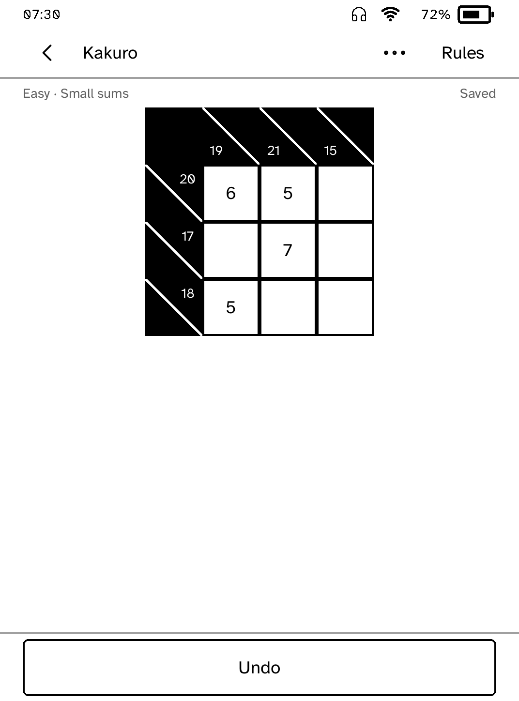
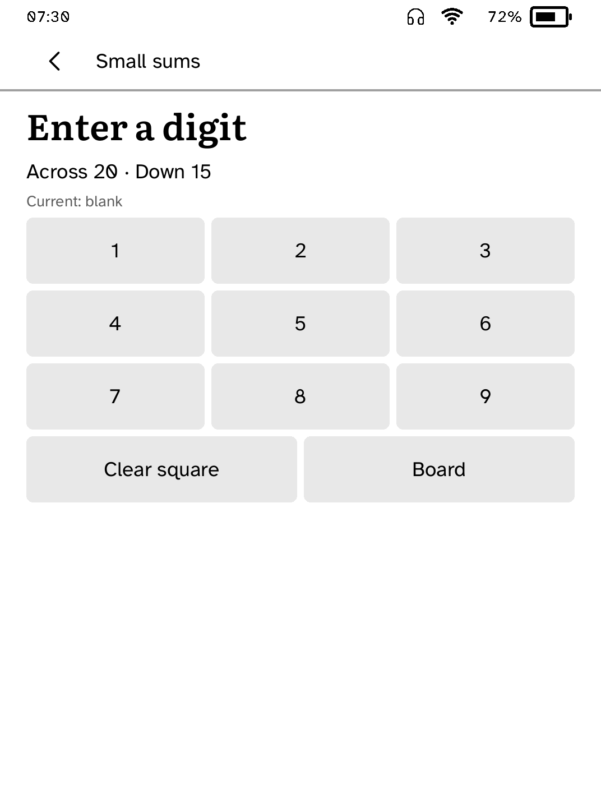
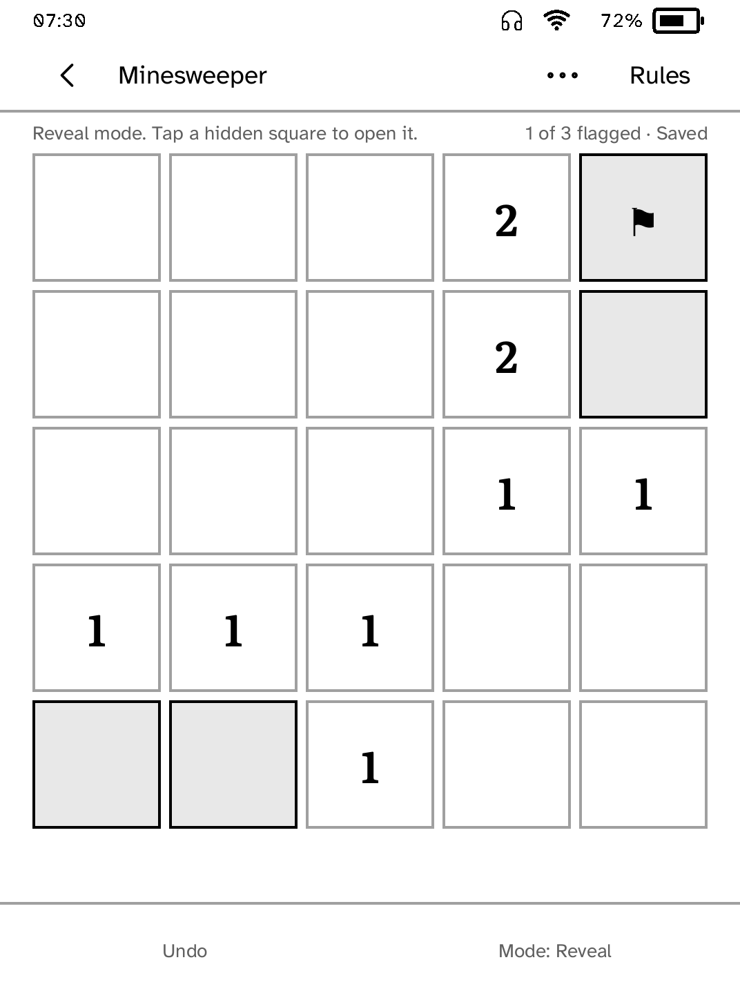

# Logic Pack

Four hundred and twenty offline puzzles: 105 each of Slitherlink, Hashi, Kakuro
and Minesweeper.

<table>
<tr>
<td width="50%" valign="top"><br>The four games, with how many of each are solved</td>
<td width="50%" valign="top"><br>Slitherlink</td>
</tr>
<tr>
<td width="50%" valign="top"><br>Hashi, with single and double bridges</td>
<td width="50%" valign="top"><br>Kakuro</td>
</tr>
<tr>
<td width="50%" valign="top"><br>Entering a Kakuro digit, with both sums shown</td>
<td width="50%" valign="top"><br>Minesweeper, with untouched squares shaded</td>
</tr>
</table>

## Puzzles

- **Slitherlink**: 2 × 2 to 4 × 4 loops, from every clue shown to a handful.
- **Hashi**: four to twenty-two islands, with single and double bridges.
- **Kakuro**: from three blanks to twenty-seven.
- **Minesweeper**: 4 × 4 to 8 × 8. Each new field opens with a safe patch
  cleared and never needs a guess. The five original fields keep a safe first
  reveal instead, and some of them need a guess.

Each game has Starter, Easy, Medium and Hard puzzles. A grade comes from the
hardest step a puzzle needs: Easy needs one clue at a time, Medium needs the
game's own rule (one loop, every island connected, where a sum's digits must
go, or two numbers read together), and Hard needs trying a move and following
it through. **Rules**, then **Difficulty**, shows the open puzzle's guide.

## Playing

Every game keeps its controls in the same places: **Rules** and the menu at
the top, **Undo** first at the foot. The menu starts with **New game**, which
opens the next puzzle of the same kind you have not solved, then **Restart
puzzle** and **Puzzles**. Slitherlink and Minesweeper put their mode beside
Undo: Line or Cross, Reveal or Flag.

- The puzzle list shows one grade at a time and as many puzzles as fit the
  page, each marked solved or in progress.
- A puzzle tells you when it is solved, and when a finished-looking board
  breaks a rule, which rule it is.
- Each puzzle keeps its own progress and up to 32 undo steps, which survive
  reopening.
- In Kakuro, tapping a square opens a digit chooser that shows both sums.
- **Restart puzzle** asks first, leaves other puzzles alone and can be undone.
- Progress shows **Saving…** until storage confirms it. If a save fails, keep
  the app open and choose **Retry save**.

## How the puzzles are made

The first twenty puzzles are the original collection and stay first, because
saved games refer to them. The rest come from a generator with fixed seeds. A
complete search proves that every Slitherlink, Hashi and Kakuro puzzle has
exactly one solution, and a step-by-step solver confirms each grade and that
every new Minesweeper field clears from its opening without a guess. To
rebuild or verify the collection:

```sh
python3 apps/logicpack/tools/generate.py
python3 apps/logicpack/tools/generate.py --check
```

`cargo test -p kobo-logicpack` checks the shipped file again: one solution for
every loop, bridge and sum puzzle, and a guess-free clear for every new field.

## Permissions

None. Logic Pack runs offline.

## Development

```sh
cargo test -p kobo-logicpack
python3 scripts/check-apps-sim.py logicpack
```

The simulator check builds the app, opens it in a fresh simulator and plays
`drive.kobo`. `scripts/quality/check-logicpack-sim.py --output /tmp/logicpack-check`
also completes and reopens the original twenty puzzles and the first new one of
each kind, and checks saving, older saves and recovery.
