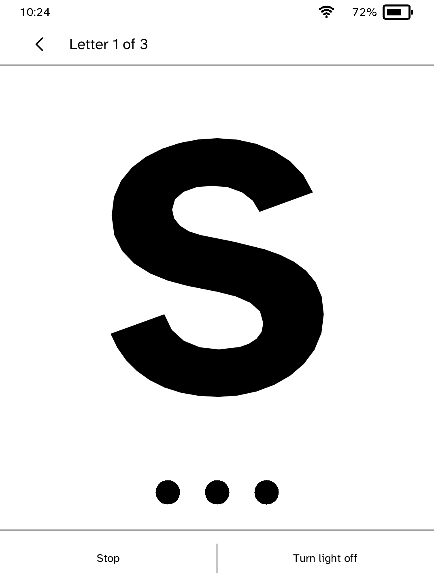

# Morse

Send a typed message in Morse code with the front light, one letter at a
time.

<table>
<tr>
<td width="50%" valign="top"><br>The letter S filling the screen while it is sent, with its dots and dashes under it</td>
</tr>
</table>

## Features

- The letter being sent fills the screen, so it can be read from across a
  room.
- The front light flashes at full brightness on each beat and goes dark
  between them.
- A message can be up to 30 characters. An estimate of how long it will take
  updates as you type, next to **Send**.
- **Learning** is a switch under the message. While it is on, each letter's
  dots and dashes are drawn under it as the light sends it. The bar counts the
  letters either way.
- **Turn light off** in the bar keeps the letters on the panel without the
  flashing, and **Turn light on** brings it back.
- When the message ends, **Send again** repeats it and **Edit** goes back to
  the message.
- **Letter reference** in the **More** menu lists every character Morse can
  send, with its code.
- Your previous brightness comes back when the message ends, when you turn the
  light off or when you leave the app.
- The screen changes once per letter, during the pause before it, so the
  letter is readable while it flashes.

## Speed

One Morse unit is one second, the shortest wait the app can schedule. `SOS`
takes 27 seconds and a short sentence takes a few minutes. This also keeps the
flashing well below the rate that can affect people with photosensitive
epilepsy.

## Characters

A to Z, 0 to 9, and `.` `,` `?` `/`. Other characters have no code. They are
left out, and the screen lists which ones.

## Permissions

- `frontlight-control`: flashes the front light.
- `keep-awake`: stops the reader sleeping partway through a message.

## Development

```sh
cargo test -p kobo-morse
python3 scripts/check-apps-sim.py morse
```

The simulator check builds the app, opens it in a fresh simulator and plays
`drive.kobo`.
