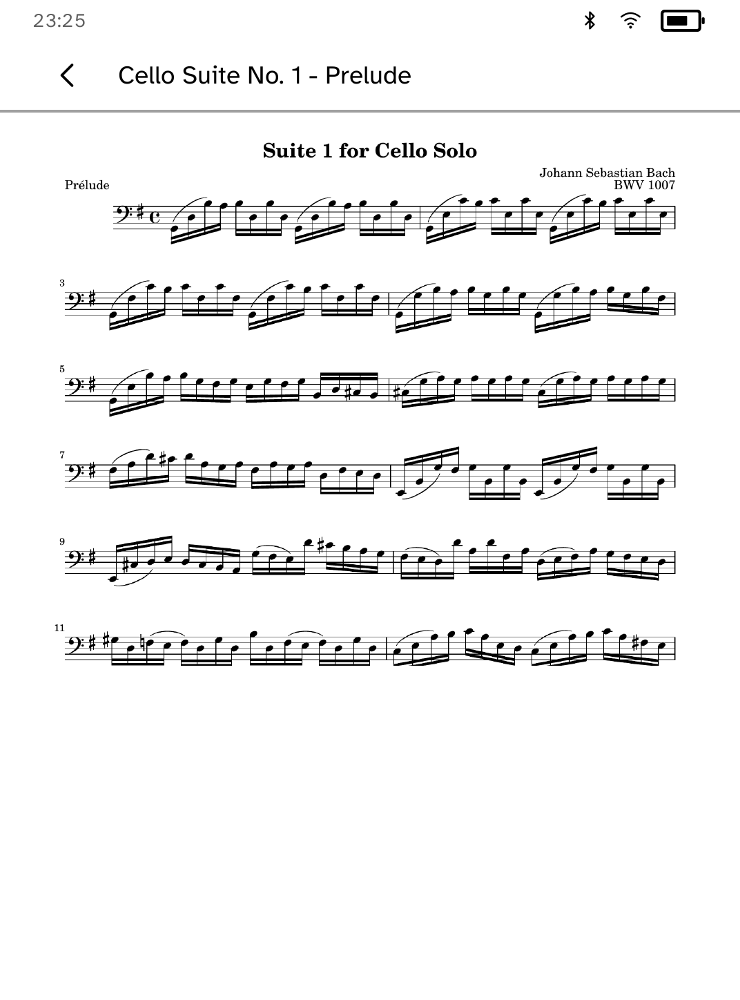
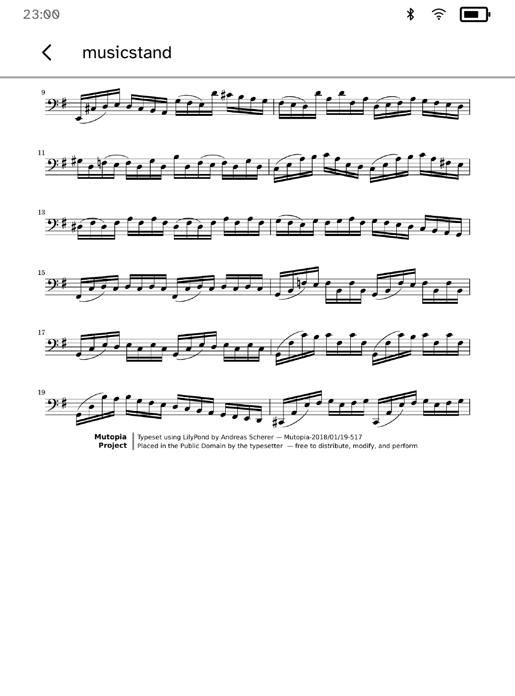
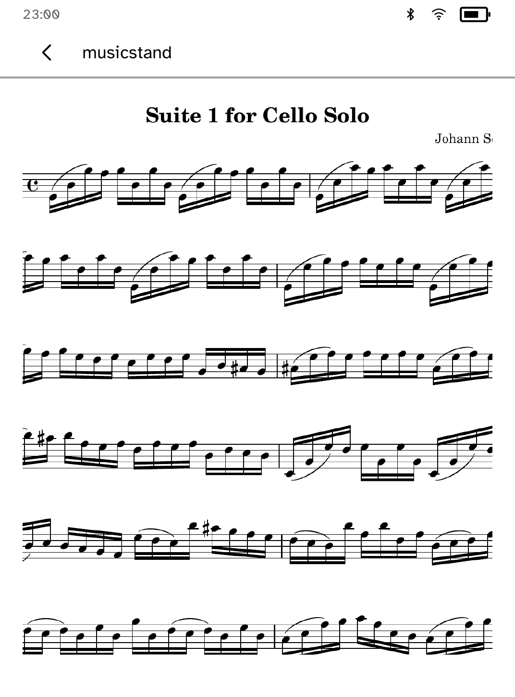
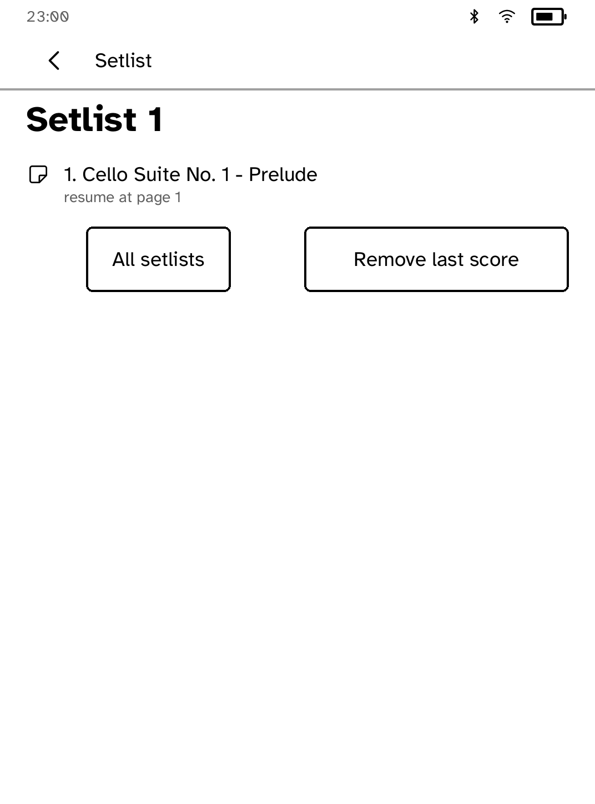

# Music Stand

A score reader for a Kobo on a music stand, with setlists and half-page
turns.

<table>
<tr>
<td width="50%" valign="top"><br>A full page at reading size</td>
<td width="50%" valign="top"><br>A half-page turn keeps the current line in view</td>
</tr>
<tr>
<td width="50%" valign="top"><br>Staff-width zoom for dense passages</td>
<td width="50%" valign="top"><br>A setlist resuming at its saved page</td>
</tr>
</table>

## Features

- Keeps the screen on while you play.
- Turn pages with the page buttons or by tapping the screen.
- Half-page turns: each page is split into two overlapping halves, so the line
  you are reading stays in view after a turn.
- Staff-width zoom for dense passages.
- Each score remembers its page, zoom and corner mark.
- Setlists keep rehearsal order and continue from one piece's last page to the
  next piece. Add scores from your library, move them up or down, or take them
  off from the menu beside each one. Deleting a setlist keeps its scores.
- Scores you send appear the next time you come back to Music Stand.

## Setup

1. To send PDF scores, install Poppler on your computer: `brew install
   poppler` on a Mac, or `sudo apt install poppler-utils` on Debian or Ubuntu.
   Music Stand uses its `pdftoppm` to turn each page into a picture. Folders
   of page images do not need it.
2. Set up the reader once over USB, if you have not already: `kobo setup`.
3. Send scores:

```sh
kobo musicstand push Prelude.pdf Sarabande.pdf
kobo musicstand push ~/Scores            # every PDF in the folder
kobo musicstand plan ~/Scores            # what a push would send
kobo musicstand ls
kobo musicstand rm ID
```

Commands use the reader `kobo setup` saved. Add `--device IP` for another
reader, or `--sim` to try a command on the simulator.

- A push adds to your library. Sending a score again under the same name
  replaces the old copy. `--replace` makes the library exactly what you sent
  and removes every other score.
- Each PDF in a folder becomes its own score. Page images directly in a folder
  become one score named after the folder.
- A push ends by listing every score now on the reader.

Only send scores you have the right to use.

## Permissions

- `keep-awake`: keeps the screen on while a score is open.

## Development

```sh
cargo test -p kobo-musicstand
python3 scripts/check-apps-sim.py musicstand
```

The simulator check builds the app, opens it in a fresh simulator and plays
`drive.kobo`. `scripts/quality/check-musicstand-shelf-sim.py` covers sending a score.

## Credits

The screenshots show Bach's Cello Suite No. 1 (BWV 1007), a public-domain
engraving from the Mutopia Project.
