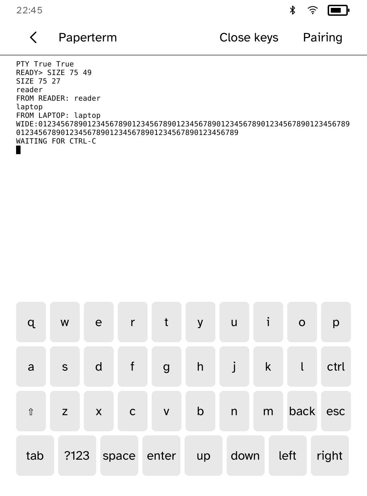
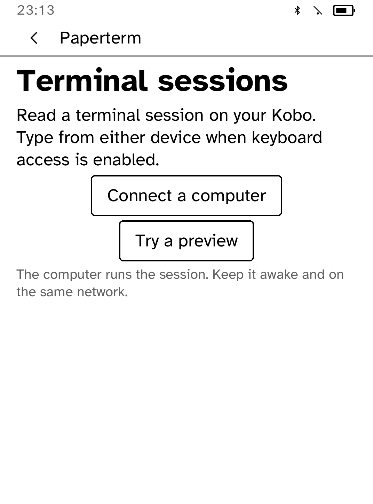
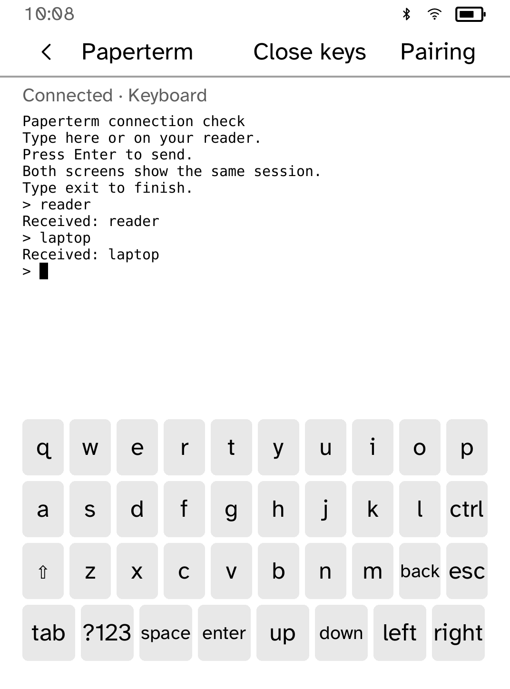
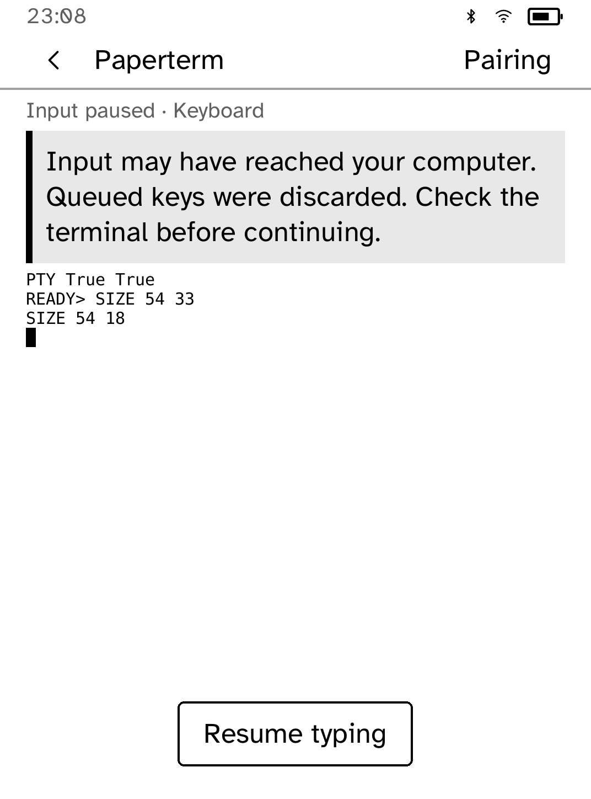
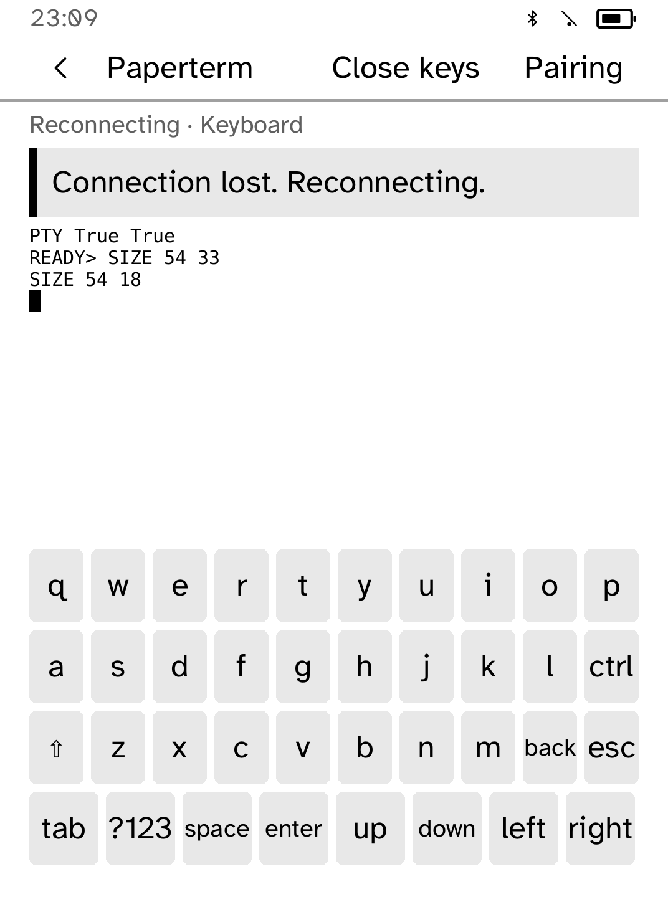
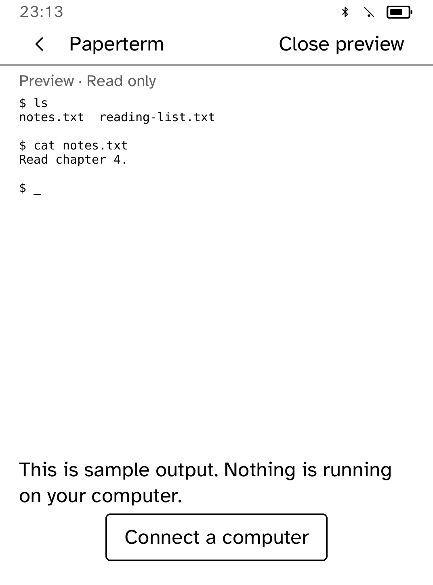

# Paperterm

Show a terminal session from your computer on your Kobo, and type into it from
either side.

<table>
<tr>
<td width="50%" valign="top"><br>A shared terminal with the keyboard open</td>
<td width="50%" valign="top"><br>First launch</td>
</tr>
<tr>
<td width="50%" valign="top"><br>The connection check, typed from both sides</td>
<td width="50%" valign="top"><br>Typing paused after a timeout</td>
</tr>
<tr>
<td width="50%" valign="top"><br>Reconnecting, with the output kept</td>
<td width="50%" valign="top"><br>The offline preview</td>
</tr>
</table>

The shell, its programs and your credentials stay on the computer. Paperterm
only displays the session and sends keys. It cannot run commands on the
reader and does not save terminal output.

## Features

- Three modes, chosen on the computer:
  - **Read only**: the reader watches.
  - **Controls**: arrows, Enter, Esc, y, n and Ctrl-C.
  - **Keyboard**: a full on-screen keyboard, opened with **Keyboard** and
    hidden with **Close keys**.
- The terminal grid is sized to the screen and your text size. A Clara BW at
  the default size shows 75 columns by 47 rows, or 75 by 25 with the keyboard
  open. Larger text means fewer columns, not squashed letters.
- Only changed rows are redrawn.
- If the computer stops answering, the last output stays on screen under a
  **Reconnecting** notice.
- If a key might not have arrived, typing pauses until you check the terminal
  and choose **Resume typing**.
- **Try a preview** shows sample output offline.

## Setup

Paperterm needs your computer. **Connect a computer** in the app shows the
same steps. On the computer:

1. Set up the reader once over USB, if you have not already:

   ```sh
   kobo setup
   ```

2. Pair this computer with the reader. There is nothing to type on the
   reader. The first time, close Cobalt and open it again afterwards so it
   trusts the computer. If you also use Sidekick or Deck, `kobo sidekick init`
   pairs all three at once.

   ```sh
   kobo stream init
   ```

3. Share a terminal and leave it open, then open Paperterm on the reader.

   ```sh
   kobo stream terminal
   ```

If `init` cannot reach the reader, it prints an address and a six-character
code to enter in Paperterm. The default port is 9332, and `kobo stream
pairing` shows them again. When the computer's address changes, the next
session renews its certificate for the new address; run `kobo stream init`
again to update the reader. `kobo stream demo` is a connection check that
runs no commands.

Until the computer has answered once, Paperterm says **Not connected yet**
and what to run, rather than that a connection was lost.

## Sharing a session

```sh
kobo stream terminal                   # your login shell
kobo stream monitor                    # top
kobo stream --interactive -- /bin/sh   # any command, with the full keyboard
kobo stream --controls -- COMMAND      # navigation keys only
kobo stream -- COMMAND                 # read only
```

All of them accept `--port PORT`. Keep the computer awake while sharing.

To stop sharing, press **Ctrl+]** in the computer's terminal. This ends the
shared command and restores your terminal settings. Ctrl-C still goes to the
shared program.

The computer reports **waiting for a reader**, **Reader connected**,
**waiting for the reader to reconnect** after 45 seconds without contact, and
**command stopped**, when the final screen stays up for one minute.

## Permissions

- `network`: connects to the computer sharing the session.

## Development

```sh
cargo test -p kobo-paperterm
python3 scripts/check-apps-sim.py paperterm
```

The simulator check builds the app, opens it in a fresh simulator and plays
`drive.kobo`. The screenshots come from a live check against a local session with private test certificates. Its `--pair-on-reader`, `--load-failure`, `--save-failure` and `--temporary-pairing` options cover pairing and recovery.
