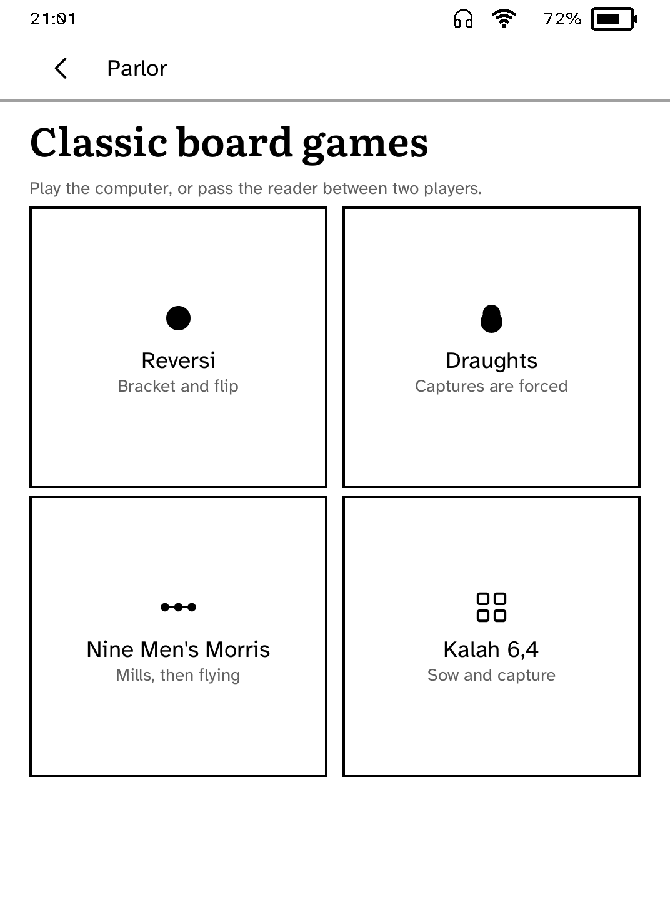
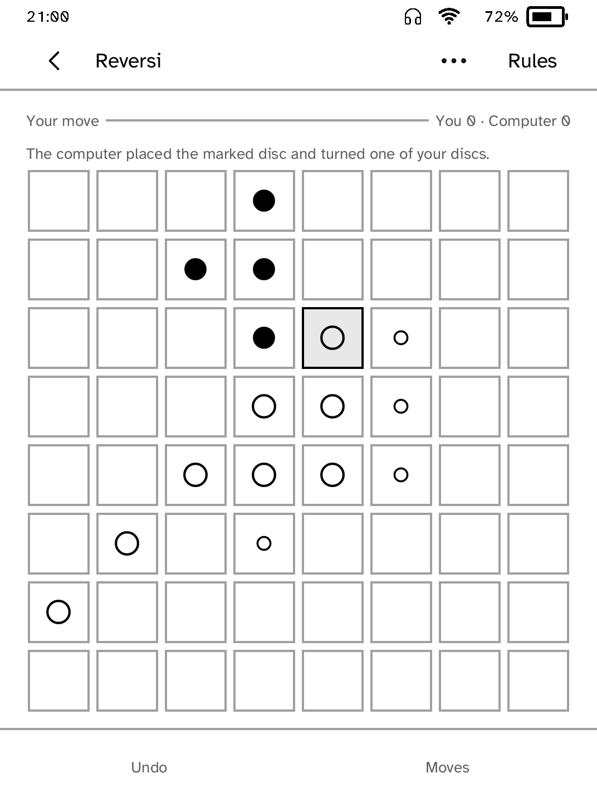
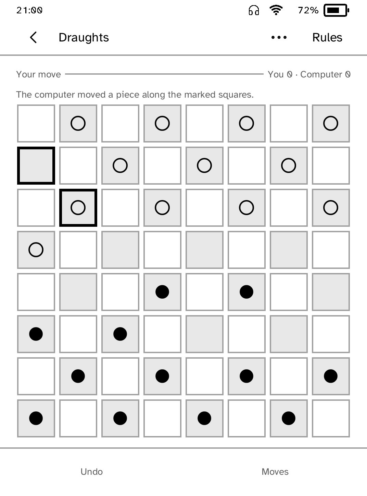
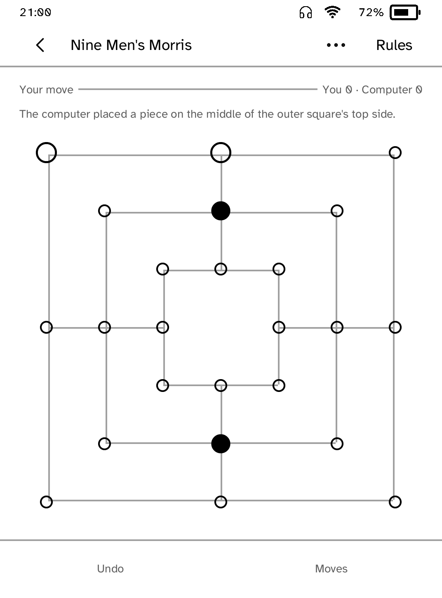

# Parlor

Four classic board games against the computer, or for two players passing one Kobo.

<table>
<tr>
<td width="50%" valign="top"><br>The game table</td>
<td width="50%" valign="top"><br>Reversi against the computer, its last move marked</td>
</tr>
<tr>
<td width="50%" valign="top"><br>Draughts, with the computer's reply marked</td>
<td width="50%" valign="top"><br>Nine Men's Morris</td>
</tr>
</table>

## Games

- **Reversi**
- **Draughts**: Anglo-American 8×8 rules, with forced captures and capture
  chains.
- **Nine Men's Morris**: placing, mills, protected pieces, moving and flying
  with three pieces.
- **Kalah 6,4**: sowing, captures, extra turns and endgame collection.

## Features

- Play the computer at three levels: Casual, Club and Strong. It replies as
  soon as you move, and its move stays marked on the board, and named in a
  line above it, until you move again. The same position and level always
  produce the same move.
- Undo takes back your move and the computer's reply together.
- Pass-and-play is the other choice on the setup screen. The board turns
  180° for the player to move, or stays still for side-by-side play, and
  undo needs the other player to agree.
- Rules and the menu (New game, Change game, Use landscape) sit in the top
  bar, and Undo at the foot, where every Cobalt game keeps them.
- Use landscape turns the reader on its side, with the board beside whose
  move it is; the choice is kept until Use portrait.
- The setup screen is a form: nothing changes until Start game, and Back
  leaves the game in progress as it was.
- Legal destinations are marked with hollow rings.
- Every move is saved, and reopening offers to resume the exact position.

## Rules references

- Reversi: [World Othello Federation](https://www.worldothello.org/about/about-othello/othello-rules/official-rules/english)
- Draughts: [World Checkers/Draughts Federation](https://www.wcdf.net/rules/rules_of_checkers_english.pdf)
- Nine Men's Morris: [Board Game Arena](https://en.boardgamearena.com/doc/GamehelpnineMensMorris)
- Kalah: [Mancala World](https://mancala.fandom.com/wiki/Kalah)

The engine also knows International 10×10 draughts
([FMJD rules](https://www.fmjd.org/docs/Annex_1.pdf)), but the reader draws at
most 81 cells, so Parlor offers only the 8×8 game.

## Permissions

None. Parlor runs offline.

## Development

```sh
cargo test -p kobo-parlor
python3 scripts/check-apps-sim.py parlor
```

The simulator check builds the app, opens it in a fresh simulator and plays
`drive.kobo`.

## Credits

The game engines and computer players are original code. "Othello" is a
trademark of MegaHouse and Mattel, so Parlor calls the game Reversi.
