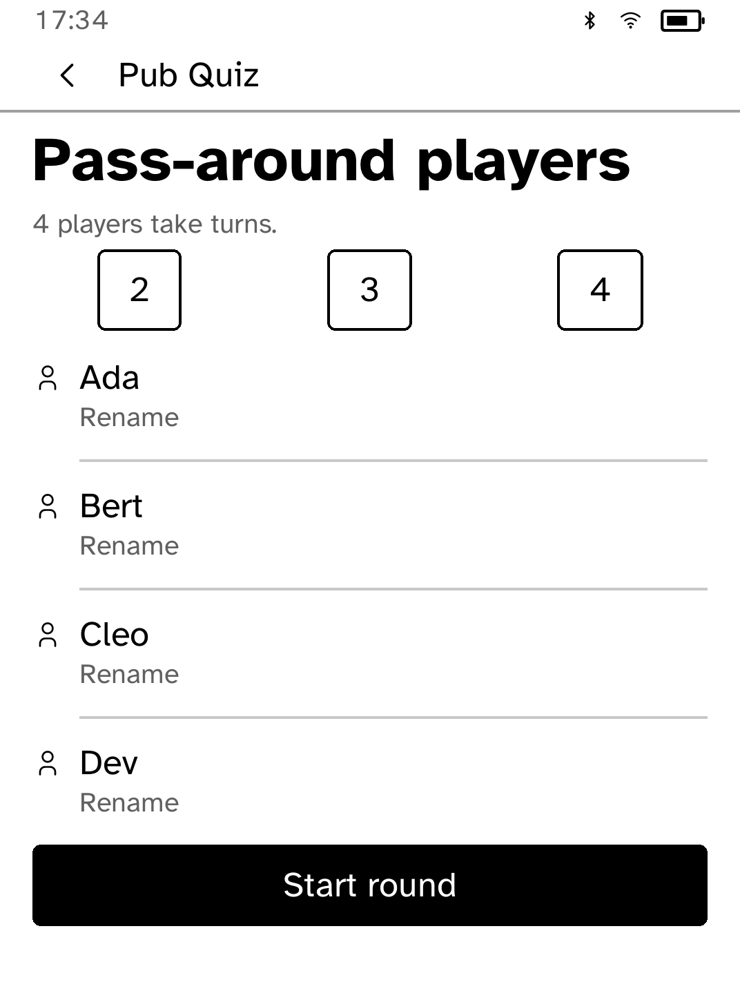
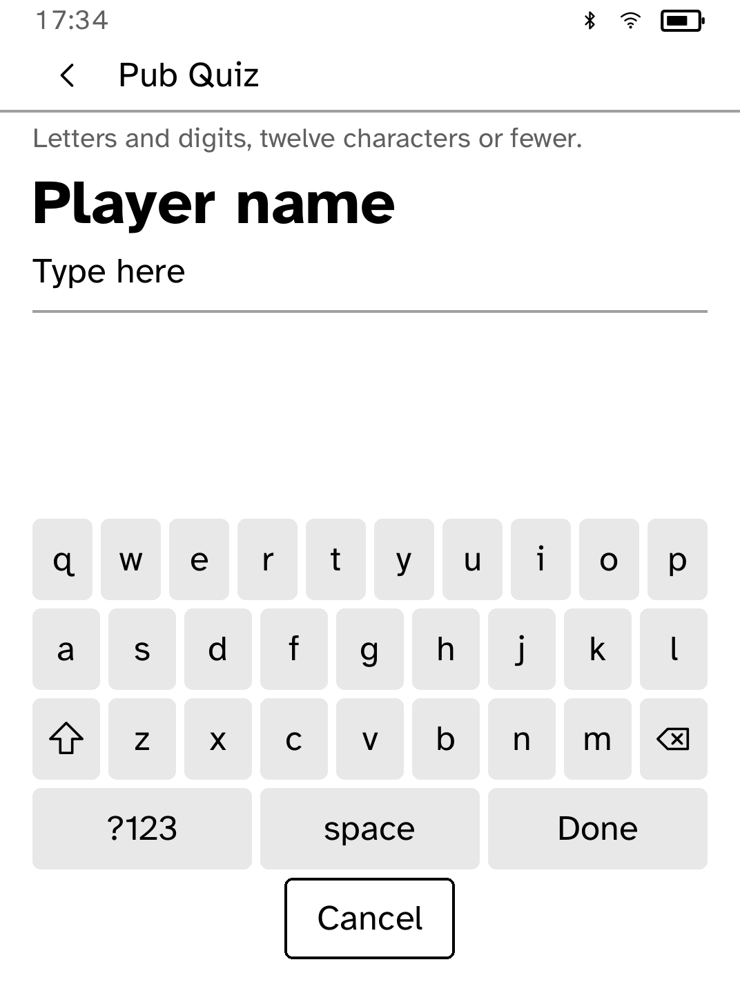
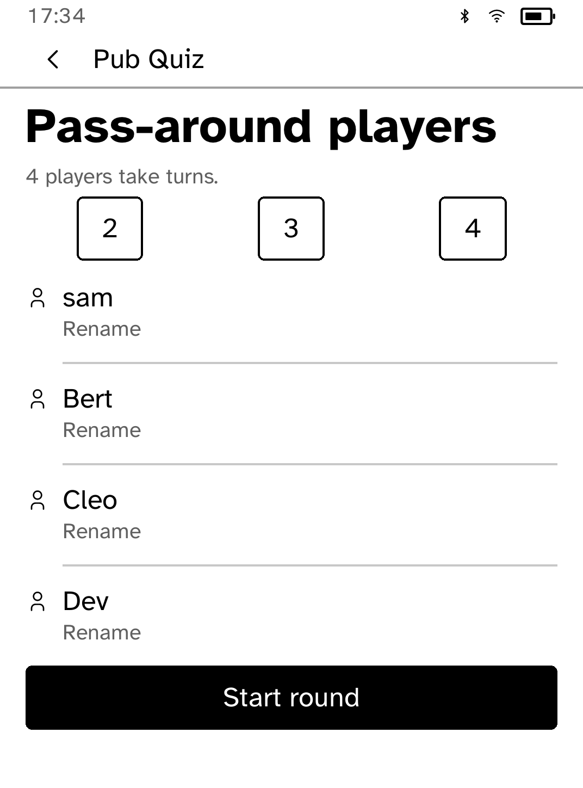
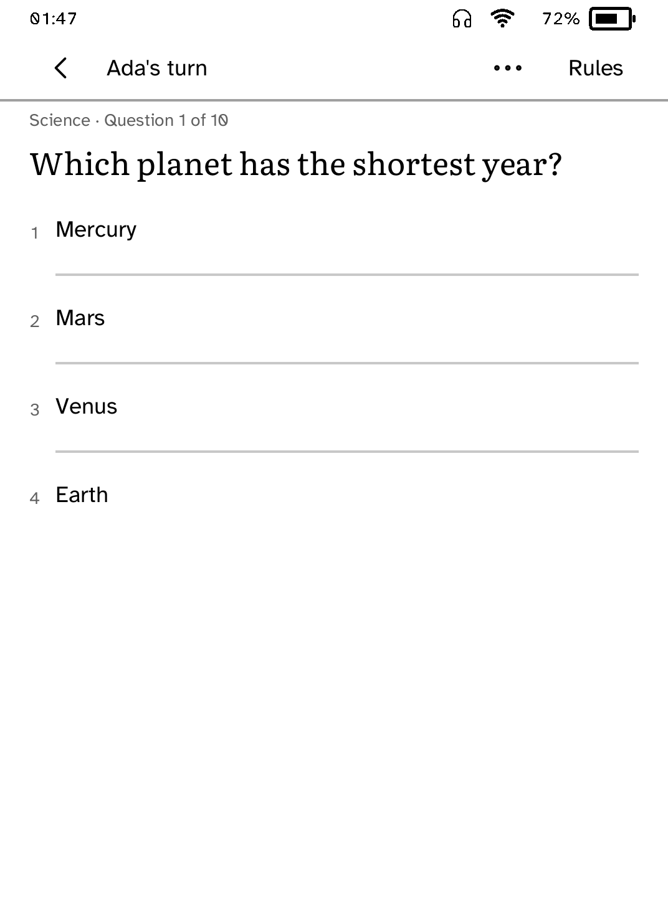

# Pub Quiz

Trivia rounds for one player, or for a group passing one Kobo around.

<table>
<tr>
<td width="50%" valign="top"><br>Four players in pass-around mode</td>
<td width="50%" valign="top"><br>Renaming a player</td>
</tr>
<tr>
<td width="50%" valign="top"><br>The player list after renaming</td>
<td width="50%" valign="top"><br>A question naming whose turn it is</td>
</tr>
</table>

## Features

- 414 bundled questions in six categories (Science, Geography, History, Arts &
  Literature, Nature, Sport & Games), each at three difficulties. They play
  offline from the first launch.
- Get more questions adds a pack from Open Trivia DB while online. The pack
  plays offline afterwards, alongside the bundled questions. If the download
  fails, the message on Home says why and carries Join Wi-Fi or Try again.
- Solo rounds of up to ten questions.
- Pass-around mode for two to four named players. Everyone answers the same
  question in turn, with a hand-over screen between players, then the table
  sees who was right. Renaming a player starts from the name already there,
  and the keyboard shows the naming rule.
- Rules and the game menu sit in the top bar of every round screen. New game
  in the menu ends the round and goes back to its choices.
- The round is saved as it is played, so a reader that sleeps mid-round opens
  where it stopped.

## Permissions

- `network`: downloads question packs from Open Trivia DB.

## Development

```sh
cargo test -p kobo-pubquiz
python3 scripts/check-apps-sim.py pubquiz
```

The simulator check builds the app, opens it in a fresh simulator and plays
`drive.kobo`.

## Credits

The bundled questions in [`assets/questions.tsv`](assets/questions.tsv) were
written for Pub Quiz and are not taken from Open Trivia DB. They are covered by
this repository's licence.

Downloaded packs come from [Open Trivia DB](https://opentdb.com/) under CC BY-SA
4.0. Cached packs stay under that licence, and an attribution and licence file
is stored with them. See [QUESTION-DATA-LICENSE.md](QUESTION-DATA-LICENSE.md).
