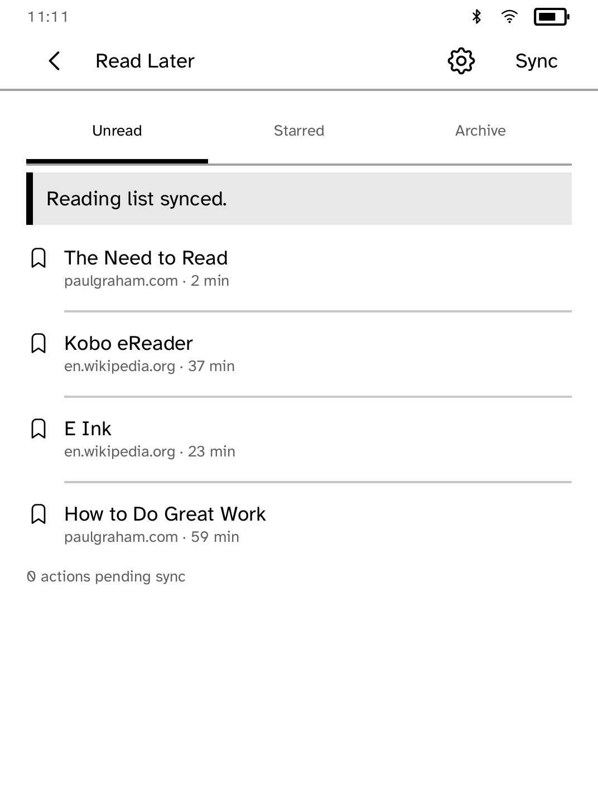
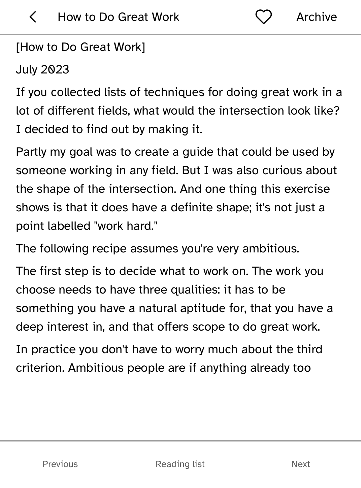
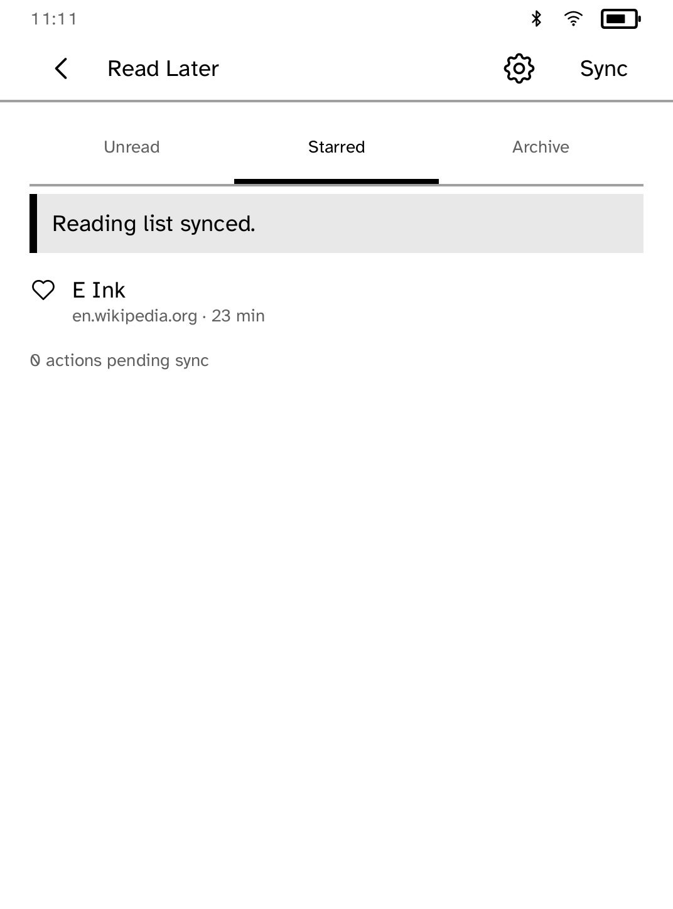
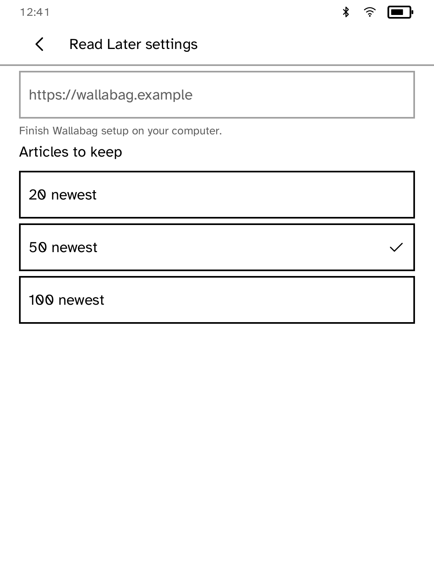

# Read Later

Read your [Wallabag](https://wallabag.org/) articles on your Kobo, online or
off.

<table>
<tr>
<td width="50%" valign="top"><br>The unread list after a sync</td>
<td width="50%" valign="top"><br>An article, with star and archive controls</td>
</tr>
<tr>
<td width="50%" valign="top"><br>The Starred tab</td>
<td width="50%" valign="top"><br>Setup</td>
</tr>
</table>

## Features

- Unread, Starred and Archive tabs.
- Articles are saved on the reader for offline reading, with Unicode and
  paragraph breaks intact. The collection is capped at 8 MiB.
- Star and archive articles offline. The changes sync to Wallabag next time.
- A failed refresh keeps the current list and offers **Sync** to retry. A
  failed save keeps the previous copy and offers **Retry saving**.

Save links with Wallabag's own browser or phone tools, then sync them here.

## Setup

1. Set up the reader once over USB, if you have not already: `kobo setup`.
2. On your Wallabag server, create an API client (on wallabag.it: **Settings,
   API clients**).
3. Sign in from your computer:

   ```sh
   kobo connect readlater
   ```

   It asks for the server, the client ID and secret, your username and your
   password (typed without being shown), completes Wallabag's sign-in, and
   sends the session to the reader. Open Read Later, or tap **Check again** if
   it is already open. No restart is needed.

For scripts, the same sign-in takes flags and reads the password from
`KOBO_WALLABAG_PASSWORD`, `--password-env VAR` or `--password-file PATH`:

```sh
kobo readlater login --server https://wallabag.example \
  --client-id ID --client-secret-file SECRET_FILE --username you@example.com
```

The reader renews the session on its own. The token can only be sent to your
Wallabag server, and the password is not stored on the reader. The client
secret and refresh token remain in private app state so the reader can renew
the session. Run it again only if you revoke access.

When something fails, the list stays readable and a banner says why: a
refused sign-in, a server that did not answer, or no Wi-Fi.

## Permissions

- `network`: syncs with your Wallabag server.

## Development

```sh
cargo test -p kobo-readlater
python3 scripts/check-apps-sim.py readlater
```

The simulator check builds the app, opens it in a fresh simulator and plays
`drive.kobo`.

## Credits

Read Later is unofficial and not affiliated with or endorsed by the Wallabag
project. Wallabag is MIT-licensed.
