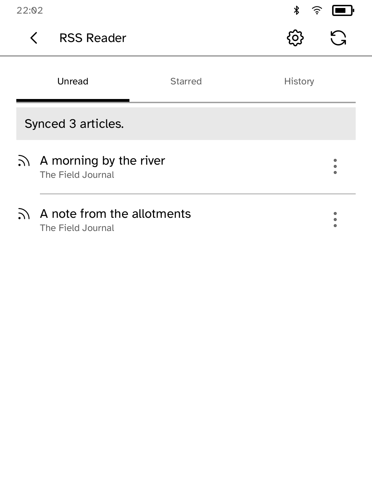
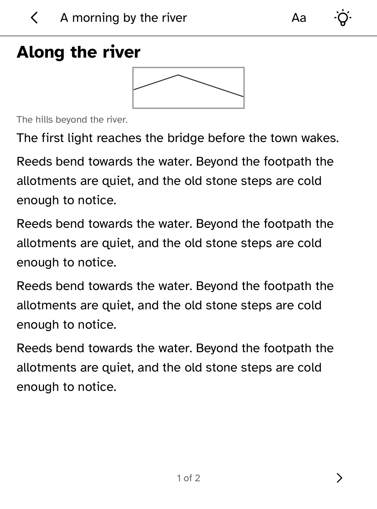
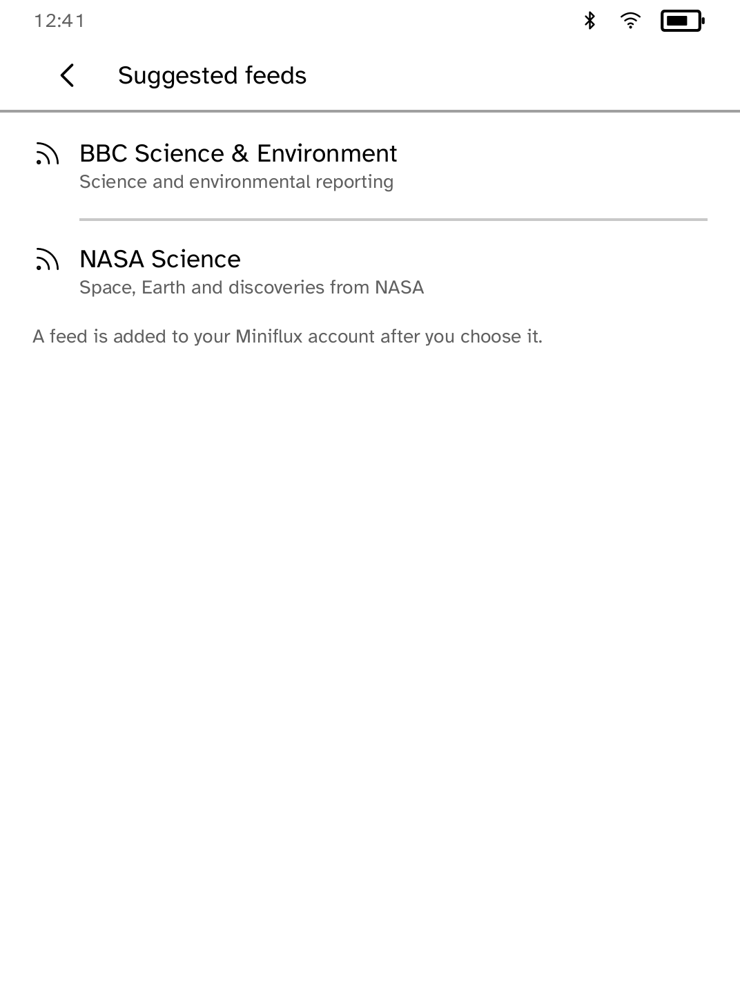

# Digest

Read your [Miniflux](https://miniflux.app/) feeds on your Kobo, with or
without Wi-Fi.

<table>
<tr>
<td width="50%" valign="top"><br>Unread articles</td>
<td width="50%" valign="top"><br>An article with its picture and caption</td>
</tr>
<tr>
<td width="50%" valign="top"><br>Suggested feeds</td>
</tr>
</table>

## Features

- Unread, Starred and Read tabs, all available offline after a sync.
- Articles open in the document reader, with headings, quotes, tables and
  pictures. Pictures are saved after the first view. Your place in each
  article is remembered.
- **Load full article** asks Miniflux to fetch the full page when a feed only
  carries a summary, and saves it for offline reading.
- Opening an article marks it read. The row menu stars, keeps unread and
  archives.
- Changes made offline are saved on the reader, shown straight away and sent
  on the next sync, before anything new is downloaded.
- **Settings ▸ Suggested feeds** adds one of two public feeds to your
  account.

## Setup

1. Set up the reader once over USB, if you have not already: `kobo setup`.
2. In Miniflux, create an API key.
3. Connect from your computer:

   ```sh
   kobo connect rss-miniflux
   ```

   It asks for your Miniflux server and the key, checks them, installs the key
   bound to that server and fills in the address in Digest. Open Digest, or
   tap **Check again**.

With the key in a private file, the same setup is one command:

```sh
kobo secret set miniflux --app rss-miniflux --server https://miniflux.example --from KEY_FILE
```

Prefer this to plain `kobo secret set miniflux`: a bound key can only ever be
sent to the server it was checked against, and Digest gets its address with
it. A plain key still works, limited to the requests Digest makes. If a sync
part is refused, Digest keeps the fresh Unread list and says why.

The runtime attaches the key to requests itself, so the app never sees it.
The account cannot be changed while changes are waiting to be sent.

## Limits

- Each sync keeps up to 100 articles: 60 unread, 20 starred and 20 read.
- Article bodies up to 256 KiB, and server responses up to 768 KiB. A response
  that is too large or invalid leaves your saved articles unchanged.

For feeds without a Miniflux account, use Feeds, in `examples/rss`.

## Permissions

- `network`: syncs with your Miniflux server.

## Development

```sh
cargo test -p kobo-rss-miniflux
python3 scripts/check-apps-sim.py rss-miniflux
```

The simulator check builds the app, opens it in a fresh simulator and plays
`drive.kobo`.

## Credits

Digest is unofficial and not affiliated with or endorsed by the Miniflux
project. [Miniflux](https://github.com/miniflux/v2) is licensed under
Apache-2.0.
