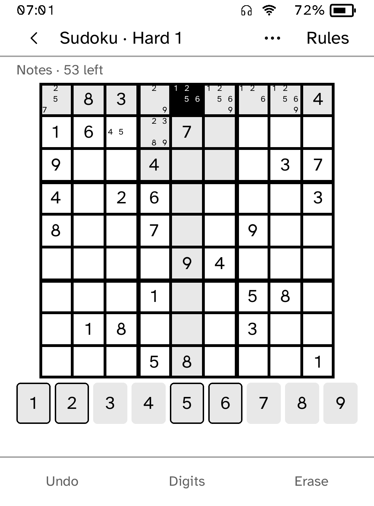
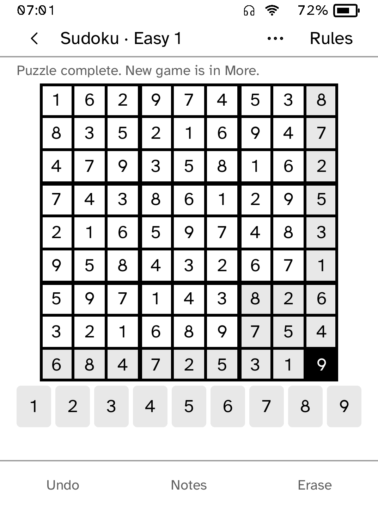
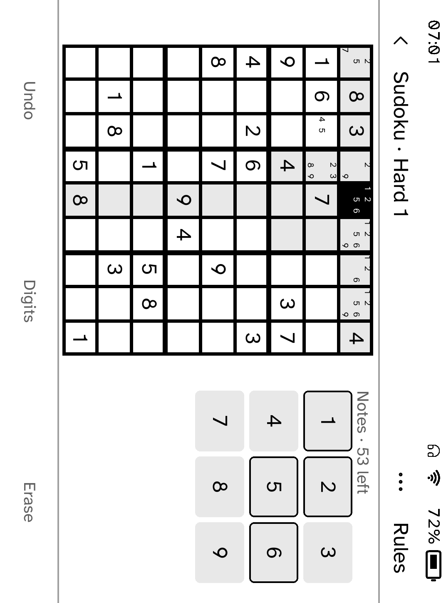
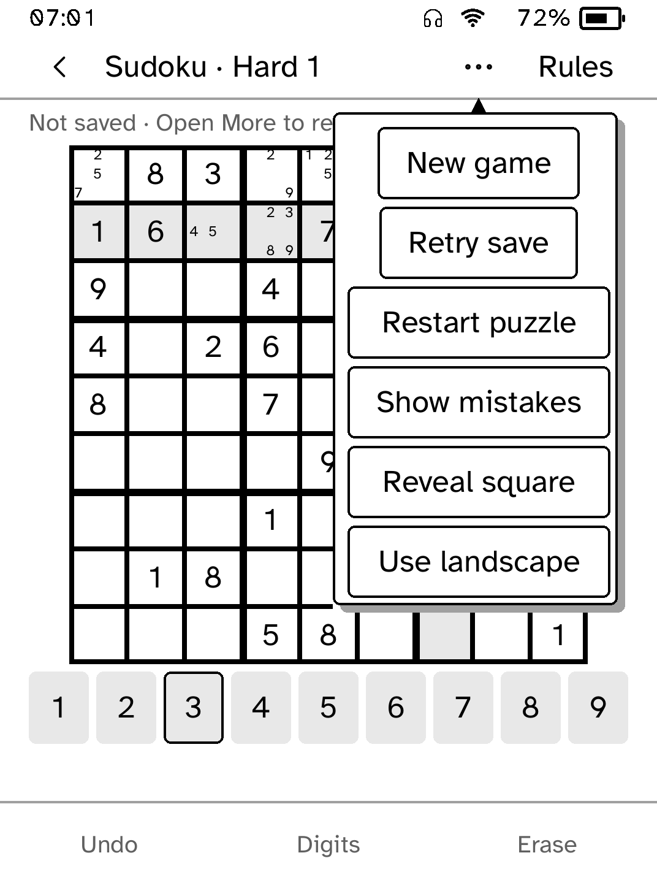

# Sudoku

600 original Sudoku puzzles with pencil notes, undo and saved games, playable
offline.

<table>
<tr>
<td width="50%" valign="top"><br>A Hard puzzle with pencil notes</td>
<td width="50%" valign="top"><br>A completed puzzle</td>
</tr>
<tr>
<td width="50%" valign="top"><br>The same puzzle in landscape</td>
<td width="50%" valign="top"><br>Retry saving in More after a save failed</td>
</tr>
</table>

## Features

- 200 puzzles each at Easy, Medium and Hard. Every puzzle has exactly one
  solution.
- Tap a square, then a number. The selected row and column are shaded, and
  the 3×3 boxes are spaced apart.
- The bar at the foot holds **Undo**, **Notes** and **Erase**, in the same
  place as in the other Cobalt games. **Notes** switches to pencil notes and
  **Digits** switches back. **Erase** clears the selected square, so notes can
  go where an answer was.
- **Undo** reverses one edit, including an erase, reveal or restart, and keeps
  the last 64 edits after reopening.
- **Rules** in the top bar opens the rules in one tap.
- The three dots beside it open **More**: **New game**, **Restart puzzle**,
  **Show mistakes**, **Reveal square** and **Use landscape**.
- Mistakes are hidden by default. **Show mistakes** makes a wrong answer in
  the selected square say "Wrong answer" without changing it, and **Hide
  mistakes** turns that off again.
- **Reveal square** fills the selected square after asking, and can be
  undone. It counts as a hint, and the hint count shows when the puzzle is
  complete.
- **New game** starts the next puzzle at Easy, Medium or Hard, replacing the
  current game. Each difficulty keeps its own place, so a game of Hard does
  not skip any Easy puzzles. After the last puzzle, a difficulty starts again
  from the first.
- **Use landscape** shows the board with the digits beside it.
- Answers, notes, selection, orientation and settings are saved.

## Difficulty

- **Easy**: each step has a square with only one possible number.
- **Medium**: also needs a number with only one possible place in a row,
  column or box.
- **Hard**: also needs pairs or pointing: naked or hidden pairs, or a number
  confined to one line of a box (pointing and box-line reduction). Every Hard
  puzzle past the original twelve can be finished with these techniques,
  without guessing.

This is a guide to technique, not solving time.

## Saving

Changes save automatically. If a save fails, the status line says **Not
saved**, your game stays in memory and **More → Retry saving** tries again.
Closing the app before a successful retry can lose those edits. A save that
cannot be read is kept, and the app offers to retry rather than starting a
blank game.

## The puzzles

[assets/puzzles.txt](assets/puzzles.txt) holds one puzzle per line as
`level|givens|solution`. The first 36 lines are the original pack and keep
their places, because a saved game names its puzzle by line. The rest were
generated for this app by [tools/generate.py](tools/generate.py) from a fixed
seed, using the Python standard library only.

The generator grades each puzzle with a logical solver: Easy is solvable with
naked singles alone, Medium needs hidden singles, and Hard needs a pair,
pointing or box-line reduction. It also counts every puzzle's solutions with a
separate search. `python3 tools/generate.py --check` checks the shipped file
without changing it, and a Rust test checks again that every puzzle has
exactly one solution that agrees with its givens.

Seven of the original twelve Hard puzzles (lines 27, 28, 31, 32, 33, 34 and
36) need harder techniques than the ones above: one falls to an X-wing and
the rest need chains or trial and error. They stay where they are so saved
games still open.

## Permissions

None. Sudoku runs offline.

## Development

```sh
cargo test -p kobo-sudoku
python3 scripts/check-apps-sim.py sudoku
```

The simulator check builds the app, opens it in a fresh simulator and plays
`drive.kobo`. `scripts/quality/check-sudoku-sim.py --output /tmp/sudoku-check --scale extra-large` runs a longer check covering notes, undo, save failures, restarts and landscape. See [screenshots/README.md](screenshots/README.md) for how the screenshots were made.
