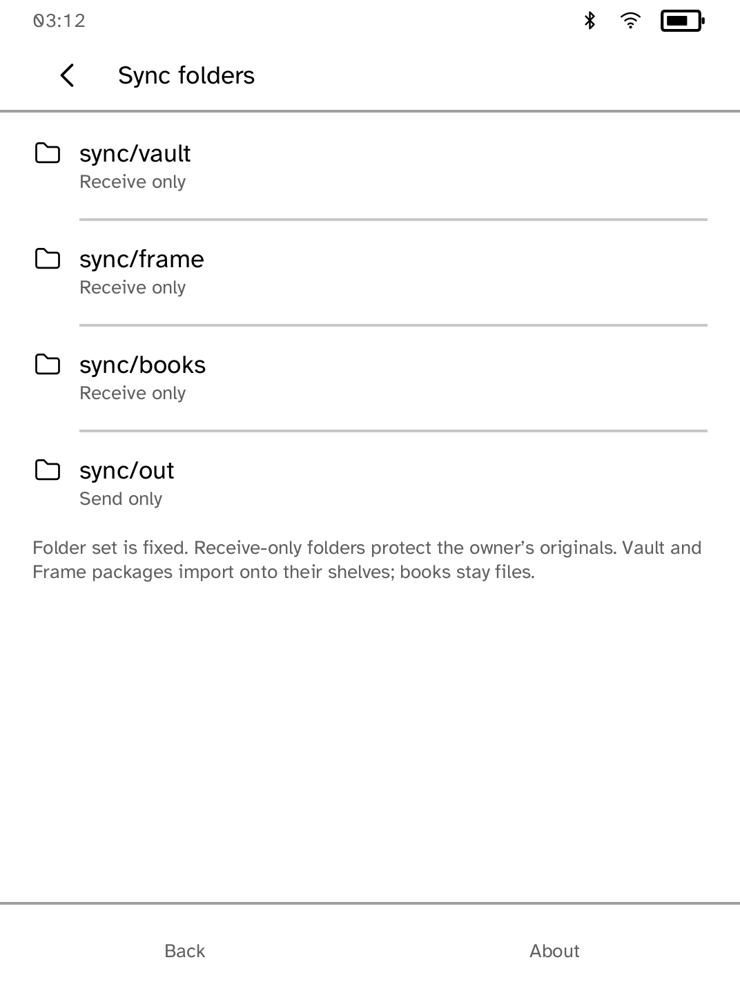
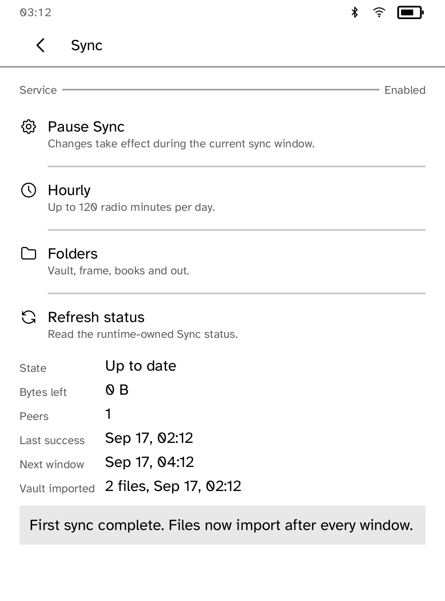
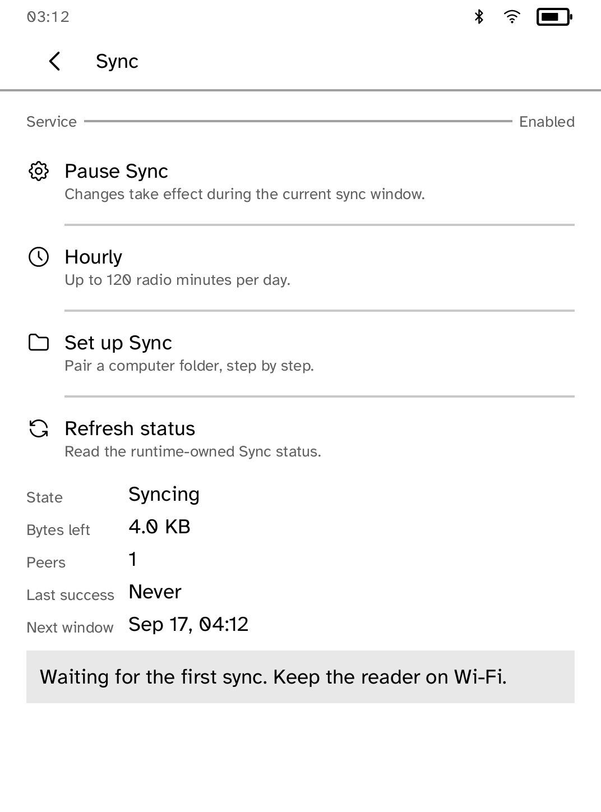
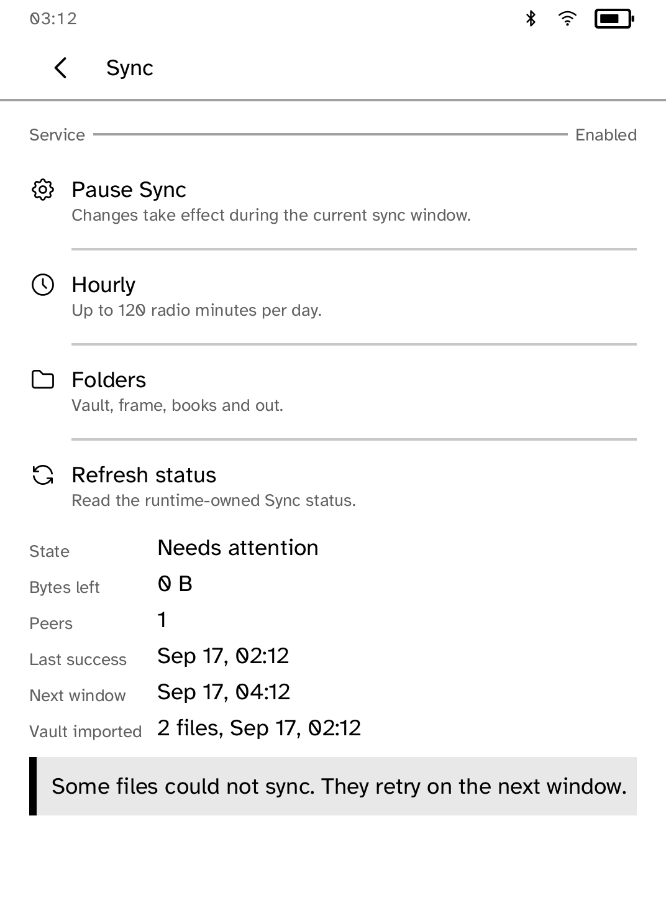

# Sync

Sync folders between your computer and your Kobo with Syncthing. Sync when
you tap Sync now, or on a schedule while Cobalt is open on Wi-Fi.

<table>
<tr>
<td width="50%" valign="top"><br>The four sync folders</td>
<td width="50%" valign="top"><br>The first sync, with what it imported</td>
</tr>
<tr>
<td width="50%" valign="top"><br>A sync in progress</td>
<td width="50%" valign="top"><br>Files that did not sync, tried again next time</td>
</tr>
</table>

## Features

- Four fixed folders. Files in `vault`, `frame` and `books` come to the Kobo,
  and changes made on the Kobo never go back. Files in `out` go to the
  computer.
- Sync now sends and receives for up to five minutes. A schedule (every
  hour, every 4 hours or once a day) syncs while Cobalt is open on Wi-Fi, and
  catches up when Cobalt next opens. Turn off Sync stops both.
- The status screen shows what happened last time, when the next sync is due,
  and the reason a sync did not finish, such as the computer not being found.
- Notes in `vault` open in [Vault](../vault/) and photos in `frame` appear as a
  [Frame](../frame/) album. Deletions are not carried over, and each sync
  lists what it added.

## Setup

1. Set up the reader once over USB, if you have not already. Sync also needs
   Syncthing on this computer, installed with its package manager.

   ```sh
   kobo setup
   ```

2. With the reader awake on Wi-Fi, pair one folder on this computer with a
   folder on the reader. The first time, the reader downloads the Syncthing
   engine.

   ```sh
   kobo sync setup ~/Documents/notes --folder vault
   ```

3. Start this computer's side of Sync and leave it running.

   ```sh
   kobo sync run
   ```

4. On the reader, open Sync and tap Turn on Sync. The first sync starts at
   once and takes up to five minutes.

`kobo sync status` shows each folder, and `kobo sync stop` stops this
computer's side.

`kobo sync` runs its own Syncthing identity under `~/.config/kobo/syncthing`
and never changes another Syncthing installation. The directory for `out`
must be empty the first time. Setup refuses symlinked or overlapping folders.

### Notes for Vault

Vault reads a package of your notes rather than the notes themselves.
`kobo sync setup` and every `kobo sync run` pack the notes into
`~/.config/kobo/syncthing/packages/vault`, and that package is what
syncs. Nothing is written into your notes folder, so Obsidian sees only your
own notes. To send edits made while `kobo sync run` is already running, run:

```sh
kobo sync publish --folder vault
```

If an older version of `kobo sync publish` left `synced-note-*.md` copies and
a `synced.v1` file in your notes folder, the next publish removes the copies
it can match to their original notes. A copy you edited since is left alone.

## How it runs on the reader

Cobalt starts each sync itself: when you tap Sync now, when you turn Sync on,
and when the schedule comes round while Cobalt is open on Wi-Fi. A sync runs
for at most five minutes and finishes even if the reader goes back to the
Kobo home screen. The reader cannot yet wake from sleep to sync, so a
schedule missed while it slept runs the next time Cobalt opens.

The Syncthing engine is not in the platform package. The reader downloads it
the first time a computer is set up and checks it against a digest built into
Cobalt before running it. Its API listens on the reader only, and apps cannot
add folders or supply keys.

`build-armv7.sh` rebuilds the engine from the pinned Syncthing v2.0.9 source
and checks the result against the same digest. It downloads nothing. The same
rebuild runs in `.github/workflows/syncthing-engine.yml`.

## Permissions

- `scheduled-wake`: brings Sync's status up to date when a scheduled sync is
  due.

## Development

```sh
cargo test -p kobo-syncthing
python3 scripts/check-apps-sim.py syncthing
```

The simulator check builds the app, opens it in a fresh simulator and plays
`drive.kobo`.

## Credits

[Syncthing](https://github.com/syncthing/syncthing) is licensed under MPL-2.0.
Sync is unofficial and not affiliated with or endorsed by the Syncthing
Foundation. See [THIRD-PARTY.md](THIRD-PARTY.md).
