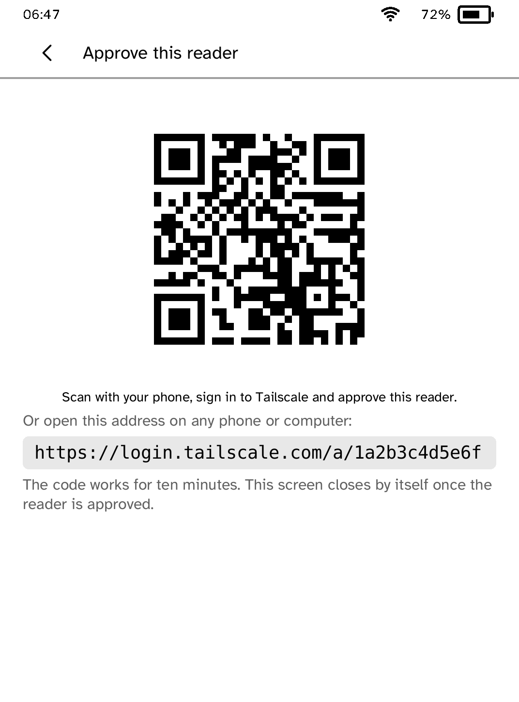
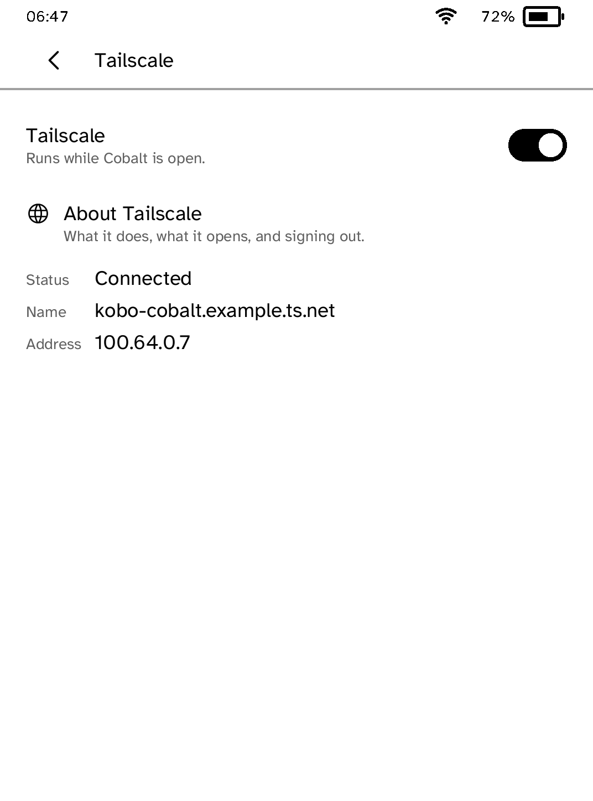

# Tailscale

Put your Kobo on your [Tailscale](https://tailscale.com) tailnet, the private
network between your own devices. Your computer then reaches the reader from
any network, so `kobo send` and `kobo clip` work away from home, and apps on
the reader can reach your own servers by name.

<table>
<tr>
<td width="50%" valign="top"><br>The approval code to scan with a phone</td>
<td width="50%" valign="top"><br>Connected, with the reader's tailnet name and address</td>
</tr>
</table>

No Kobo has run this yet. Everything below has been tested against stand-ins
for the Tailscale programs, not on a reader. The evidence bar in
[docs/DEVICES.md](../../docs/DEVICES.md) applies before it is called tested.

## Features

- One switch. Tailscale starts when the switch is on and Cobalt is open on
  Wi-Fi, and stops when you leave Cobalt.
- Sign in by scanning a code on the reader with your phone. The address is
  written out under the code for a device that cannot scan.
- Once connected, the screen shows the reader's tailnet name and address, and
  a mark appears in the status band on every screen.
- When it cannot start, the screen says why and what to do: no Wi-Fi, a
  download that did not finish, sign-in that timed out, or a reader that is
  not safe to put on a tailnet yet.
- **Sign out** forgets the reader's key. Use it before you give the reader
  away.

## Setup

1. Set up the reader once over USB, if you have not already. Setup also
   closes password login to the reader, which Tailscale requires before it
   will start.

   ```sh
   kobo setup
   ```

2. On the reader, open Tailscale and turn on the switch. The first time, the
   reader downloads Tailscale over Wi-Fi, about 37 MB, and checks it before
   running it.

3. Scan the code on the reader with your phone, sign in to Tailscale and
   approve the reader. The screen then shows the reader's tailnet name and
   address.

4. Save that address on your computer. After this, `kobo send` and `kobo clip`
   reach the reader from any network while Cobalt is open on it.

   ```sh
   kobo pair kobo --device 100.64.0.7
   ```

In the Tailscale admin console, consider turning off key expiry for the
reader. Keys expire after 180 days by default, and the reader then asks to be
approved again.

## What the reader opens to your tailnet

The reader has no packet filter, so every port it listens on is reachable
from the tailnet once it joins. A tailnet is every device signed in to it and
anything shared into it, not only your laptop.

- **SSH, port 22.** This is the point: it is how `kobo` reaches the reader.
  The runtime will not join a tailnet until the SSH server refuses root a
  password, which `kobo setup` arranges. A reader still on the firmware's
  defaults shows what to run instead of starting.
- **Sync, ports 22000 and 21027, while a sync is running.** It accepts only
  the computers you paired.
- **Nothing else from Cobalt.** The runtime and its apps listen on no network
  port.
- **Telnet and FTP, if the reader's debug services are on.** They take no
  password, so the runtime refuses to join a tailnet while they are
  listening.

The reader is a leaf. It forwards no traffic, offers no exit node and no
routes, accepts none, and does not run Tailscale SSH. Its DNS is left alone:
the names of your tailnet's computers are kept in a marked block in
`/etc/hosts` while Tailscale is running, and taken out when it stops.

## What it keeps, and where

- **The reader's key** is in `/var/lib/cobalt/tailscale` on the reader's own
  system partition. It is not on the partition a computer sees over USB.
- **It survives** a restart, a Cobalt update and reinstalling Cobalt, so the
  reader stays the same device on your tailnet and needs no second approval.
- **A Kobo firmware update replaces that partition**, and the key with it.
  The reader then asks to be approved again and appears as a new device,
  usually named `kobo-cobalt-1`. Remove the old one in the admin console.
- **Uninstalling Cobalt does not remove the key**, because uninstalling
  happens over USB and cannot reach that partition. Use **Sign out** in the
  app first. If the reader is offline when you sign out, also remove it in
  the admin console.
- **The two Tailscale programs** are on the book partition beside the Sync
  engine, about 70 MB. They are checked against pinned digests every time
  they are started, and downloaded again after each Cobalt update.

## How it runs

The app saves one word, on or off. The runtime does the rest
(`crates/kobod/src/tailscale.rs`):

1. Checks that the kernel has a tunnel driver and that nothing unsafe is
   listening.
2. Downloads the pinned build, `tailscale_1.104.7_arm.tgz`, from
   `pkgs.tailscale.com` if it is not installed, and refuses anything that
   does not match the digests compiled into the runtime.
3. Starts `tailscaled` with its state under `/var/lib/cobalt/tailscale`, log
   upload and file transfer off, and a memory limit sized for a reader.
4. Runs `tailscale up` with every leaf setting named and anything set by hand
   reset.
5. Stops the daemon when you switch Tailscale off, and before the reader is
   handed back to the Kobo software when you leave Cobalt.

Tailscale does not run while the Kobo software has the screen or while the
reader is asleep. Open Cobalt to bring it back; a reader that has been
approved reconnects in a few seconds.

Files sent to the reader with Taildrop are not accepted.

## Development

```sh
cargo test -p kobo-tailscale
cargo test -p kobod tailscale
python3 scripts/check-apps-sim.py tailscale --all-routes
```

The first runs the app's own tests. The second runs the supervisor against
two shell scripts standing in for the Tailscale programs, which is every
state and failure that can be reached without a reader. The third opens the
app in fresh simulators and plays `drive.kobo` and each `drive-*.kobo`.

## Credits

[Tailscale](https://tailscale.com) is licensed under the BSD 3-Clause
License. This app is unofficial and not affiliated with or endorsed by
Tailscale Inc. See [THIRD-PARTY.md](THIRD-PARTY.md).
