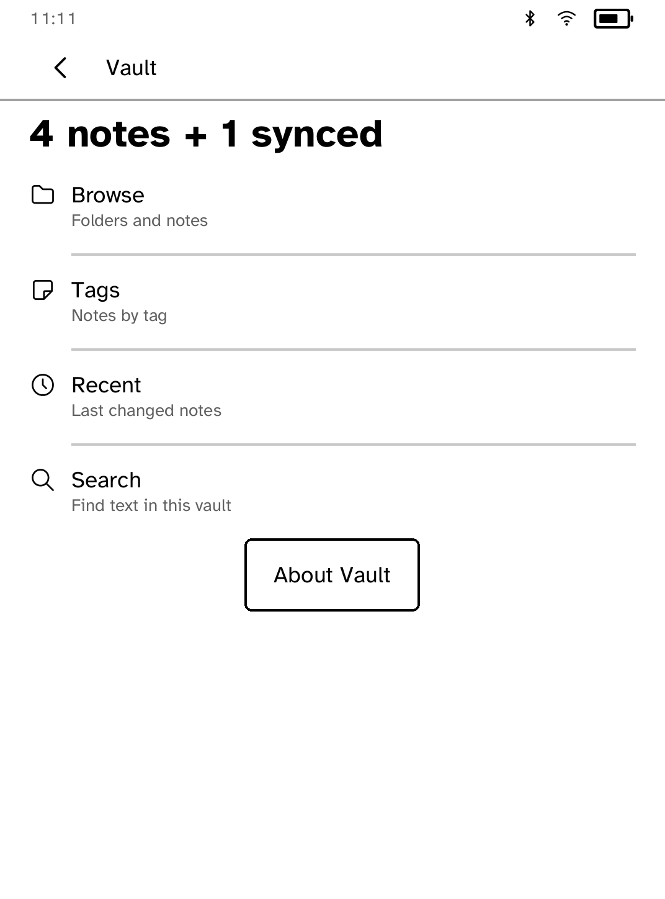
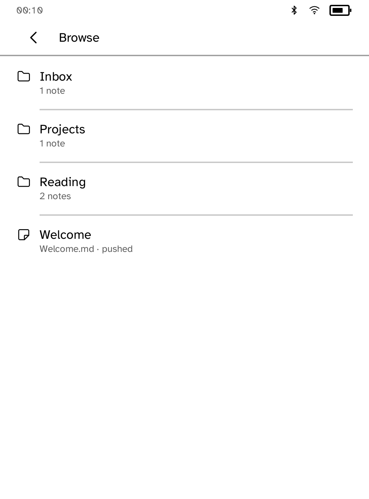
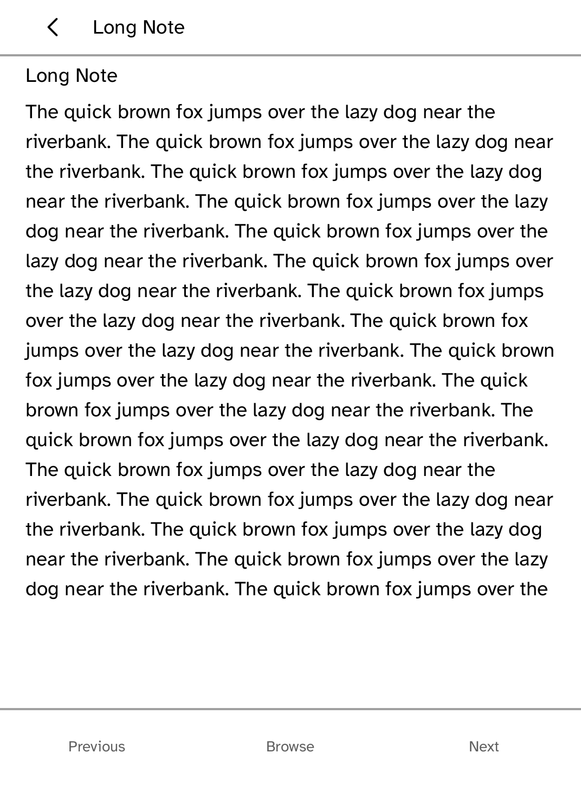
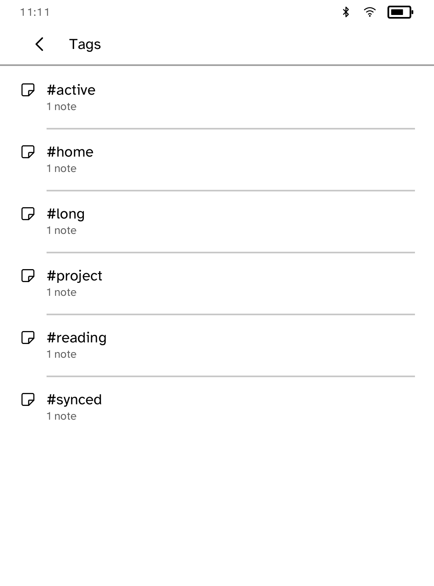
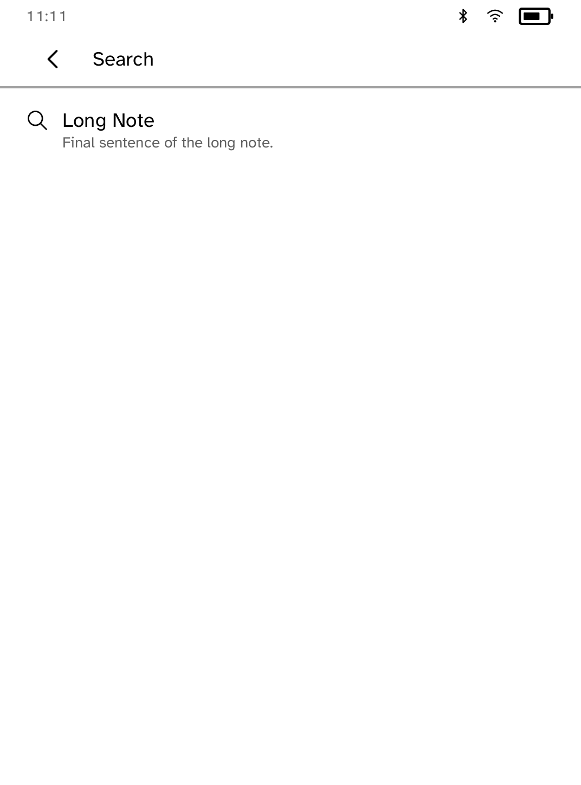
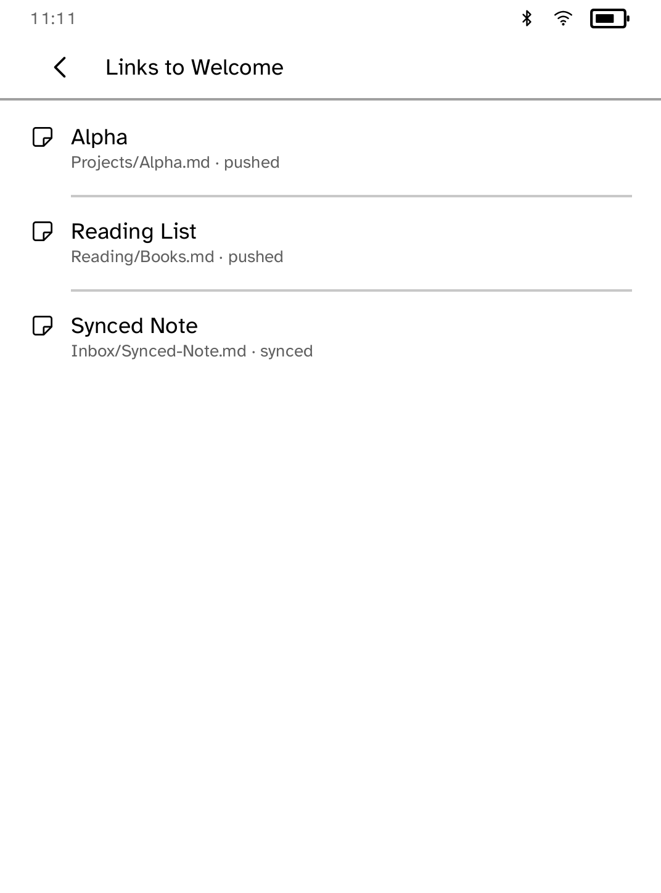

# Vault

A read-only, offline reader for your Obsidian notes.

<table>
<tr>
<td width="50%" valign="top"><br>Home: Browse, Tags, Recent and Search</td>
<td width="50%" valign="top"><br>Folders with note counts</td>
</tr>
<tr>
<td width="50%" valign="top"><br>A long note, paged</td>
<td width="50%" valign="top"><br>Tags with note counts</td>
</tr>
<tr>
<td width="50%" valign="top"><br>A search result opened at the matching line</td>
<td width="50%" valign="top"><br>Notes linking to the open note</td>
</tr>
</table>

## Features

- Browse folders, filter by tag, see recent notes and search every note's
  text.
- Headings are set as headings.
- Wiki links (`[[Note]]` and `[[Note|label]]`) open the note they name when it
  is on the reader. Back returns to the page you followed the link from. Each
  note also lists the notes that link to it.
- Long notes are paged, and each note reopens where you left off. The page
  buttons turn pages.
- Notes you push appear the next time you come back to Vault.

## Setup

1. Set up the reader once over USB, if you have not already: `kobo setup`.
2. Send a folder of notes:

```sh
kobo vault push ~/Notes
```

Push again whenever your notes change. Only changed notes are sent, a renamed
note keeps its place, and the push ends by counting the notes on the reader.
Commands use the reader `kobo setup` saved. Add `--device IP` for another
reader, or `--sim` to try a command on the simulator.

Other commands:

```sh
kobo vault plan ~/Notes                   # what a push would change
kobo vault preview NOTE.md                # roughly how one note will page
kobo vault ls                             # notes on the reader
kobo vault rm ID                          # remove one note
```

- A push adds to what is on the reader. `--replace` makes the reader hold
  exactly this folder, and removes pushed notes it no longer has.
- `--exclude TEXT` skips matching files, and can be repeated.
- Vault is for reading. Edits are made on your computer and pushed again.

## Permissions

None. Vault runs offline.

## Development

```sh
cargo test -p kobo-vault
python3 scripts/check-apps-sim.py vault
```

The simulator check builds the app, opens it in a fresh simulator and plays
`drive.kobo`.

## Credits

Markdown is parsed with `pulldown-cmark` (MIT). Vault is unofficial and not
affiliated with Obsidian or Dynalist Inc.
