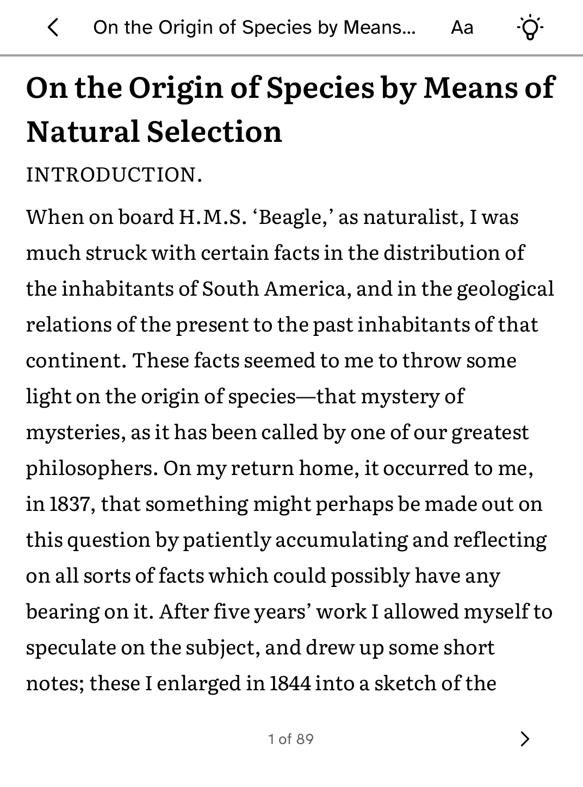

# Stacks

Browse your Zotero collections and read papers on your Kobo.

<table>
<tr>
<td width="50%" valign="top"><br>Reading the indexed text of a book from a Zotero library</td>
</tr>
</table>

## Features

- Browse several collections. **Collections** in the header switches between
  them.
- Read each paper's details, abstract and Zotero's indexed full text.
- **Search** looks through the papers already on the reader. **Keep offline**
  saves a paper for reading without Wi-Fi. Your reading position and
  annotations are kept.
- Read-only. Stacks never changes your Zotero library.

## Setup

1. Set up the reader once over USB, if you have not already: `kobo setup`.
2. Open [Zotero's API key settings](https://www.zotero.org/settings/keys) and
   create a key with read-only access to your personal library.
3. Connect from your computer:

   ```sh
   kobo connect zotero-reader
   ```

   It checks the key with Zotero and fills in your numeric user ID, so
   nothing is typed on the reader. Open Stacks, or tap **Check again**.
4. Choose a collection.

To set it up on the reader instead, enter the numeric user ID (the keyboard
opens on the digits) and add the key from the account screen, which counts
the characters typed and has **Show**.

The runtime keeps the key and sends it only to Zotero's read-only API routes.
The app never sees it.

## Limits

Zotero's indexed full text is plain text, so the original PDF layout, tables,
figures and formulas are lost.

For structured papers with headings, tables, figures and formulas, a
self-hosted conversion service exists at
[andreclerigo/cobalt-zotero-reader](https://github.com/andreclerigo/cobalt-zotero-reader).
It needs a custom build of Cobalt, because the Store build only sends
credentials to Zotero. See its
[setup guide](https://andreclerigo.github.io/cobalt-zotero-reader/setup.html)
and [self-hosting guide](https://andreclerigo.github.io/cobalt-zotero-reader/self-hosting.html).

## Permissions

- `network`: reads your Zotero library.
- `frontlight-control`: adjusts the front light while reading.

## Development

```sh
cargo test -p kobo-zotero-reader
python3 scripts/check-apps-sim.py zotero-reader
```

The simulator check builds the app, opens it in a fresh simulator and plays
`drive.kobo`. To try it by hand in the browser simulator, run `kobo dev` in
`apps/zotero-reader`. The test fixtures are synthetic and contain no account
data.

## Credits

Stacks is unofficial and not affiliated with or endorsed by Zotero or the
Corporation for Digital Scholarship, which owns the Zotero trademark.
