# Colour accents, as the simulator shows them

Captures from the simulator sweep that accompanied the colour accents change,
for reviewing the palette against the grey design it is laid over. Taken with
`scripts/check-apps-sim.py` under `KOBO_SIM_PROFILE=clara-colour-393` and
`clara-bw-391`, plus two panel-view shots taken by hand, and halved in size for
the repository. Nothing here is a photograph of a reader.

Three views of the same screens:

- **bw**: the Clara BW, which is unchanged by this work. The grey design.
- **colour ideal**: the renderer's own RGB for a Clara Colour. This is what the
  runtime writes to the framebuffer.
- **colour panel**: the same frame through the simulator's model of the
  Kaleido 3 filter (sixteen levels per channel, colour averaged over two by
  two pixels, saturation reduced to 60%), with the usual residue. The model's
  quantisation and colour resolution are the panel's published figures; the
  saturation is a stated approximation and waits for a photograph of a real
  Clara Colour beside it.

| Screen | bw | colour ideal | colour panel |
|---|---|---|---|
| Launcher, cobalt | 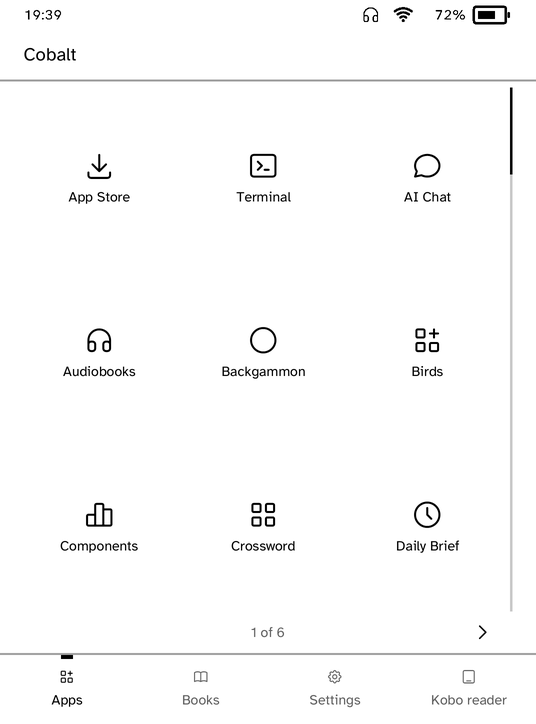 | 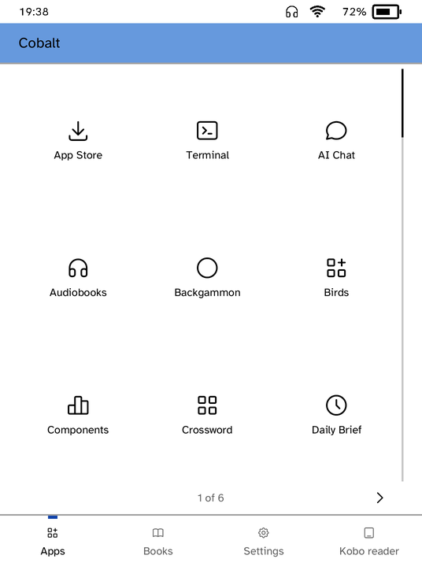 | 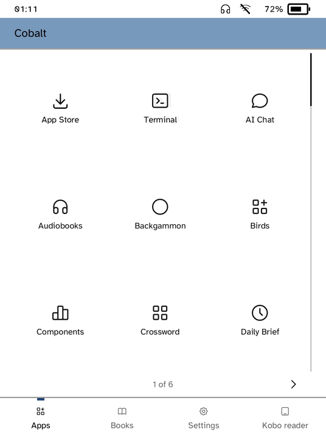 |
| Hacker News, orange | 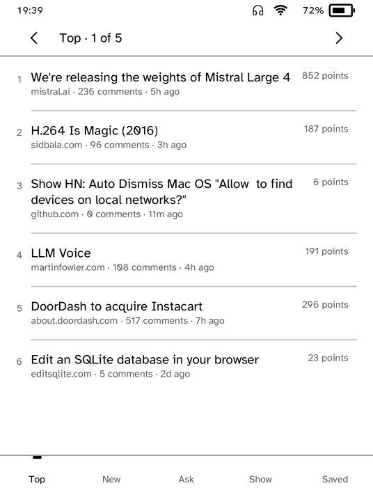 | 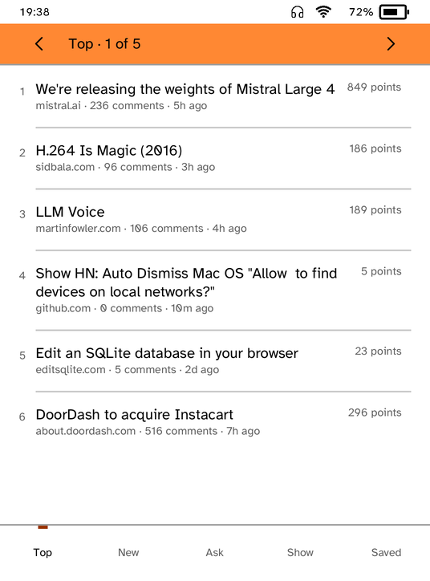 | 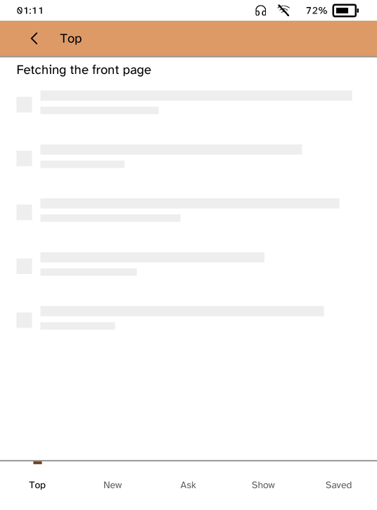 |
| Store, error banner | 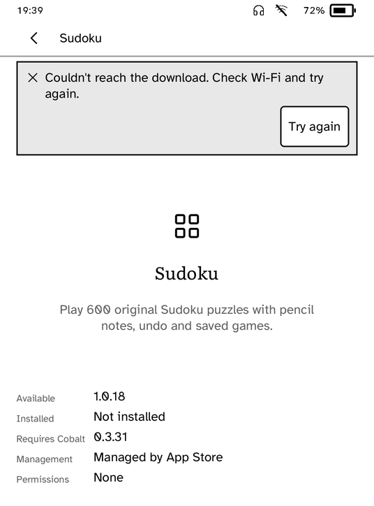 | 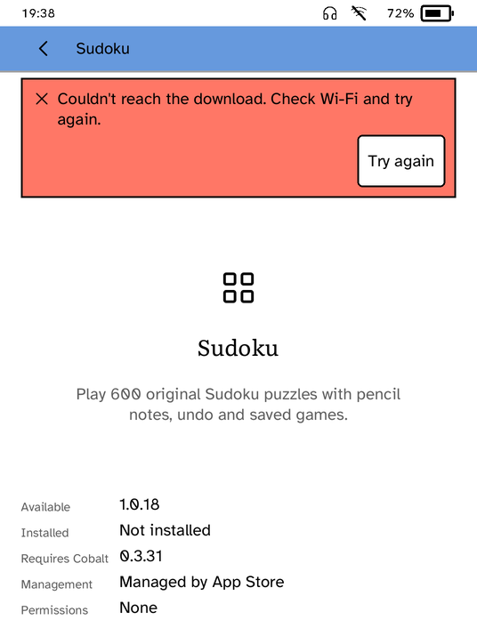 | |
| Settings, controls | 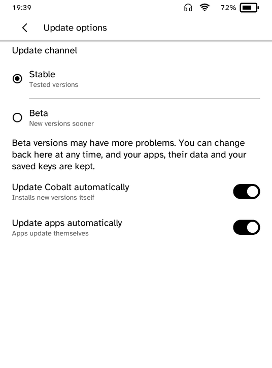 | 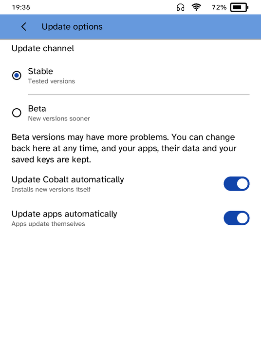 | |
| Preprints, red | | 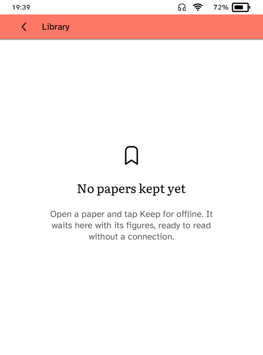 | |
| Feeds, orange | | 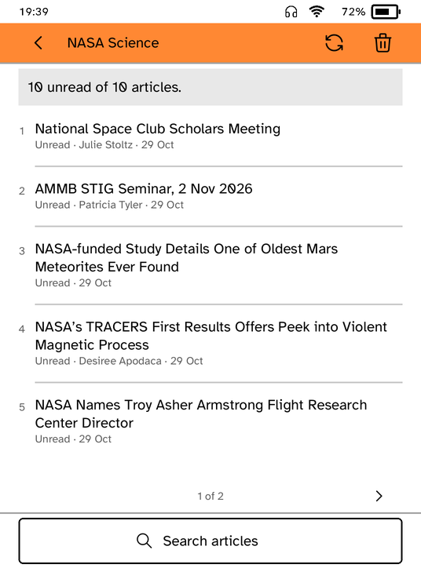 | |

What to look for: the bar wears the accent's tint with its title and controls
still in ink; the one filled control and the mark under the current
destination wear the strong shade; the error banner is the platform's red
with its mark and outline kept; everything else, every word included, is the
grey it was. The Hacker News panel view was taken offline while the front page
was still being fetched, which is why it shows the skeleton rows.
