# Protocol 17 type and spacing, as the simulator shows them

Captures from the simulator sweeps either side of the protocol 17 type change,
taken with `scripts/check-apps-sim.py --all-routes` on a Clara BW at the
default text size and halved in size for the repository. Nothing here is a
photograph of a reader. The Flashcards pair is that app's golden screenshots.

**Folio** is how every app built against protocol 16 or earlier is drawn, and
stays drawn by a 0.3.32 runtime. **Quiet** is protocol 17.

| Screen | Folio | Quiet |
|---|---|---|
| Deck, pairing | 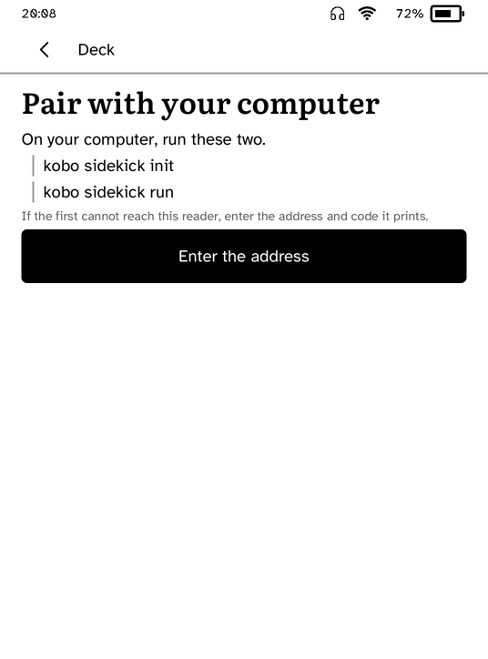 | 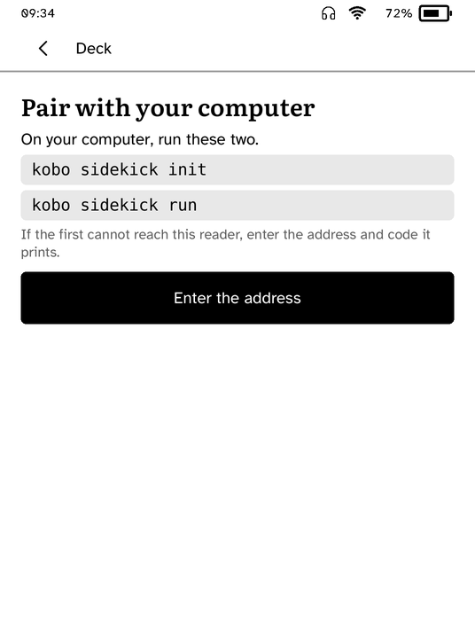 |
| Flashcards, first use | 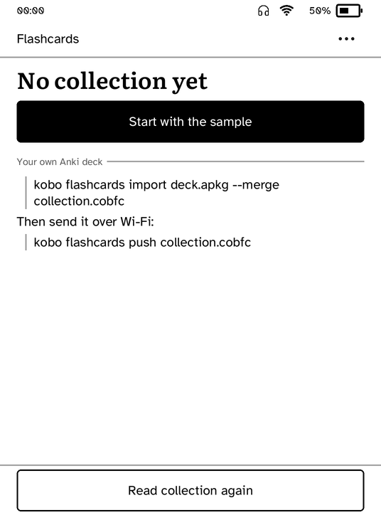 | 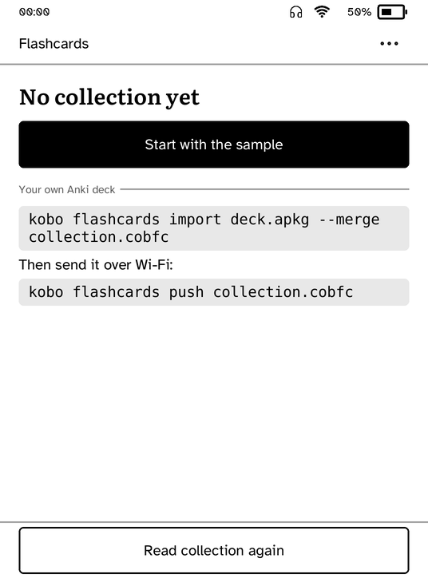 |
| Kitchen Card, connect | 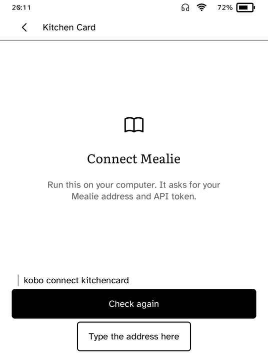 | 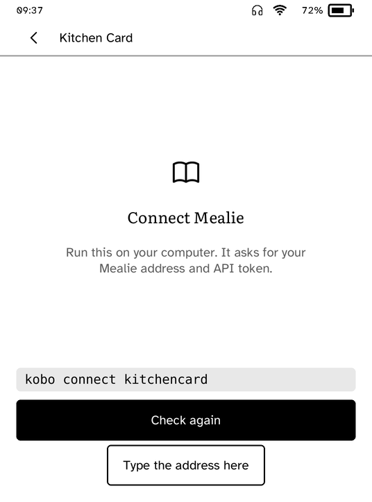 |
| Fieldbook, a species | 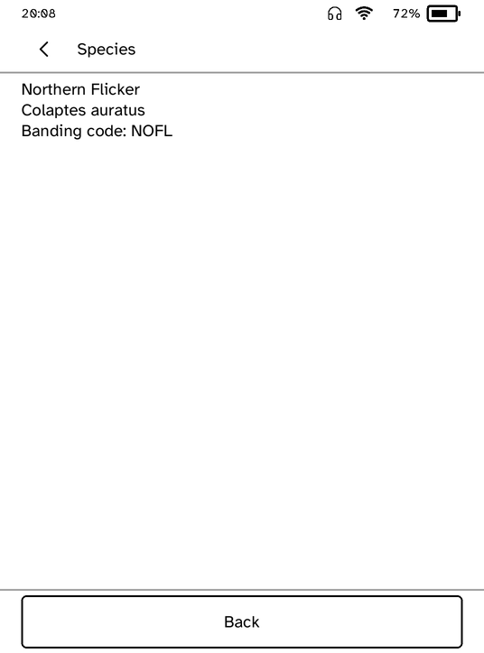 | 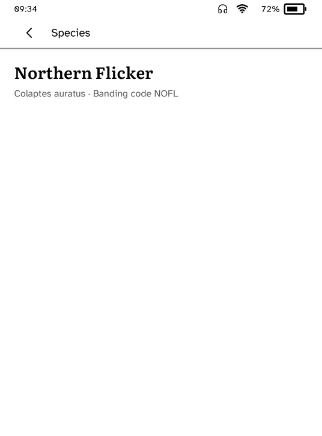 |
| The runtime's typing screen | 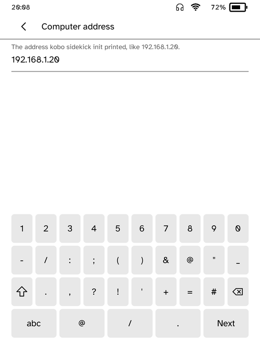 | 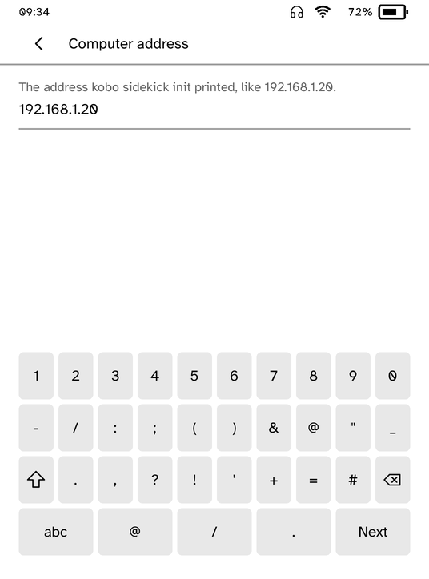 |
| Deck, pads | 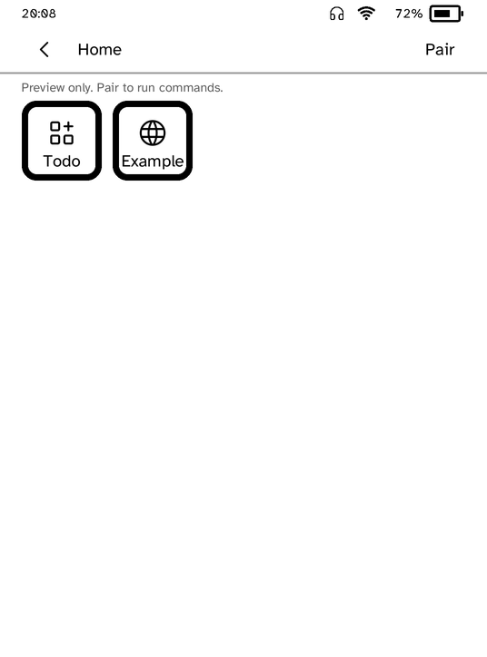 | 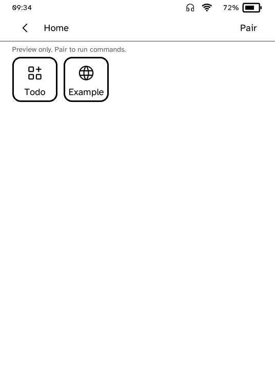 |

What to look for:

- The heading is 4.6 mm rather than 5.4 mm, and leads the page without
  competing with the bar.
- Three millimetres under the bar's rule, four above a heading that follows
  other content, two above the first button after text. Everything else is
  still a millimetre apart.
- A secondary line is 2.7 mm, so "If the first cannot reach this reader..."
  and the typing screen's hint read as sentences.
- A command is set in the fixed-pitch face on a grey panel and breaks only at
  its spaces. It used to be a quotation, with a rule at the left.
- Deck's pads keep their rounded square in a 0.5 mm line rather than 1.2 mm.
- The deck grid has no extra room under the bar. A screen built round a board
  or a grid of squares keeps Folio's gaps, because the board is sized to all
  the room it is given.

At the larger text sizes a screen that does not fit with the extra room is
laid out without it, and with secondary lines at caption size, before anything
is cut. Those screens look as they did under Folio, apart from the smaller
headings and the command panels.
