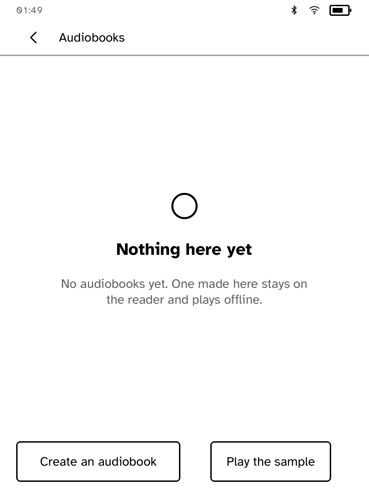
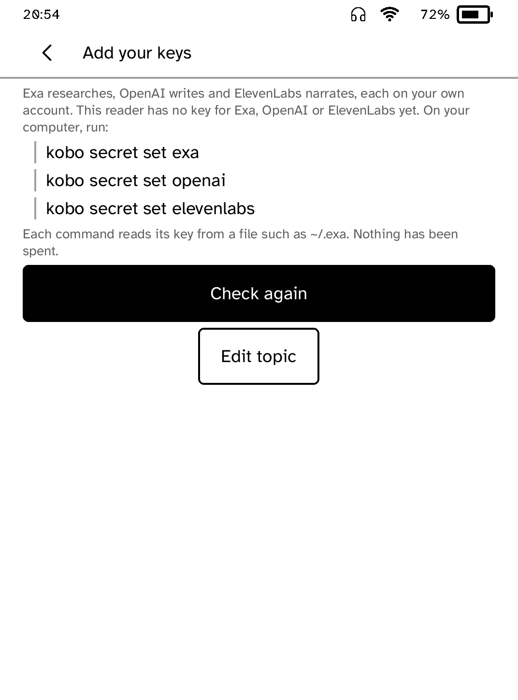
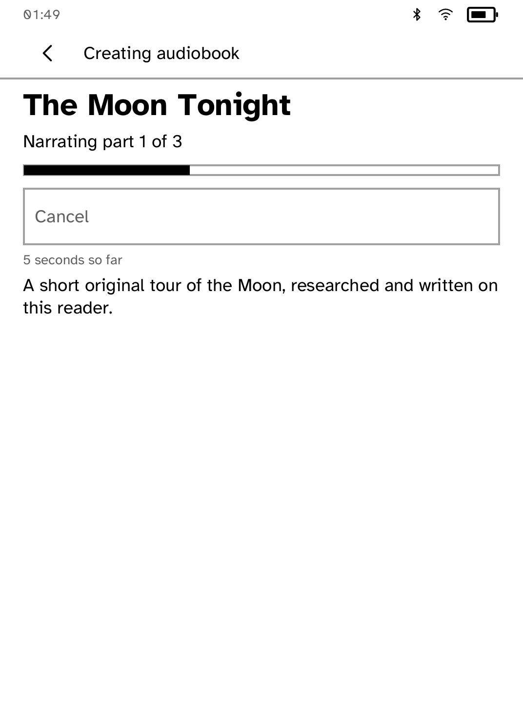
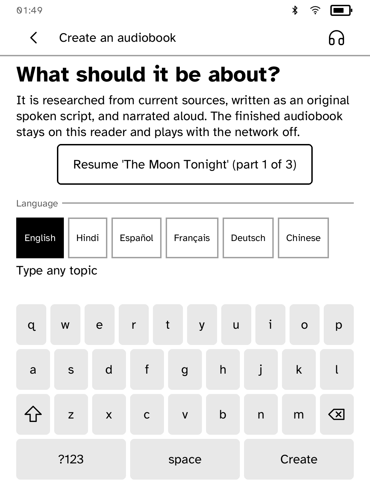
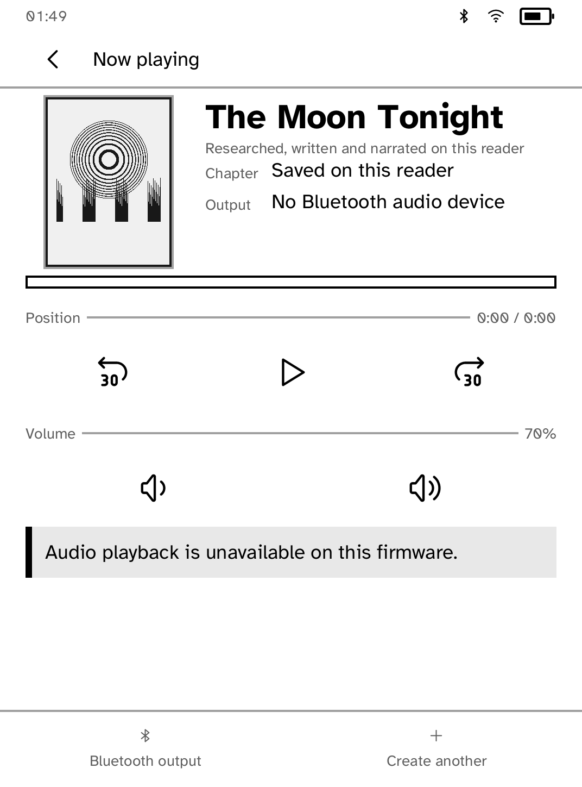

# Audiobook Studio

Turn a topic into an original narrated audiobook and listen on your Kobo.

<table>
<tr>
<td width="50%" valign="top"><br>The shelf, with a free sample</td>
<td width="50%" valign="top"><br>Missing keys, each with the command that adds it</td>
</tr>
<tr>
<td width="50%" valign="top"><br>Narrating part 1 of 3</td>
<td width="50%" valign="top"><br>Resuming an interrupted book</td>
</tr>
<tr>
<td width="50%" valign="top"><br>The player</td>
</tr>
</table>

## Features

- Type a topic. Exa researches it, OpenAI writes an original script and
  ElevenLabs narrates it.
- Before anything is spent, it shows what a book takes: about 3 to 8 minutes
  and roughly $1 to $5 across the three accounts, most of it narration.
- Finished books are saved as `.mp3z` files in `/mnt/onboard/Audiobooks`, so
  they also appear in the Kobo's My Books.
- The shelf opens first, and every saved book plays offline.
- The player has cover art, position, 30-second skips, play and pause, and
  volume.
- Plays through Bluetooth headphones or speakers. If none is connected, **Play**
  opens a device picker, and the book starts once one connects.
- While a book is being made, the screen shows elapsed time every five seconds
  and save progress in bytes.
- Each narrated part is kept as it arrives. If a book stops part way, even
  across a restart, **Resume** carries on from the next part and does not pay
  for the finished ones again.
- A free sample plays without any accounts.

## Setup

Audiobook Studio uses your own accounts with three services.

1. Set up the reader once over USB, if you have not already:

   ```sh
   kobo setup
   ```

2. Create an API key with Exa (research), OpenAI (writing) and ElevenLabs
   (narration). Save them in private files: `~/.exa`, `~/.openai` and
   `~/.elevenlabs`.
3. Install the three keys:

   ```sh
   kobo secret set exa
   kobo secret set openai
   kobo secret set elevenlabs
   ```

4. Open Audiobook Studio and type a topic.

The app checks all three keys before making any paid request. If one is
missing, it names the exact command to run and keeps your topic, so **Check
again** picks up where you were. The runtime attaches each key only to its
provider's endpoints, and the app never sees them.

## Permissions

- `network`: calls Exa, OpenAI and ElevenLabs.
- `audio`: plays the audiobook.
- `bluetooth-audio`, `bluetooth-control`: finds and connects headphones or
  speakers.

## Development

```sh
cargo test -p kobo-audiobook
kobo run --sim --app audiobook      # in the browser simulator
python3 scripts/check-apps-sim.py audiobook
kobo deploy --device <ip>       # onto a reader over Wi-Fi
```
The screenshots come from `scripts/quality/check-audiobook-sim.py`, which runs against local test servers.

---

Part of [Cobalt](../../README.md). See [all apps](../../README.md#apps).
