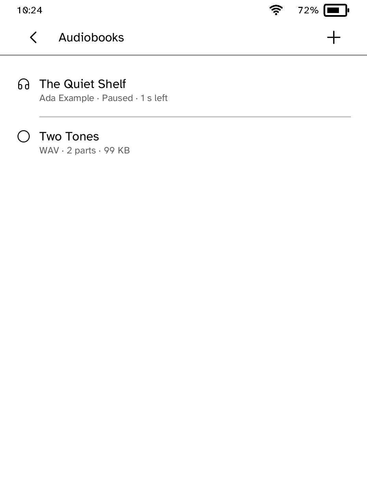
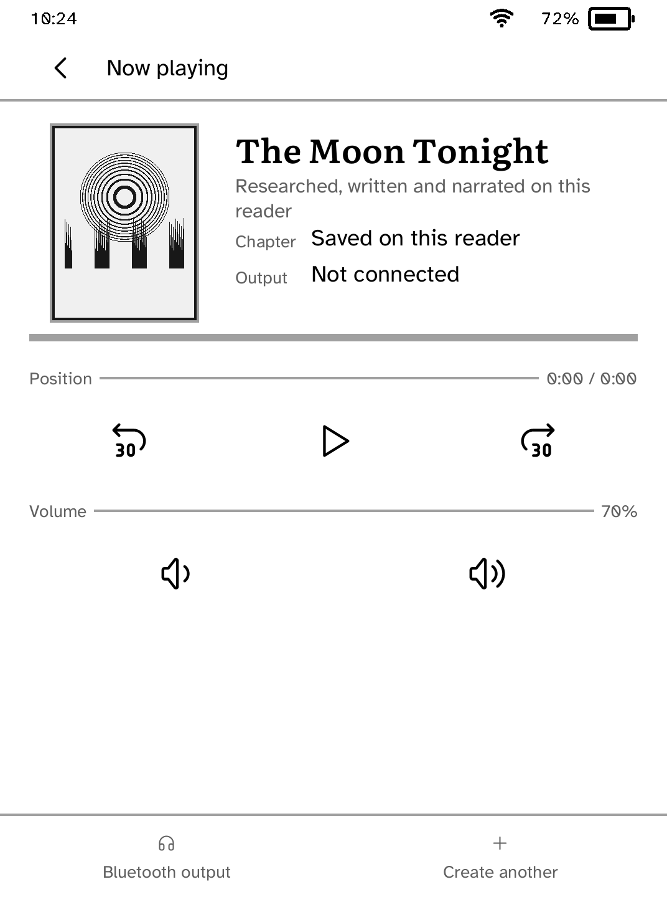
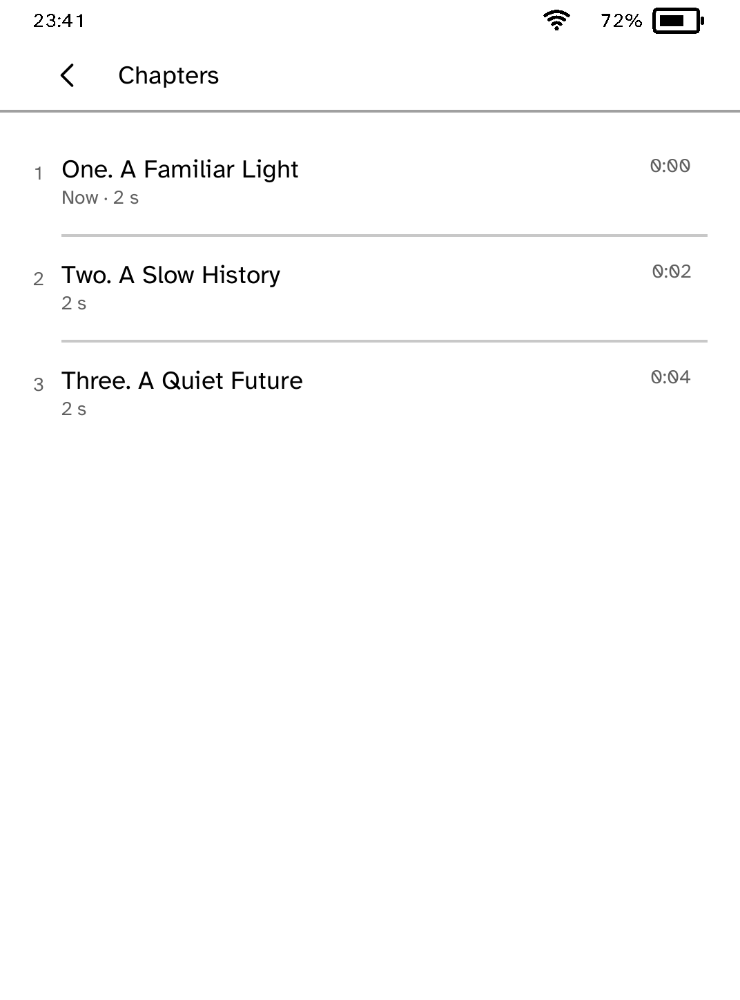
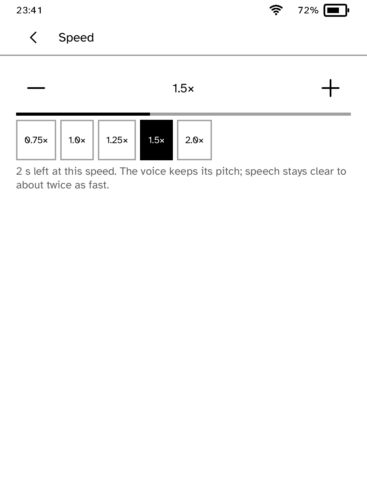
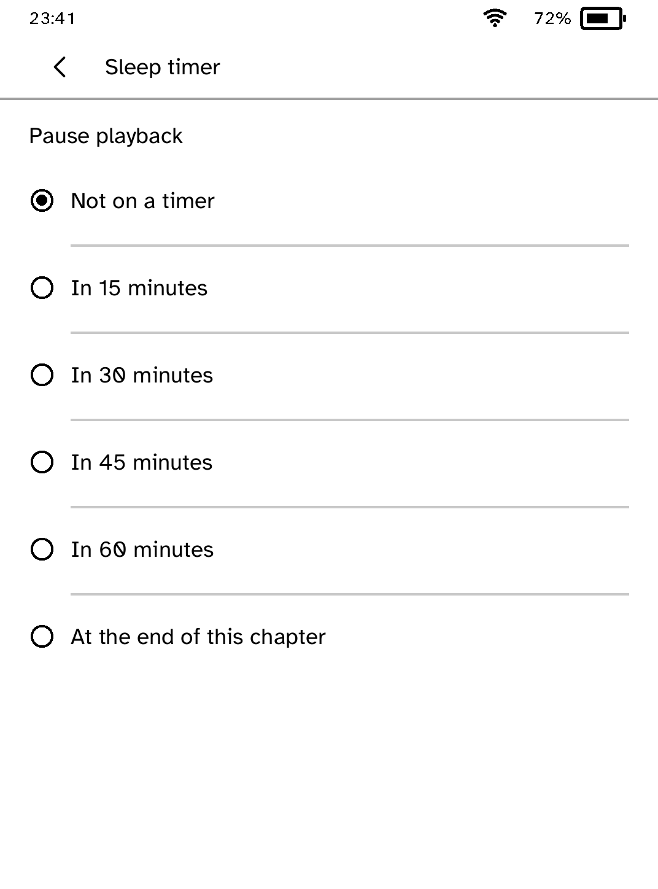
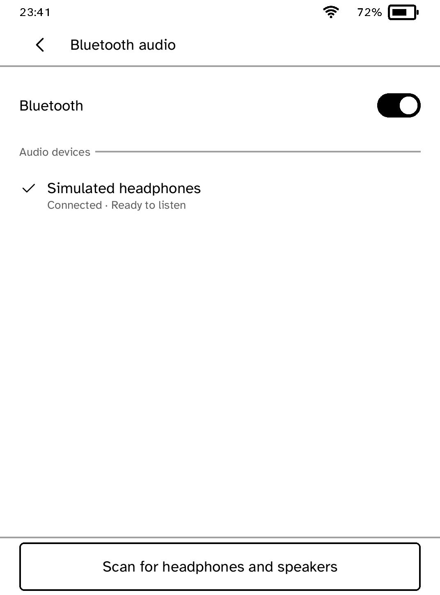

# Audiobooks

Play the audiobooks on your Kobo, with chapters, speed, a sleep timer and your
place kept. Or make one from a topic with your own accounts.

<table>
<tr>
<td width="50%" valign="top"><br>The library, with a book on the go first</td>
<td width="50%" valign="top"><br>The player</td>
</tr>
<tr>
<td width="50%" valign="top"><br>The chapters, with the one playing marked</td>
<td width="50%" valign="top"><br>Speed, with the common ones a tap each</td>
</tr>
<tr>
<td width="50%" valign="top"><br>The sleep timer</td>
<td width="50%" valign="top"><br>Play asks for headphones when none are connected</td>
</tr>
</table>

## Features

- Plays what you copy onto the reader over USB: MP3, M4B and M4A (AAC), Ogg
  Vorbis, Ogg Opus, FLAC and WAV, and the `.mp3z` archives the reader's own
  store uses. A folder of numbered files is one book with a part per file,
  which is how a ripped set of discs arrives.
- Shows the book's own cover, title, author and narrator, and its chapters,
  whether they are in the file, in an ID3 tag, in Ogg comments, or one per
  file.
- Chapter keys either side of the transport, and a chapter list that opens
  on the chapter playing. Back within a chapter goes to its start; back
  again goes to the one before.
- Speed from half to three times, in steps of five percent, with the voice's
  pitch unchanged. The common speeds are a tap each.
- A sleep timer: in 15, 30, 45 or 60 minutes, or at the end of this chapter.
- Your place in every book is kept. Opening a book again carries on where
  you left it, a few seconds earlier the longer you have been away, and the
  library lists the books on the go first with how much is left in each.
- Losing the headphones keeps your place. Play carries on from where the
  sound stopped once they are back.
- Backing out of the player keeps the book playing; the library's first row
  leads back to it. The page keys skip half a minute either way.
- Plays through Bluetooth headphones or speakers. If none is connected,
  tapping a book opens a device picker, and the book starts once one
  connects.
- A free sample plays without any accounts.
- Everything plays offline. Nothing on the reader is uploaded anywhere.

### Making a book

- Type a topic. Exa researches it, OpenAI writes an original script and
  ElevenLabs narrates it. Before anything is spent, it shows what a book
  takes: about 3 to 8 minutes and roughly $1 to $5 across the three accounts,
  most of it narration.
- Finished books are saved as `.mp3z` files in the Audiobooks folder, so they
  also appear in the Kobo's My Books, and they list and play here like any
  other book.
- Each narrated part is kept as it arrives. If a book stops part way, even
  across a restart, **Resume** carries on from the next part and does not pay
  for the finished ones again.

## Setup

1. Set up the reader once over USB, if you have not already:

   ```sh
   kobo setup
   ```

2. Plug the reader in, open its storage and copy audiobooks into a folder
   called `Audiobooks`. One file is one book; a folder of numbered files is
   one book with a part per file. The folder can be anywhere the reader's
   own books go, including the SD card.
3. Open Audiobooks and tap a book. Connect headphones or a speaker when
   asked.

To make a book from a topic, create an API key with Exa (research), OpenAI
(writing) and ElevenLabs (narration), save them in `~/.exa`, `~/.openai` and
`~/.elevenlabs`, and install the three keys:

```sh
kobo secret set exa
kobo secret set openai
kobo secret set elevenlabs
```

The app checks all three keys before making any paid request. If one is
missing, it names the exact command to run and keeps your topic, so **Check
again** picks up where you were. The runtime attaches each key only to its
provider's endpoints, and the app never sees them.

## What plays and what does not

Everything is decoded on the reader by the runtime, in pure Rust: MP3, AAC-LC
in MPEG-4, Ogg Vorbis, Ogg Opus, FLAC and WAV. HE-AAC (AAC with SBR) is not
decoded; a file that says it needs it is refused as a kind this reader cannot
play. Books with DRM do not play. A listing stops at two thousand books and
says so.

## Permissions

- `network`: calls Exa, OpenAI and ElevenLabs when making a book.
- `audio`: lists and plays the audiobooks on the reader.
- `bluetooth-audio`, `bluetooth-control`: finds and connects headphones or
  speakers.

## Development

```sh
cargo test -p kobo-audiobook
kobo run --sim --app audiobook      # in the browser simulator
python3 scripts/check-apps-sim.py audiobook --all-routes
kobo deploy --device <ip>       # onto a reader over Wi-Fi
```

The simulator check seeds two books from `crates/kobo-audio/fixtures` and
simulates a pair of headphones once Bluetooth is switched on. The studio's
end-to-end check, `scripts/quality/check-audiobook-sim.py`, runs the creation
flow against local test servers.

---

Part of [Cobalt](../../README.md). See [all apps](../../README.md#apps).
