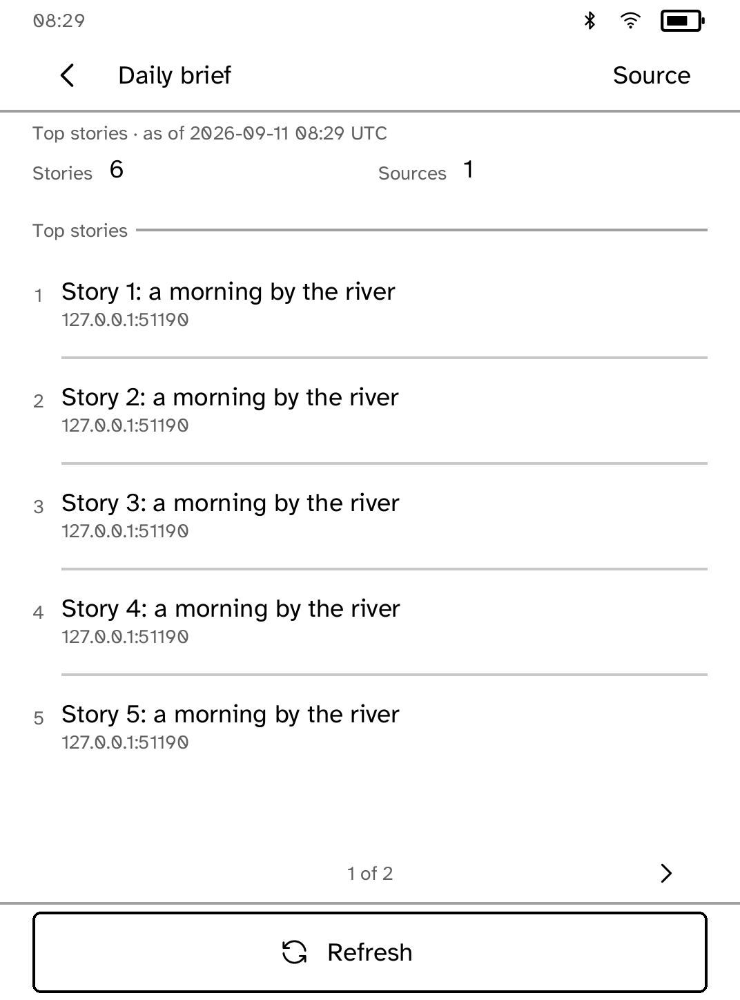
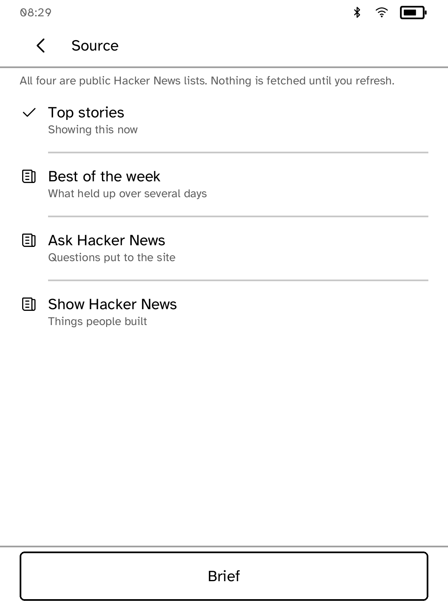

# Daily Brief

A news brief that keeps loading while you use other apps.

<table>
<tr>
<td width="50%" valign="top"><br>The brief, with its source and fetch time</td>
<td width="50%" valign="top"><br>Choosing the source list</td>
</tr>
</table>

## Features

- Draws twelve stories from one of four Hacker News lists: the front page,
  best of the week, Ask HN or Show HN. **Source** switches between them.
- Refreshes itself. After your first **Refresh**, it wakes the reader each
  morning to fetch a new brief, and fetches one whenever you open it more than
  six hours after the last.
- Every story behind a headline is saved on the reader with its pictures as
  the brief arrives, so the whole brief reads without Wi-Fi. The brief says
  what is ready offline, for example "Ready offline: 12 stories, 2.4 MB".
  Stories from earlier briefs are removed.
- Stories open in the document reader cut to the article, without the site's
  menus and footers. Each reopens where you left it, and a new one opens at the
  text size you chose last.
- Shows which list it came from and when it was fetched, in the reader's own
  time zone.
- Tap **Refresh** and switch to another app. The brief keeps loading and is
  ready when you come back.
- If a refresh fails, the last brief stays and you can try again.

## Permissions

- `network`: fetches stories and articles.
- `scheduled-wake`: wakes the reader each morning to fetch the brief.

## Development

```sh
cargo test -p kobo-brief
kobo run --sim --app brief      # in the browser simulator
python3 scripts/check-apps-sim.py brief
kobo deploy --device <ip>       # onto a reader over Wi-Fi
```

---

Part of [Cobalt](../../README.md). See [all apps](../../README.md#apps).
