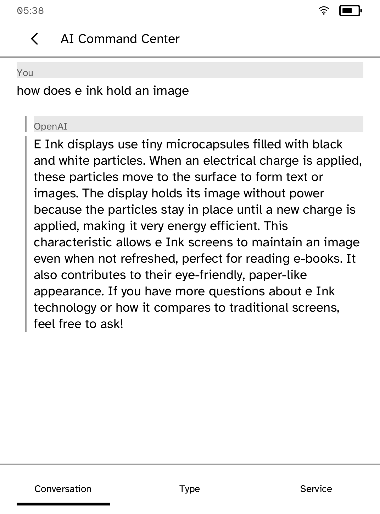
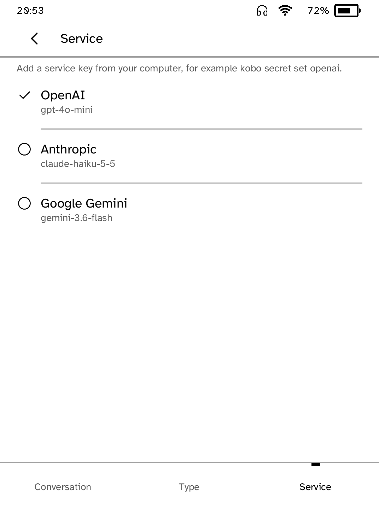
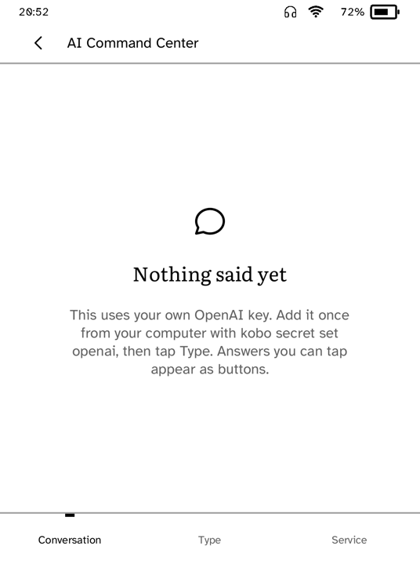
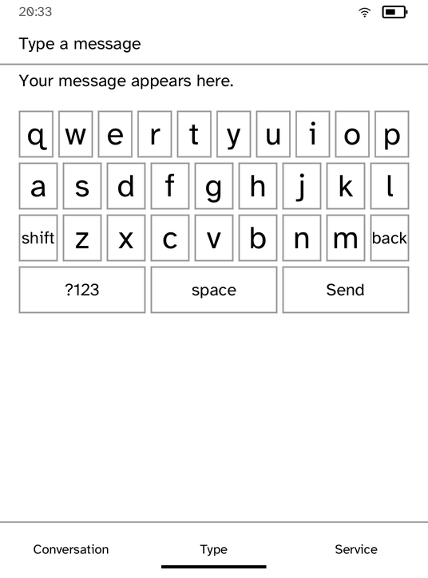

# AI Command Center

Ask OpenAI, Anthropic or Google Gemini a question and read the answer on your
Kobo.

<table>
<tr>
<td width="50%" valign="top"><br>An answer, set for reading</td>
<td width="50%" valign="top"><br>Choosing the service</td>
</tr>
<tr>
<td width="50%" valign="top"><br>A new conversation</td>
<td width="50%" valign="top"><br>The keyboard</td>
</tr>
</table>

## Features

- Choose OpenAI, Anthropic or Google Gemini.
- Long answers are paged for reading. An answer that reaches its length
  limit offers **Continue the answer**.
- When a question has a set of possible answers, they appear as buttons, so
  most turns need no typing.
- Remembers the conversation across restarts and can save a copy for a paired
  computer.

## Setup

AI Command Center uses your own API key, so it needs an account with one of
the three services.

1. Set up the reader once over USB, if you have not already:

   ```sh
   kobo setup
   ```

2. Create an API key with OpenAI, Anthropic or Google Gemini. Save it in a
   private file named for the service: `~/.openai`, `~/.anthropic` or
   `~/.gemini`.
3. Install the key on the reader under the same name, `openai`, `anthropic`
   or `gemini`:

   ```sh
   kobo secret set openai
   ```

4. Open AI Command Center. If the key is not for OpenAI, tap **Service** and
   choose its service, then tap **Type** and ask.

The first screen names the key the chosen service needs before you type
anything. The runtime attaches the key to requests itself. The app never sees
it, and a test checks that no request body contains anything that looks like
a key.

## Permissions

- `network`: sends questions to the chosen service.

## Development

```sh
cargo test -p kobo-chat
kobo run --sim --app chat      # in the browser simulator
python3 scripts/check-apps-sim.py chat
kobo deploy --device <ip>       # onto a reader over Wi-Fi
```

---

Part of [Cobalt](../../README.md). See [all apps](../../README.md#apps).
