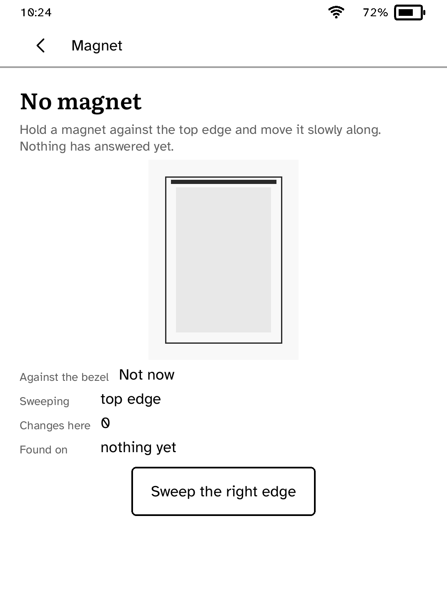
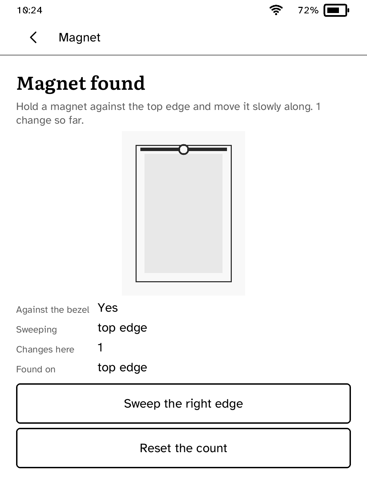

# Magnet

Find the magnet sensor behind your Kobo's bezel and watch it respond.

<table>
<tr>
<td width="50%" valign="top"><br>Waiting, with the edge to sweep marked</td>
<td width="50%" valign="top"><br>The sensor responding at the top edge</td>
</tr>
</table>

## Using it

1. The diagram marks one edge of the reader. Hold a magnet against that edge
   and move it slowly along.
2. When the sensor responds, the screen says so and a ring appears on that
   edge.
3. **Sweep the right edge** (or whichever edge is next) moves on to it.

The edge that responded is remembered, so next time the app opens on it and
says where it was found.

Each edge counts how many times the sensor changed state. A magnet moved
slowly can make the sensor flicker, and the count shows that. **Reset the
count** starts again.

The app reports what the sensor measured. It does not claim a cover is closed,
because the sensor cannot tell a cover from any other magnet.

## Using the sensor in your own app

```rust
fn on_start(&mut self, context: &mut Context) {
    context.device().read_cover();
}

fn on_device_result(&mut self, context: &mut Context, request: DeviceRequest, result: DeviceResult) {
    if let (DeviceRequest::ReadCover, DeviceResult::Cover { available: true, magnet_present }) =
        (request, result)
    {
        self.present = magnet_present;
        context.set_screen(self.screen());
    }
}

fn on_cover_change(&mut self, context: &mut Context, magnet_present: bool) {
    self.present = magnet_present;
    context.set_screen(self.screen());
}
```

- Call `read_cover` once at the start. A magnet already in place produces no
  change event, so the starting state comes back through `on_device_result`.
  `available` is false on a reader without the sensor.
- Only the app in the foreground receives changes. Ask again when your app
  returns to the foreground.

## Permissions

- `cover-sensor`: reads the magnet sensor.

## Development

```sh
cargo test -p kobo-magnet
(cd examples/magnet && kobo dev)   # in the browser simulator
python3 scripts/check-apps-sim.py magnet
kobo deploy --device <ip>   # install Cobalt, with this app, over Wi-Fi
```

---

Part of [Cobalt](../../README.md). See [all apps](../../README.md#apps).
