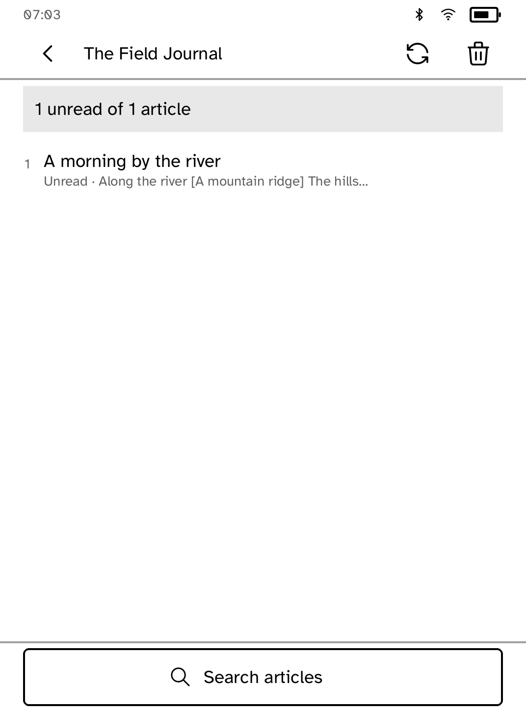
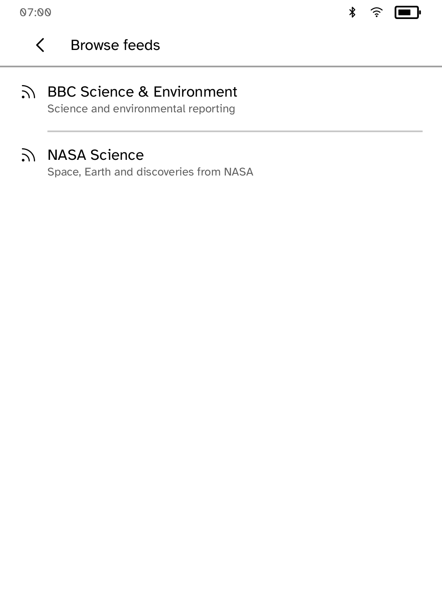
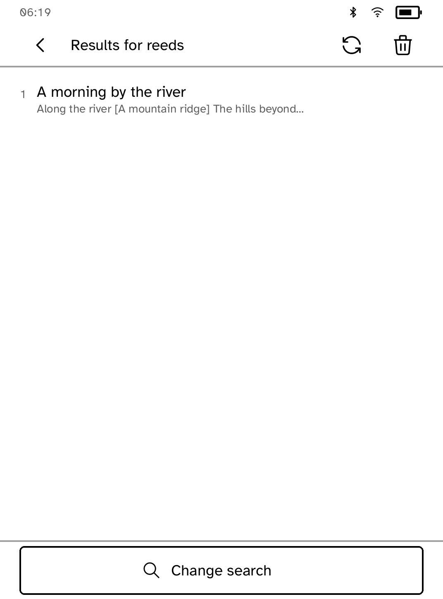
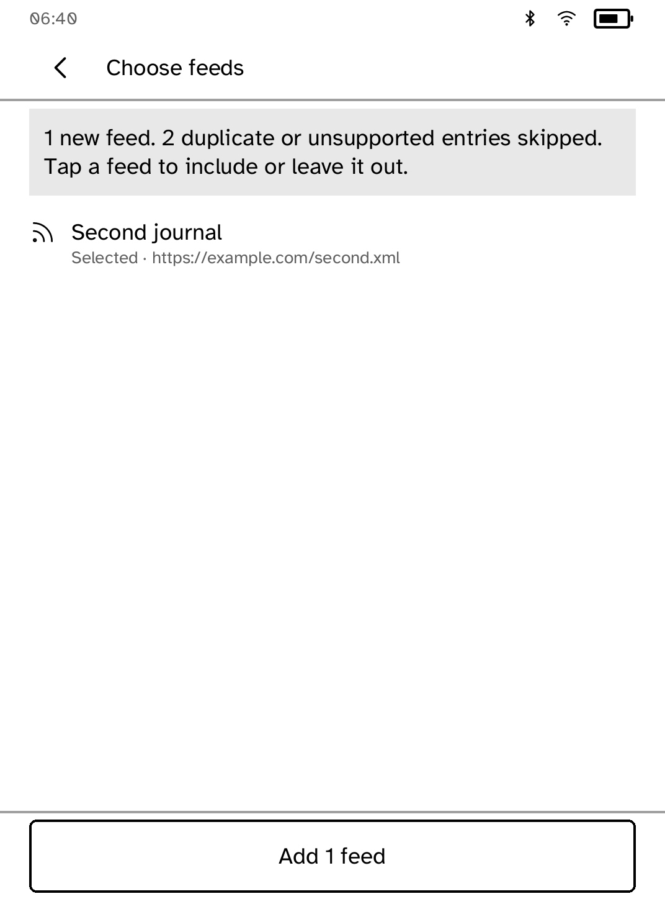
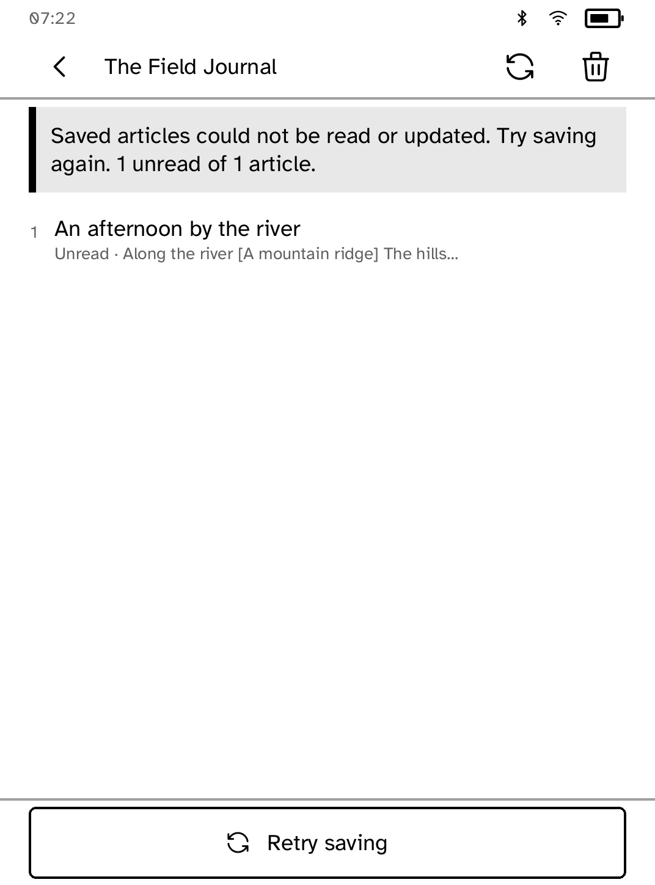

# Feeds

Follow websites and read their articles offline.

<table>
<tr>
<td width="50%" valign="top"><br>Unread articles from a feed</td>
<td width="50%" valign="top"><br>Reading an article</td>
</tr>
<tr>
<td width="50%" valign="top"><br>Browsing suggested feeds</td>
<td width="50%" valign="top"><br>Searching saved articles</td>
</tr>
<tr>
<td width="50%" valign="top"><br>Importing subscriptions from OPML</td>
<td width="50%" valign="top"><br>Retrying a save that failed</td>
</tr>
</table>

## Features

- Find a feed by website name, paste its HTTPS address, or browse the starter
  feeds, which carry whole articles. Names are looked up with Feedsearch.
  Pasted addresses are fetched directly and never sent to Feedsearch.
- RSS, Atom and JSON Feed. Each feed is previewed with its name and article
  count before you add it.
- Import subscriptions from an OPML file.
- Search saved articles across every subscription.
- Articles open in the shared reader, with saved position and inline images
  with captions. A new article opens at the text size you chose last.
- **Refresh all** on the shelf reads every feed in turn. The ten newest
  unread articles with pictures in each feed are saved whole, pictures
  included, so they open without Wi-Fi. The shelf says what is ready offline, for example
  "Ready offline: 120 articles, 6.2 MB".
- Every article's words are saved with its feed. Pictures of older articles
  are downloaded when you open them and reused across feeds.
- Refresh times are shown in the reader's own time zone.
- Refreshing keeps the current articles until new ones arrive. If saving fails,
  **Retry saving** saves the refresh without downloading it again.

## Sending subscriptions from your computer

Set up the reader once over USB with `kobo setup`, if you have not already.
Then:

```sh
kobo feeds check subscriptions.opml   # check an OPML file
kobo feeds push subscriptions.opml    # send it to the reader
```

Then open Feeds and choose **Import OPML**. Files up to 256 KB are accepted.
Add `--sim` to send it to the simulator instead.

## Notes

Feeds shows what a feed provides. If a feed carries only summaries, that is
what you get. For a Miniflux account, use [Digest](../../apps/rss-miniflux/).

## Permissions

- `network`: fetches feeds, articles and images.

## Development

```sh
cargo test -p kobo-rss
kobo run --sim --app rss      # in the browser simulator
python3 scripts/check-apps-sim.py rss
kobo deploy --device <ip>       # onto a reader over Wi-Fi
```

---

Part of [Cobalt](../../README.md). See [all apps](../../README.md#apps).
