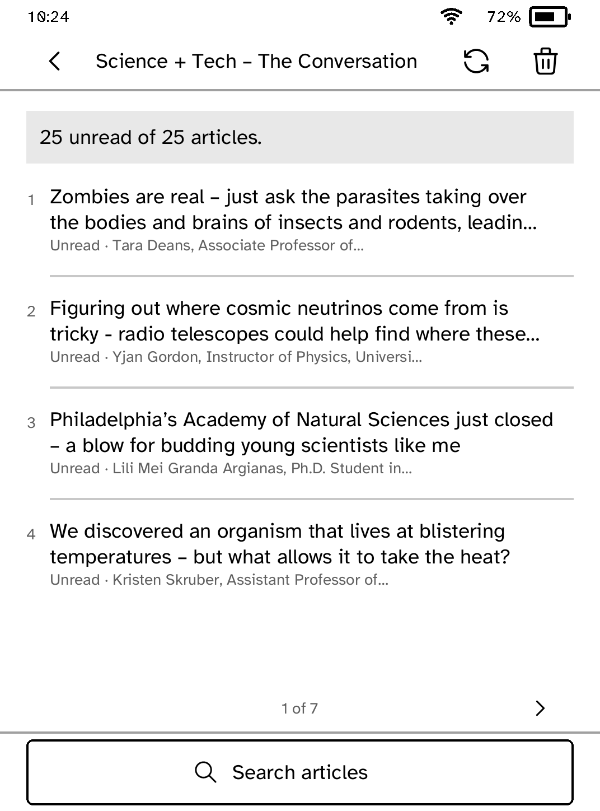
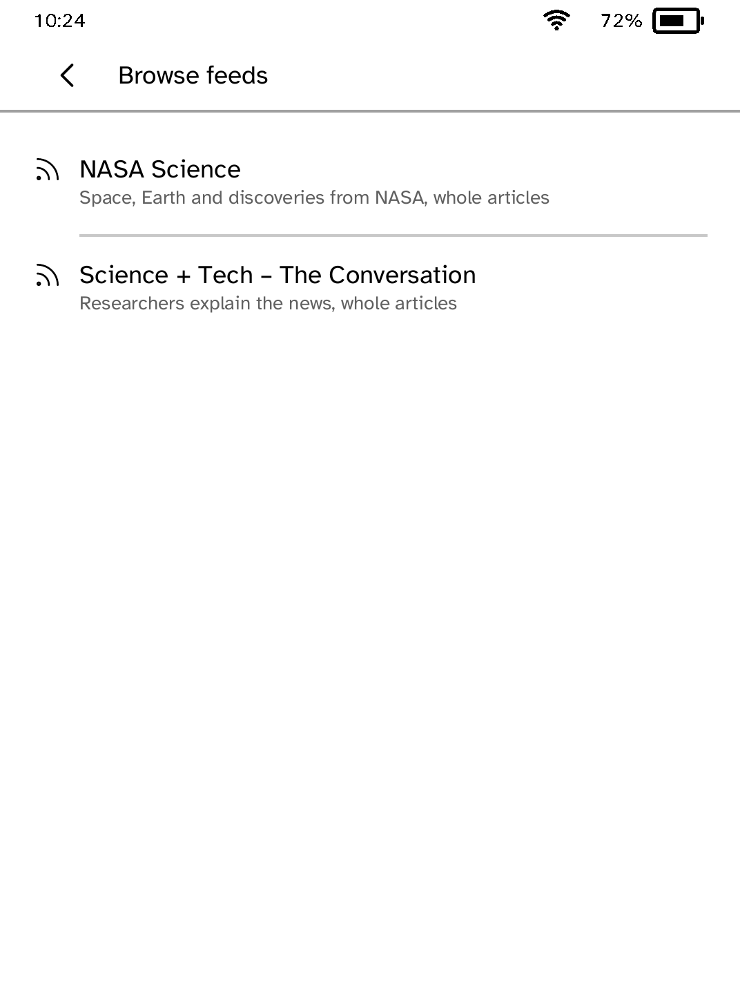
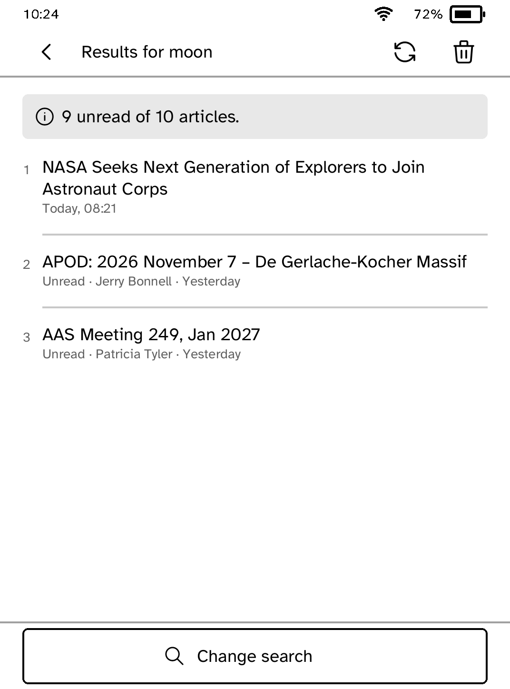
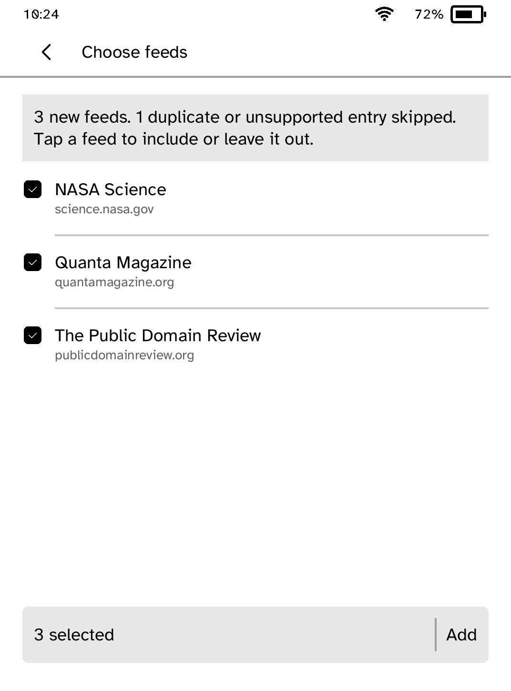
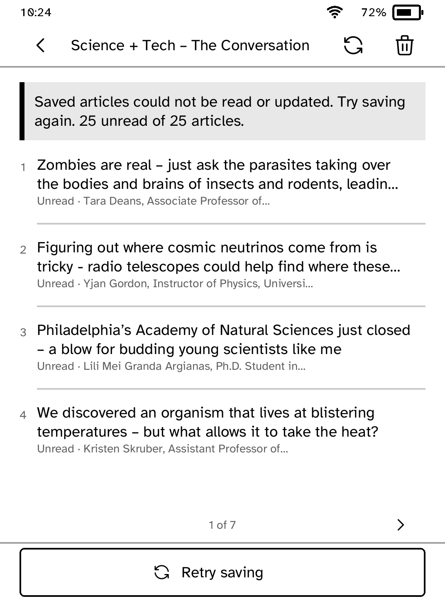

# Feeds

Follow websites and read their articles offline.

<table>
<tr>
<td width="50%" valign="top"><br>Unread articles from a feed</td>
<td width="50%" valign="top"><br>An article with its photo and caption</td>
</tr>
<tr>
<td width="50%" valign="top"><br>Browsing suggested feeds</td>
<td width="50%" valign="top"><br>Searching saved articles</td>
</tr>
<tr>
<td width="50%" valign="top"><br>Choosing feeds to import from an OPML file</td>
<td width="50%" valign="top"><br>Retrying a save that failed</td>
</tr>
</table>

## Features

- Find a feed by website name, paste its HTTPS address, or browse the starter
  feeds, which carry whole articles. Names are looked up with Feedsearch.
  Pasted addresses are fetched directly and never sent to Feedsearch.
- Paste the address of a site instead of its feed and Feeds follows it to the
  feed the page names, or to the usual feed paths on that site.
- Most newsletters can be followed the same way, by the address of their
  site: most newsletter services publish every issue as a feed as well as by
  email. A newsletter that is sent by email only cannot be followed yet.
- RSS, Atom and JSON Feed. Each feed is previewed with its name and article
  count before you add it.
- Import subscriptions from an OPML file.
- Whole articles from feeds that carry only a summary. Feeds fetches the page
  behind the summary and cuts it to the article on the reader, when you open
  it and for the newest of each feed on **Refresh all**.
- Search saved articles across every subscription, including the text of
  articles fetched from their pages.
- Articles open in the shared reader, with saved position and inline images
  with captions. A new article opens at the text size you chose last.
- **Refresh all** on the shelf reads every feed in turn. The ten newest
  unread articles in each feed are saved whole, so they open without Wi-Fi:
  pictures for an article the feed carries, and the page behind a summary. One
  refresh fetches at most forty pages, shared across the feeds, and the next
  refresh carries on. The shelf says what is ready offline, for example
  "Ready offline: 120 articles, 6.2 MB", and counts a summary only once its
  article is on the reader.
- The words a feed carries are saved with the feed. Pictures of older
  articles are downloaded when you open them and reused across feeds.
- Refresh times are shown in the reader's own time zone.
- Refreshing keeps the current articles until new ones arrive. If saving fails,
  **Retry saving** saves the refresh without downloading it again.

## Sending subscriptions from your computer

Set up the reader once over USB with `kobo setup`, if you have not already.
Then:

```sh
kobo feeds check subscriptions.opml   # check an OPML file
kobo feeds push subscriptions.opml    # send it to the reader
```

Then open Feeds and choose **Import OPML**. Files up to 256 KB are accepted.
Add `--sim` to send it to the simulator instead.

## Notes

Feeds shows the whole article where it can get it. Some sites refuse a reader
that is not a browser, keep their articles behind a paywall or draw their
pages with scripts. For those you get the summary the feed carries, with a
line under it saying so the first time, and Feeds does not ask that page
again. If a site did not answer, opening the article again asks once more.
Pictures are fetched from the article's own site only, so a picture served
from elsewhere reads as its caption.

A feed larger than 512 KB is cut to its newest articles. For a Miniflux
account, use [Digest](../../apps/rss-miniflux/).

## Permissions

- `network`: fetches feeds, articles and images.

## Development

```sh
cargo test -p kobo-rss
(cd examples/rss && kobo dev)   # in the browser simulator
python3 scripts/check-apps-sim.py rss
python3 scripts/quality/check-rss-whole-sim.py --output target/rss-whole
kobo deploy --device <ip>   # install Cobalt, with this app, over Wi-Fi
```

---

Part of [Cobalt](../../README.md). See [all apps](../../README.md#apps).
