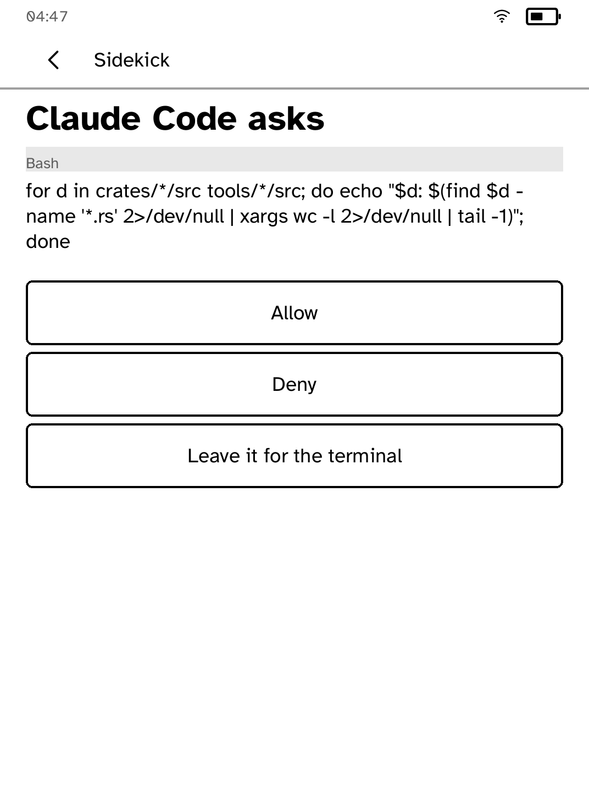
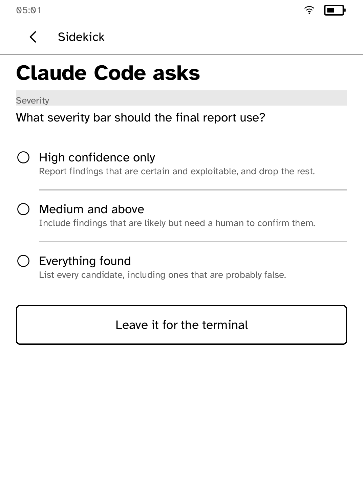
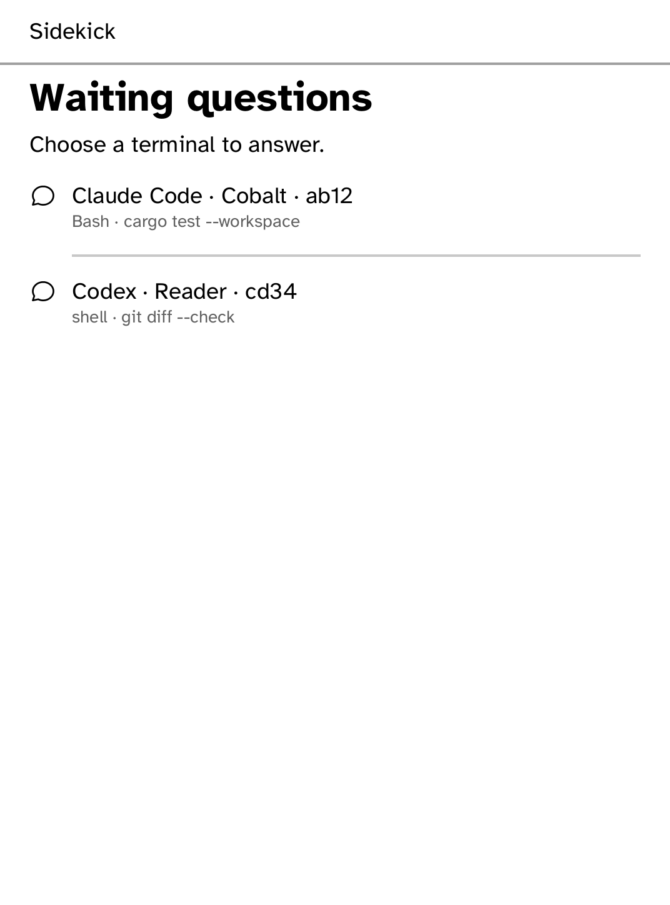
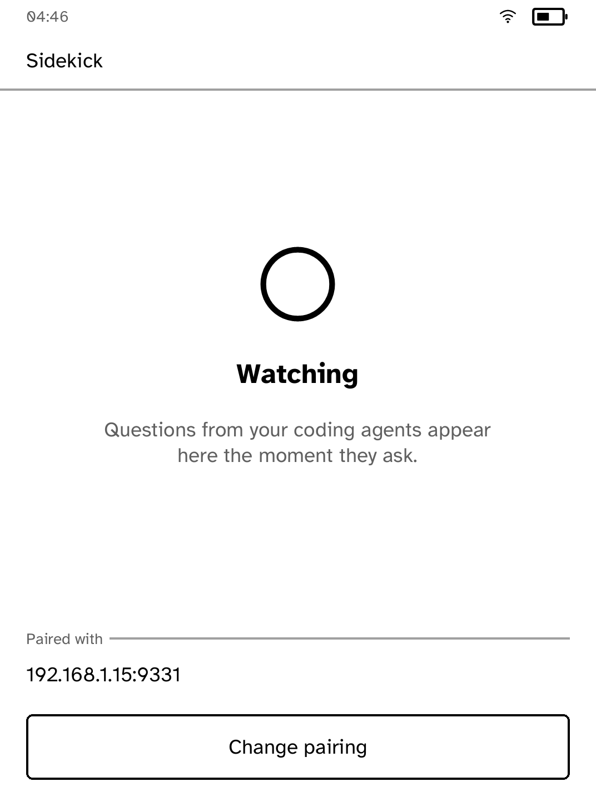
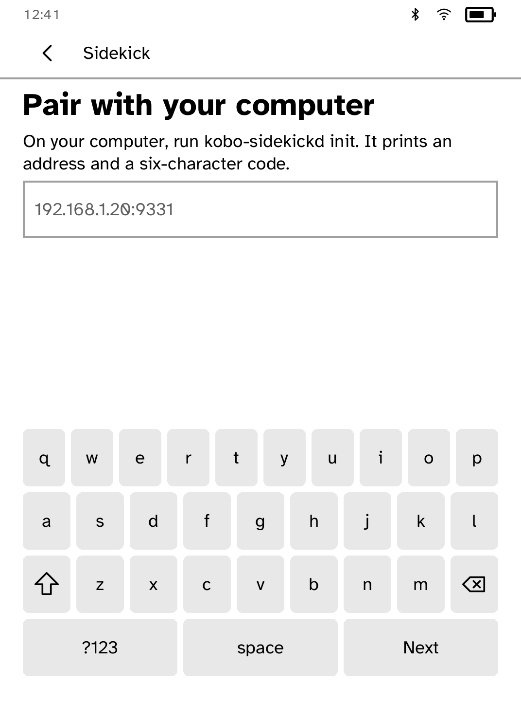

# Sidekick

Answer your coding agents' permission prompts from your Kobo.

<table>
<tr>
<td width="50%" valign="top"><br>A command waiting for approval</td>
<td width="50%" valign="top"><br>A question with its own answers</td>
</tr>
<tr>
<td width="50%" valign="top"><br>Several terminals waiting</td>
<td width="50%" valign="top"><br>Paired and watching</td>
</tr>
<tr>
<td width="50%" valign="top"><br>Pairing with a computer</td>
</tr>
</table>

When Claude Code or Codex stops to ask "may I run this?", Sidekick shows the
question on your Kobo. The [sidekick daemon](../../crates/kobo-sidekickd) on
your computer catches it through the agent's own hooks.

## Features

- Shows the full command, which agent is asking, and from which terminal on
  which computer.
- Answer **Allow**, **Deny** or **Leave it for the terminal**. Pressing Back
  also leaves it for the terminal.
- Questions that come with their own options, such as choosing an approach,
  show each option with its description. Questions that allow several choices
  let you tick them, then send.
- When several questions are waiting, a board lists them all. Each answer
  returns to the terminal that asked.
- The screen redraws only when a question arrives.

| Agent | Status |
| --- | --- |
| Claude Code | Permission requests and `AskUserQuestion` |
| Codex | Permission requests |
| Gemini CLI, OpenCode, GitHub Copilot CLI, Cursor CLI | Detected, not yet supported |

## Setup

Sidekick needs your computer. On it:

1. Set up the reader once over USB, if you have not already:

   ```sh
   kobo setup
   ```

2. Pair this computer with the reader. This writes the pairing for Sidekick,
   [Deck](../../apps/deck/) and [Paperterm](../../apps/paperterm/) onto the
   reader over Wi-Fi, so there is nothing to type there. The first time, close
   Cobalt on the reader and open it again afterwards so it trusts the computer.

   ```sh
   kobo sidekick init
   ```

3. Let your agent ask through Sidekick. Use `codex` instead of `claude` for
   Codex.

   ```sh
   kobo sidekick setup claude
   ```

4. Start the helper and leave it running, then open Sidekick on the reader.

   ```sh
   kobo sidekick run
   ```

`kobo sidekick test` sends the reader a harmless question and waits for your
answer. `kobo sidekick status` says whether the helper is running and whether
a reader is watching.

If `init` cannot reach the reader, it prints an address and a six-character
code. Enter them in Sidekick; they are remembered. **Change pairing** on the
watching screen starts again.

The top of the screen says **Watching** only while the computer answers. When
it does not, Sidekick says **Not connected** and why, and your agents ask at
their terminals as usual. A question asked while no reader has been in touch
for a minute goes straight back to the terminal instead of waiting.

## Security

The connection uses TLS with the certificate `init` installed on the reader,
and every request carries the pairing code, so no one else on the network can
see or answer questions. If the helper is unreachable, the agents' own
terminal prompts work as usual.

## Permissions

- `network`: connects to the daemon on your computer.

## Development

```sh
cargo test -p kobo-sidekick
kobo run --sim --app sidekick      # in the browser simulator
python3 scripts/check-apps-sim.py sidekick
kobo deploy --device <ip>       # onto a reader over Wi-Fi
```

---

Part of [Cobalt](../../README.md). See [all apps](../../README.md#apps).
