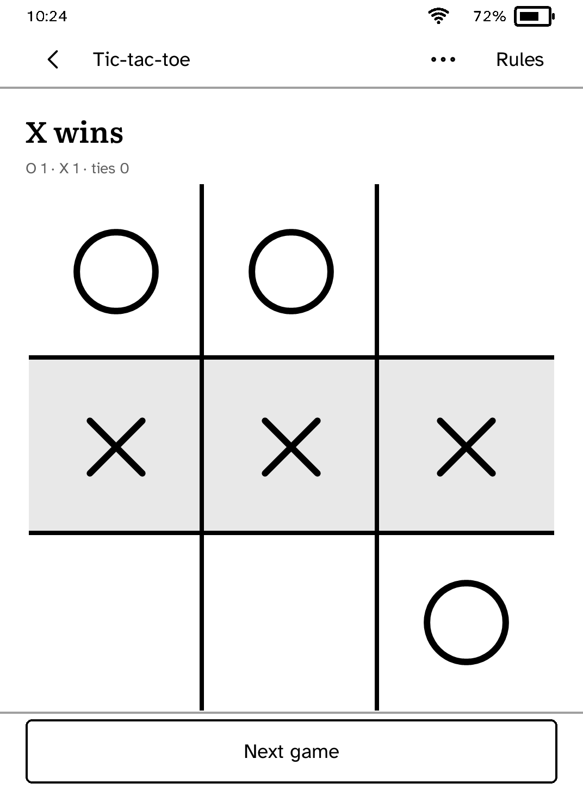
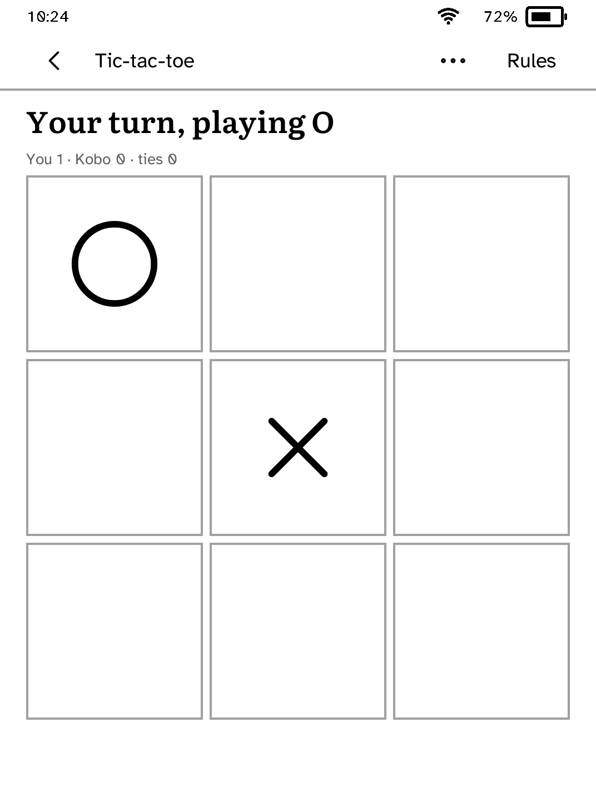

# Tic-tac-toe

Tic-tac-toe for two players on one Kobo, or against the Kobo.

<table>
<tr>
<td width="50%" valign="top"><br>A finished game, with the winning line marked</td>
<td width="50%" valign="top"><br>Playing against the Kobo</td>
</tr>
</table>

## Features

- Two players take turns on one Kobo. Noughts go first.
- **Against the Kobo** plays a simple opponent: it wins when it can, blocks
  when it must, and can be beaten.
- The winning line is marked on the board.
- The score for the session is shown under the heading. **Next game** keeps
  it, and **Clear score** resets it. The score survives closing the app. An
  unfinished game does not.

The board is the SDK's ordinary grid node, drawn with
`board_with_selection`, the same node a keypad uses. The top bar menu and
**Next game** come from the shared `kobo_sdk::game` helpers. It is a quick
check that the layout engine still handles the basics.

## Permissions

None.

## Development

```sh
cargo test -p kobo-tictactoe
(cd examples/tictactoe && kobo dev)   # in the browser simulator
python3 scripts/check-apps-sim.py tictactoe
kobo deploy --device <ip>   # install Cobalt, with this app, over Wi-Fi
```

---

Part of [Cobalt](../../README.md). See [all apps](../../README.md#apps).
